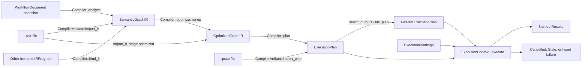
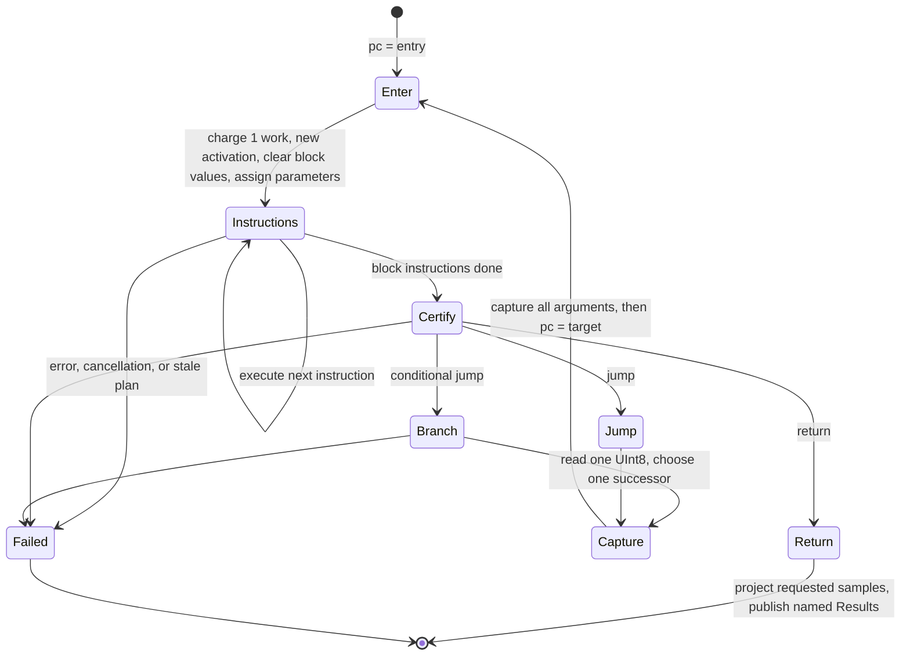

# Compiler and Local Execution

## Scope and ownership

The callable pipeline has five stages: DAG frontend, `SemanticGraphIR`, `OptimizedGraphIR`, `ExecutionPlan`, and execution through `ExecutionContext`. The semantic IR, optimized IR and plan are immutable compiled values; each Run owns mutable execution state. The current package is 0.37.0 with OperationTraits version 29. `Compiler` borrows a frozen `OperationRegistry` for its whole lifetime; its constructor throws `std::invalid_argument` for a null or mutable registry. `ExecutionContext` owns the bounded CPU pool, the optional native backend lane, caches, and a resource root shared by Runs and surviving owners. The context uses default `ResourceLimits` unless `managed_resources` supplies explicit limits; `maximum_live_bytes` also limits Payload.

`WorkflowInputDeclaration` stores an id, exact name, and required Result schema. `ExecutionBinding` stores a name and owning `ResultRef`. Tensor remains typed backing used by Result storage and codecs. `OperationMetadata` carries only the complete Result schema; metadata specialization is structural inference of output schemas from input schemas and static parameters. Tensor shape and layout belong to `ResultTensorSpec`. Ports connect when their structural predicates match; the compiler does not compare domain labels, so Results with the same structure but different intended meanings connect to the same port.

Each operation's static preparation lists the `ResourceIdentity` values it needs. `analyze`, `bind_ir` and the artifact importers select exactly those entries from the caller's `ResourceSet`, fail if one is missing, and retain the selected owners in every later stage. Semantic identity covers declarations, operation keys, ordered inputs, static parameters, operation traits (including bound validator and declared diagnostic identities), selected resource identities, output schemas and the control-flow graph. Addresses, callback pointers, and diagnostic contents are not part of it.

## Compiler stages



`Compiler::compile(context, options, resources)` runs `analyze`, `optimize` and `plan` as one fail-before-publication flow and returns all three stages plus raw stage timings. Each stage is also callable on its own, so a caller can save, inspect or replace any intermediate object.

- **DAG frontend.** `analyze(snapshot, resources)` accepts only a current schema-7 `WorkflowDocument` with at most 65,536 nodes, 4,096 inputs and 1 to 4,096 named outputs; other versions, including earlier label-based workflows, fail. The frontend sorts named outputs by name and runs an iterative depth-first walk from each returned node through its inputs in port order, then from every remaining node in id order. Every frontend call therefore appears exactly once in IR, including calls that no output uses; a shared upstream call keeps one definition. Each call becomes its own basic block, and an explicit jump links each block to the next in walk order. The last block returns the named outputs. A cycle fails `Cycle`.
- **IR binding.** `bind_ir(program, resources)` accepts an `IRProgram` from any frontend and returns a `SemanticGraphIR`. It is the same validator and preparer that `analyze` uses. Binding ignores caller-supplied traits and preparation and rebinds both from the registry; each call is prepared once.
- **Optimizer.** `optimize(semantic)` copies every call, value, block and terminator unchanged and computes a separate optimized digest. The stage exists so later passes can rewrite IR without changing the DAG frontend; frontend lowering performs no semantic pruning.
- **Planner.** `plan(optimized, options)` expands every reachable result into fixed tile instructions, places each instruction in the block of its call, and validates the program before returning it.
- **Execution.** `ExecutionContext::execute(plan, bindings, cancellation, options)` interprets the plan's blocks in order. It never maps dependencies, expands tiles, or reorders instructions.

## IR data model

```cpp
namespace ps {
using IRValueId = std::uint64_t;  // zero is never valid
using IRBlockId = std::uint64_t;
using IRCallId = std::uint64_t;

struct SemanticNode {             // one static operation call
  IRCallId id;
  std::string operation;
  std::vector<IRValueId> inputs;
  std::map<std::string, ParameterValue> parameters;
  OperationTraits traits;                          // rebound by bind_ir
  std::shared_ptr<const PreparedOperation> prepared;  // rebound by bind_ir
  std::vector<SemanticOutput> outputs;             // {key, result_schema, value}
};
struct IREdge { IRBlockId target; std::vector<IRValueId> arguments; };
struct IRJump { IREdge edge; };
struct IRConditionalJump { IRValueId condition; IREdge if_true; IREdge if_false; };
struct IRReturn { std::vector<IRValueId> values; };
using IRTerminator = std::variant<IRJump, IRConditionalJump, IRReturn>;

struct IRBlock {
  IRBlockId id;
  std::vector<IRBlockParameter> parameters;  // {value, result_schema}
  std::vector<IRCallId> calls;               // execution order inside the block
  IRTerminator terminator;
};
struct IRProgram {
  std::vector<WorkflowInputDeclaration> input_declarations;
  std::vector<IRInputBinding> input_bindings;  // {declaration_id, value}
  std::vector<SemanticNode> calls;             // metadata order only
  std::vector<IRBlock> blocks;
  IRBlockId entry;
  std::vector<IRReturnDeclaration> returns;    // ordered result signature
};
}  // namespace ps
```

The block's `calls` list defines execution order; the order of `IRProgram::calls` only fixes metadata preparation order. `SemanticGraphIR::program()` and `OptimizedGraphIR::program()` return an owning editable copy that another pass or frontend can modify and bind again.

`bind_ir` accepts the program only when all of these hold:

- Call, value and block identifiers are nonzero and unique in their own namespaces. Every call belongs to exactly one block, and every declaration has exactly one input binding.
- The entry block exists and has no parameters. Every block is reachable from entry, and every edge names an existing block with matching argument count.
- Every SSA use is dominated by its definition: an earlier call in the same block, a dominating block, a block parameter, or an external input. A value that recurses through a loop must travel through a block parameter; a call that consumes its own result, directly or through other calls, fails binding.
- Edge argument schemas equal the destination parameter schemas exactly. Every return supplies the full signature, and each return schema matches the declaration. Block parameters must carry a validated schema, including on loop backedges.
- A branch condition is a Result with exactly one tensor holding one `UInt8` sample. Zero selects `if_false`; any other byte selects `if_true`. Other shapes and implicit truthiness fail `TypeMismatch`.
- Count bounds hold: at most 65,536 calls and blocks, 4,096 declarations, returns and parameters per block, and 1,024 inputs and parameters per call.

Shapes and tile grids stay fixed at compile time. A loop or branch selects which fixed-shape calls run; it does not create tensors whose shape depends on runtime data.

## Physical plan

```cpp
namespace ps {
struct PlanningOptions {
  ExecutionMode execution_mode = ExecutionMode::CpuExact;  // or NativeGpu
  std::map<std::string, TileRequest> output_requests;      // omitted name = all tiles
  std::uint64_t tile_extent = 128;            // positive power of two
  std::uint64_t maximum_instructions = 4194304;
  std::uint64_t maximum_dependency_edges = 16777216;
};
struct PlanTensorRead {      // fixed read capability
  std::uint32_t input, tensor_slot;
  bool descriptor_only;      // schema facts only, no payload
  TileSet tiles;
  Footprint samples;         // union of the complete tiles
};
struct PlanSharedRead { std::uint32_t stage; TileRequest tiles; std::vector<Footprint> samples; };
struct PlanTileInstruction {
  std::size_t step_index;
  std::uint32_t shared_stage = UINT32_MAX;  // UINT32_MAX: public output tile
  std::uint32_t tensor_slot;
  TileIndex tile_unit;
  bool cpu_fallback;                        // compiled CPU retry
  std::optional<Footprint> tensor_outputs;
  TileRequest publication;
  std::vector<Footprint> publication_samples;
  std::vector<PlanTensorRead> inputs;
  std::vector<PlanSharedRead> shared_inputs;
  std::vector<std::size_t> dependencies;    // earlier instructions in this block
};
struct PlanBlock {
  IRBlockId id;
  std::vector<std::size_t> parameters, calls;
  std::vector<PlanTileInstruction> instructions;
  PlanTerminator terminator;   // PlanJump, PlanConditionalJump, PlanReturn
};
struct PlanOutput {
  std::string name;
  std::shared_ptr<const SchemaTemplate> result_schema;
  std::vector<TileGrid> tile_grids;
  std::vector<Footprint> requested_samples;
  std::size_t record_index;    // steps().size() + return ordinal
};
}  // namespace ps
```

`ExecutionPlan::steps()` is the complete table of physical call outputs: one `PlanStep` per call result, with its operation, inputs, backend, fixed schema, member grids and prepared shared stages. Steps are declarations. The executable content is `blocks()[i].instructions`, and a step can exist without any instruction, for example an unselected sibling output or an unused pure call. The number of steps is therefore not an execution count.

The planner expands roots in this order for every block: the branch condition (all tiles), every edge argument (all tiles), and each named return restricted to its normalized `output_requests` entry. It then adds every call that is not side-effect-free and every mandatory shared stage. For each root tile, it builds an instruction by calling the operation's static mapper once with a `ResultStaticQuery`, resolves the returned reads against the producers' grids, and recursively builds producer tiles before the consumer. The key `(step, shared stage, member, tile)` deduplicates units, so a tile shared by several consumers is emitted once. Inside each block, a stable sort restores IR call order while keeping each call's tiles in dependency order.

Certification closures are compiled into the reads. A read of a member covered by a `CompleteBundle` scope becomes a read of the whole bundle; a `StablePrefix` read extends to the prefix end; a producer with complete-coverage validators makes any nonempty read depend on every producer tile. A consumer with complete-coverage input validators receives all tiles of that input.

`tile_extent` must be a positive power of two. The planner fails `ResourceExhausted` before publication when instructions exceed `maximum_instructions` or dependency edges exceed `maximum_dependency_edges`, and it applies static set and work bounds to every intermediate tile set. A very large logical tensor stays plannable through atomic cells, affine broadcast, or a sparse `output_requests` selection given to `plan`; filtering a fully expanded plan later does not shrink the planning cost.

`ExecutionPlan::select_outputs(requests)` and `tile_plan(name, request)` only filter compiled instructions. A request must be a subset of the parent's normalized request; names absent from `select_outputs` are not returned. This differs from `PlanningOptions::output_requests`, where an absent name means all tiles. Filtering keeps the CFG, every condition and edge argument, side-effecting calls and mandatory stages on each block, so an empty selection omits pure output work but still runs control and mandatory effects on the path that executes. No mapper, preparation or optimizer callback runs during filtering.

`ExecutionPlan::output(name).record_index` is the dependency-record index of a named return. It equals `steps().size()` plus the return ordinal, with output ordinal 0. `outputs().at(name)` is a return-signature index, not a step index.

## Static VM execution



A Run executes one plan instruction at a time. On each block entry, the coordinator charges one unit of Run work, advances the activation counter, clears the block's call values and shared-stage state, and assigns incoming arguments to the block parameters. Clearing values on every activation keeps a loop from reading a previous iteration's result. An empty loop still charges work on each entry and observes cancellation, so `ExecutionOptions::maximum_dependency_work` bounds it with `ResourceExhausted`.

For each instruction, the coordinator binds the precompiled grants, checks that every granted input sample is already certified, optionally reuses a cached result, starts the continuation if needed and polls it. A poll that returns `ResultProgramNeed` is only checked against the instruction's fixed grants: the check charges work and fails with a protocol error for any request outside the grants, but it never starts producers, narrows a grant, or turns a descriptor-only grant into payload access. A poll that returns `ResultPublication` is validated and stored for this tile. Helpers such as `to_whole` can therefore return ready on the first poll; consumers must not assume the first result is a Need.

After all instructions of a block, the coordinator assembles and certifies each call that produced tiles in that block, including effectful calls that nobody reads. A conditional jump reads the condition sample and executes only the chosen successor; neither arm runs speculatively. An edge captures every argument value and its dependency evidence before any destination parameter changes, so swaps and self-loops see consistent sources. A return projects each named output to its requested samples, records synthetic return evidence, computes the optional result digest, and publishes the Results.

The coordinator checks cancellation, plan currentness, observer failure and the host stop signal whenever it charges work: at block entry, at every instruction, and inside operation work callbacks. It does not preempt in-process callbacks. Once a callback enters, the Run waits for it to retire before releasing borrowed phases and owners. A failed Run returns no partial output set. A failure in an instruction carries the producing call's `node_id`; an input validator failure keeps the external `input_id` (with `InvalidArgument`) or the upstream `node_id` (with `OperationFailed`), so invalid caller data and invalid operator output stay distinguishable.

`FrozenExecution` shares immutable state containing its plan, binding snapshot, operation registry, and execution identity. `plan()` returns a borrowed reference valid while the handle retains that state. `ExecutionContext::execute_fragments` first calls `select_outputs` for the requested subset and then runs the filtered program; it never calls a mapper. A `DemandHandle` request captures the current generation with a frozen plan; replacement advances the generation while older requests retain their original plan and input owners. `replace_bindings` copies the frozen bundle's owning Root while holding the handle mutex, establishes its Root allocation scope, then acquires the call lease.

## Compiler artifacts

`CompilerArtifact` stores stages as editable UTF-8 text. `.psir` holds a semantic or optimized IR program; `.psxp` holds a complete execution plan. Both use text format version 2; version 1 files are rejected.

```cpp
namespace ps {
enum class ArtifactKind { SemanticIR, OptimizedIR, ExecutionPlan };
struct ArtifactOperation { std::string key; std::string contract_digest; };
struct ArtifactManifest {
  ArtifactKind kind;
  std::uint32_t format_version = 2;
  std::vector<ArtifactOperation> operations;
  std::vector<ResourceIdentity> resources;
};
using ImportedIR = std::variant<SemanticGraphIR, OptimizedGraphIR>;

class CompilerArtifact {
 public:
  static Result<std::string> export_ir(const SemanticGraphIR&);
  static Result<std::string> export_ir(const OptimizedGraphIR&);
  static Result<std::string> export_plan(const ExecutionPlan&);
  static Result<ArtifactManifest> inspect(std::string_view text);
  static Result<ImportedIR> import_ir(const Compiler&, std::string_view, ResourceSet = {});
  static Result<ExecutionPlan> import_plan(const Compiler&, std::string_view, ResourceSet = {});
  static Status save_ir(const SemanticGraphIR&, const std::string& path);
  static Status save_ir(const OptimizedGraphIR&, const std::string& path);
  static Status save_plan(const ExecutionPlan&, const std::string& path);
  static Result<ImportedIR> load_ir(const Compiler&, const std::string& path, ResourceSet = {});
  static Result<ExecutionPlan> load_plan(const Compiler&, const std::string& path, ResourceSet = {});
};
}  // namespace ps
```

Both formats begin with a magic and version line (`psir 2` or `psxp 2`) and a parent digest. A `.psir` file then records `stage semantic` or `stage optimized`, the operation manifest, resources, input declarations and bindings, calls with their per-call resource uses, the return signature, the entry block and the blocks. A `.psxp` file additionally records the execution mode and `tile_extent`, each step's backend placement, the named output requests, and a `code` section with every block's instructions: publication target, published samples, fixed input and shared grants, block-local dependency ordinals and the `cpu_fallback` flag. Tile grids are not stored; import rebuilds them from the fixed schemas and `tile_extent`.

The text accepts `;` line comments, escaped strings and explicitly typed parameters (`i64`, `f64`, `f64_bits`, `bool`, `string`). The writer emits finite normal doubles as round-trip decimal and NaN, infinity and subnormal values as `f64_bits` with sixteen hexadecimal digits. Parsing and writing use the classic locale with a default floating environment and round-to-nearest, so the result does not depend on the caller's locale or rounding mode.

The manifest lists each operation key with a contract digest and each resource with its SHA-256 identity and byte length. The contract digest identifies registered traits and validator and report references; it does not identify or authenticate native callback code. A file contains no library path, executable code, native pointer, device handle, Run state, cache content or resource bytes.

- `inspect(text)` parses the whole file without a registry and returns the manifest. A host uses it to decide which operation libraries to load and which resources to supply before importing.
- `import_ir` links the manifest against the compiler's frozen registry, fails `TypeMismatch` when a contract digest differs and `NotFound` for a missing operation or resource, then runs `bind_ir`. An optimized artifact stays optimized; no optimization runs.
- `import_plan` performs the same linking, restores the declarations, placements and instruction blocks, rebuilds grids and static preparation, and runs full plan validation: fixed grants, input projections, members and ranges, publication closures, block-local dependency readiness, IR call order, CFG and backend legality. It calls no mapper, performs no tile expansion and chooses no backend. A stored choice the current host cannot execute, for example a GPU placement in a `CpuExact` plan, fails `BackendUnavailable` or `InvalidArgument`.
- Digests are recomputed on import. The stored parent digest is provenance and does not sign the text, so an edited file is valid exactly when it passes binding and validation.

An imported stage is independent of any `GraphContext`. Its `revision()` is 1 and `current()` stays true while the registry is alive. Execution must use an `ExecutionContext` built over the same frozen registry instance; `execute`, `freeze` and `open_demand` fail `Stale` for a plan linked to another registry. A stage compiled directly from a DAG keeps its snapshot semantics and becomes stale when the source `GraphContext` is replaced or destroyed; a saved file carries no source liveness. Export of a stale or default stage fails `Stale`.

Texts and files are capped at 64 MiB. Syntax errors return `InvalidArgument` with line and column. `save_*` encodes completely before opening the destination, so an encoding failure leaves the file untouched; the write itself is not an atomic rename, and an I/O failure can leave partial text and returns `OperationFailed` with Io/ShortIo detail. `load_*` returns `NotFound` for an unreadable path and selects the format from the magic line, not the extension.

The following excerpt shows one complete round trip. `registry` is a frozen `std::shared_ptr<OperationRegistry>`, `graph` a `GraphContext`, `resources` the `ResourceSet` that static preparation selects from, and `bindings` the per-Run `ExecutionBindings`.

```cpp
ps::Status compile_save_and_run(std::shared_ptr<ps::OperationRegistry> registry,
                                const ps::GraphContext& graph,
                                const ps::ResourceSet& resources,
                                const ps::ExecutionBindings& bindings) {
  ps::Compiler compiler(registry);
  auto semantic = compiler.analyze(graph.snapshot(), resources);
  if (!semantic.ok())
    return semantic.status();
  auto optimized = compiler.optimize(semantic.value());
  if (!optimized.ok())
    return optimized.status();
  auto plan = compiler.plan(optimized.value(), ps::PlanningOptions{});
  if (!plan.ok())
    return plan.status();

  auto saved = ps::CompilerArtifact::save_ir(semantic.value(), "pipeline.psir");
  if (saved.ok())
    saved = ps::CompilerArtifact::save_ir(optimized.value(), "pipeline.opt.psir");
  if (saved.ok())
    saved = ps::CompilerArtifact::save_plan(plan.value(), "pipeline.psxp");
  if (!saved.ok())
    return saved;

  auto ir = ps::CompilerArtifact::load_ir(compiler, "pipeline.opt.psir", resources);
  if (!ir.ok())
    return ir.status();
  if (!std::holds_alternative<ps::OptimizedGraphIR>(ir.value()))
    return {ps::ErrorCode::TypeMismatch, "expected an optimized IR artifact"};

  auto loaded = ps::CompilerArtifact::load_plan(compiler, "pipeline.psxp", resources);
  if (!loaded.ok())
    return loaded.status();
  ps::ExecutionContext execution(registry);
  auto result = execution.execute(loaded.value(), bindings);
  if (!result.ok())
    return result.status();
  // result.value().results maps each named output to its ResultRef.
  return ps::Status::success();
}
```

`load_ir` returns `ImportedIR`; a caller continues a semantic stage with `optimize` and an optimized stage with `plan`. The artifact API has no command-line front end.

## Operation callbacks and errors

A `ResultContinuation` admits one poll at a time with nonblocking atomic admission. A concurrent or reentrant poll returns `InvalidArgument` with `Protocol/Group` detail without entering the callback or changing the admitted phase, first failure, or work accounting. Callers must keep the continuation alive and inactive while moving or destroying it; continuation state is destroyed once. `OperationRegistry::start_result` checks cancellation before and after the operation factory; cancellation observed after factory entry takes precedence over allocator failure, factory status, or invalid returned state. The VM bounds polls per instruction by the smaller of `DependencyLimits::maximum_stages` and the output's `maximum_dependency_stages`.

Ordinary CPU callbacks run on the context CPU pool with the range service; GPU callbacks run on the native lane. Worker callbacks do not receive coordinator services, and nested parallel submission is forbidden. Native submissions drain before callback retirement. Kernel guards save and restore floating state; operations establish their required mode on each actual callback thread.

An operation that declares `OperationTraits::cpu_staged_tiles` runs its poll on the coordinator with the planar staged tile service. `image.stmap` does so for requests of at least 65,536 pixels: the coordinator prepares bounded spans of output pixels, submits one tile stage whose geometry depends only on the span count, and joins every tile before publication commits. `ExecutionOptions::maximum_parallelism` caps the workers of that tile service; zero uses the CPU pool's worker count. Tile callbacks receive only immutable inputs and disjoint raw output runs. See [Dependency sampling](Dependency-Sampling.md#publication-and-parallel-arithmetic) and [Parallel execution model](Parallel-Execution-Model.md#planar-staged-tile-service).

GPU-to-CPU fallback is compiled. When a step is placed on GPU and its traits declare `allows_cpu_fallback`, CPU support, determinism and freedom from side effects, the planner calls the mapper a second time with the CPU backend and sets `PlanTileInstruction::cpu_fallback` only when the CPU reads fit inside the GPU grants, including complete-validation coverage. An instruction with shared-stage reads gets no compiled fallback; that path needs explicit IR control flow. At run time, a GPU start or poll that fails with an unqualified `BackendUnavailable` (`reason=None`, origin unspecified or backend, scope unspecified or group) retries on CPU with the same grants only if the attempt published nothing and performed no input read, native dispatch, checkpoint, block or GPU selection, and no protocol, observer, resource, cancellation or stop failure vetoed it. The rejected GPU attempt keeps its timing record, the CPU attempt starts with fresh failure owners, and the retried result is excluded from completed-result, checkpoint and block reuse.

## Storage, resources and diagnostics

A Result owns its static schema, descriptor coverage, numerical backing, and ObjectId. The Run keeps one stored tile per executed instruction and assembles a call's Result from those tiles on first use. Dependency records and frozen TileEvidence belong to the Run and optional cache structures; each Run rebuilds evidence from the fixed grants. Root accounts metadata, payload, work and retained backing; returned Results and windows keep their leases after context retirement. Selected operation resources remain with preparation, plans and execution, not attached to the Result.

`ExecutionDiagnostics::operation_timings` holds one raw `OperationTiming` per poll and per failed start; a successful start has no separate record. Records carry `shared_stage`, the actual backend and the outcome, and consumers aggregate them by output, backend and stage. `OperationTiming::reports` holds the owning `DiagnosticAccumulator` for bounded operation reports. `peak_active_tasks` reports 1 for the static VM. `peak_live_bytes` reports the maximum committed controlled Payload backing attributed to the Run; `planned_peak_bytes` reports the peak reserved Payload capacity. These counters describe Root-controlled backing, not process RSS. `ExecutionContext::cache_statistics()` returns synchronized context-local cache observations; reuse creates no timing record for work that did not run.

## Public interface and version boundaries

| Axis | Current value |
| --- | --- |
| Package / SOVERSION | 0.37.0 / 0.37 |
| `OperationTraits::version` | 29 |
| C Result operation ABI | 7 (`ps_result_operation_plugin_get_api_v7`) |
| WorkflowDocument schema | 7 |
| `.psir` / `.psxp` text format | 2 |
| Semantic identity domain | `semantic-ssa-ir-v24` |
| Optimizer identity domain | `optimizer-v6-ssa-noop` |
| Physical plan identity domain | `static-tile-program-v26` |
| Plan cache key domain | `plan-cache-key-v19` |
| Saved operation contract domain | `artifact-static-operation-contract-v2` |
| Result schema canonical tag | `photospider.result-schema.v6` |

These version axes are independent. CPU parallel and tile services are version 2; native GPU services are version 1. `TileGrid::from_schema` returns `Result<TileGrid>`, and `OperationRegistry::prepare_operation` resolves the static operation contract. Semantic, optimized and plan digests include program identifiers, so renumbering calls or values changes them even when the computation is the same.

## Limitations and non-goals

- The only frontend shipped in the kernel is the WorkflowDocument DAG. A Python or text-language frontend, a machine-code backend, JIT compilation and automatic operation-library discovery from artifacts do not exist; `bind_ir` and `.psir` import are the entry points such frontends would use.
- The optimizer performs no transformation. It preserves every call, value and block.
- Tensor shapes, schemas and tile grids are fixed at compile time. Control flow selects among fixed-shape calls; it does not provide dynamic shapes.
- One Run executes one plan instruction at a time and has no ready queue, producer task or work stealing. Parallelism comes from concurrent Runs and from CPU range, CPU tile and GPU work inside one operation callback; see [Parallel execution model](Parallel-Execution-Model.md).
- Artifact digests are reproducibility aids, not signatures. Native operation modules execute as trusted in-process code; ABI validation does not sandbox them. The kernel does not own daemon IPC, durable jobs, process isolation, or recovery. A registered production image operation is usable through the unified Result image path only when its implementation provides the required typed Result contract; see [Image operations](Image-Operations.md).
- `CpuExact` rejects a GPU-only call or GPU shared stage only when the planner actually emits an instruction for it; a GPU-only call that no root reaches produces no instruction and no error.
