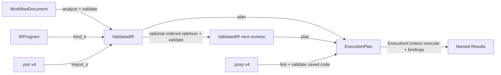
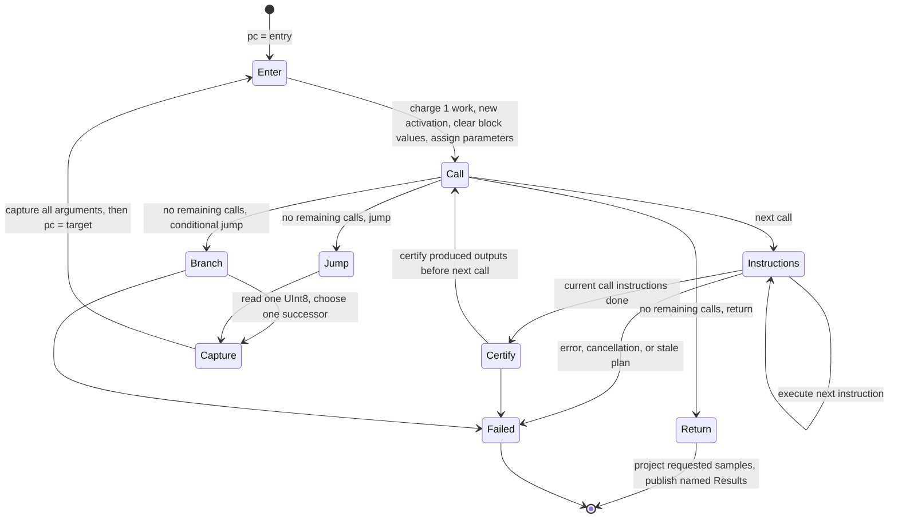

# Compiler and Local Execution

## Scope and ownership

Frontend, optimizer and planner registries have stable object identity: copying, moving and assignment are disabled. Share a frozen registry through `shared_ptr`; create a separate registry and register definitions explicitly to build another catalog.

The pipeline consists of a DAG frontend, validation, optional IR transformations, physical planning and local execution. All validated IR versions use `ValidatedIR`; immutable plans use `ExecutionPlan`, and each Run owns mutable state. Package 0.38.0 keeps OperationTraits 29 and Result ABI 7. `Compiler` retains frozen operation, frontend, optimizer and planner registries. `ExecutionContext` owns worker pools, native backend, caches and the Root shared by Runs and surviving results. `maximum_live_bytes` limits Payload in addition to managed resource limits.

`WorkflowInputDeclaration` stores an id, exact name, and required Result schema. `ExecutionBinding` stores a name and owning `ResultRef`. Tensor remains typed backing used by Result storage and codecs. `OperationMetadata` carries only the complete Result schema; metadata specialization is structural inference of output schemas from input schemas and static parameters. Tensor shape and layout belong to `ResultTensorSpec`. Ports connect when their structural predicates match; the compiler does not compare domain labels, so Results with the same structure but different intended meanings connect to the same port.

Each operation's static preparation lists the `ResourceIdentity` values it needs. `analyze`, `bind_ir` and the artifact importers select exactly those entries from the caller's `ResourceSet`, fail if one is missing, and retain the selected owners in every later stage. Semantic identity covers declarations, operation keys, ordered inputs, static parameters, operation traits (including bound validator and declared diagnostic identities), selected resource identities, output schemas, the program form and its ordered blocks and terminators. Addresses, callback pointers, and diagnostic contents are not part of it.

## Compiler stages



`Compiler::compile(context, options, resources, optimizers = {}, frontend = "dag")` analyzes the graph, runs only the requested ordered invocations, and plans the last IR. The default invokes no optimizer. `CompiledWorkflow` retains ordered `IRRevision` records and an optional Plan. Standalone `analyze`, `bind_ir`, `optimize` and `plan` remain public library entry points. The CLI additionally supports IR-only endpoints, snapshots and release; see [psc/psx](../development/Compiler-Tools.md).

- **Frontend:** `analyze` resolves a registered frontend by name. The default `dag@1` traverses named outputs in name order using input-port-ordered DFS, then retains remaining roots by ID. It emits `DependencyPaths`, retaining repeated references to shared Call IDs. Bounds are 65536 calls/blocks, 1048576 references, and schema-7 DAG input with at most 4096 inputs/outputs. Cycles fail before publication.
- **Validation:** `bind_ir` validates SSA, dominance, schemas, resources and control flow, and binds static operation contracts. It publishes immutable `ValidatedIR` from an editable `IRProgram`. Registry and source currentness remain required.
- **Optional transformation:** `OptimizerRegistry` resolves names; an ordered invocation vector preserves order and repetitions. A transform reads immutable IR and returns a new program. Validation precedes publication; invalid output is `Internal`. Producer name/version/options and parent content identity are provenance, excluded from the new content digest. No-op stages can share the same identity. The default `optimize@1` retains existing dependency-path deduplication as an optional example.
- **Planner:** `plan` accepts either legal IR form. It privately retains the first request per Call ID, removes empty chains and reconnects DependencyPaths as CFG, then performs static tile expansion. It does not dispatch an optimizer. CFG input keeps its branches and loops; distinct loop activations are never globally merged. Input IR is unchanged.
- **Execution:** the VM executes saved physical instructions with bindings; no optimizer or mapper runs.

For `B(A), C(A), D(B,C), E(D), G(B), F(G,E)`, raw chains are `ABG / AB / AC / DE / F`. The example optimizer and planner's private lowering both obtain `ABG / C / DE / F`. Repeated A/B references represent the same calls, including effects. Different Call IDs remain different invocations. Raw paths remain visible when planning directly. The plan parent is always the actual supplied IR identity.

## Frontend registration

```cpp
// The caller implements lowering with public IRProgram types.
ps::Result<ps::IRProgram> lower_source(const ps::WorkflowDocument&,
                                      const ps::OperationRegistry&);
auto frontends = std::make_shared<ps::FrontendRegistry>();
auto registration = frontends->add({"custom", "1", "Custom document lowering", lower_source});
if (!registration.ok()) return registration;
frontends->freeze();
ps::Compiler compiler(operations, {}, {}, frontends);
auto ir = compiler.analyze(graph.snapshot(), resources, "custom");
// The complete pipeline accepts the same frontend name as its final argument.
auto compiled = compiler.compile(graph, {}, resources, {}, "custom");
```

`FrontendDefinition` contains a name, version, description and lowering callback. The current typed source contract is `WorkflowDocument`, read from a coherent `GraphSnapshot`; callbacks also receive the compiler's frozen operation registry. They return an independent editable `IRProgram`. The compiler then binds operation contracts and caller-supplied resources through `bind_ir`, validates the result, and attaches the snapshot revision/currentness and registered name/version provenance. Provenance remains separate from IR content identity. Lowering implementations preserve source semantics; structural binding alone does not prove that translation.

`FrontendRegistry` preserves registration order, rejects empty or duplicate names, names over 1024 bytes, empty versions or versions over 128 bytes, missing callbacks and registration after freeze. Register and freeze before sharing; callbacks must support independent concurrent calls, retain no borrowed arguments and invoke no runtime operation callbacks. A compiler retains an injected frozen registry. `Compiler::frontends()` exposes that catalog or lazily creates the default catalog with the single `dag@1` definition. Its implementation is `src/lib/compiler/frontend/DAG/dag.cpp`; orchestration and catalog ownership are in `frontend.cpp` and `frontend_registry.cpp`.

Unknown frontend names return `NotFound`. Default, replaced or expired snapshots return `Stale`, and currentness is checked again after lowering and before successful publication. Callback failures and binding validation failures retain their error code and receive a frontend name/version diagnostic; source is not assumed valid. Thrown callback exceptions return `Internal`, and allocation failure returns `ResourceExhausted`. No partial validated IR is published. Direct `bind_ir` and artifact import do not invoke a registered frontend; IR import retains saved provenance.

`psc` uses `dag@1` for DAG JSON input and imports PSIR directly. Its input identification remains unchanged; frontend selection and discovery are library APIs only. Other source representations need a separate typed input contract. The only shipped frontend is DAG.

## IR data model

```cpp
namespace ps {
using IRValueId = std::uint64_t;  // zero is never valid
using IRBlockId = std::uint64_t;
using IRCallId = std::uint64_t;
enum class IRForm { ControlFlow, DependencyPaths };

struct SemanticNode {             // one static operation call
  IRCallId id;
  std::string operation;
  std::vector<IRValueId> inputs;
  std::map<std::string, ParameterValue> parameters;
  OperationTraits traits;                          // rebound by bind_ir
  std::shared_ptr<const PreparedOperation> prepared;  // rebound by bind_ir
  std::vector<SemanticOutput> outputs;             // {key, result_schema, value}
};
struct IREdge { IRBlockId target; std::vector<IRValueId> arguments; };
struct IRJump { IREdge edge; };
struct IRConditionalJump { IRValueId condition; IREdge if_true; IREdge if_false; };
struct IRReturn { std::vector<IRValueId> values; };
using IRTerminator = std::variant<IRJump, IRConditionalJump, IRReturn>;

struct IRBlock {
  IRBlockId id;
  std::vector<IRBlockParameter> parameters;  // {value, result_schema}
  std::vector<IRCallId> calls;               // requests or call sites, by form
  IRTerminator terminator;
};
struct IRProgram {
  std::vector<WorkflowInputDeclaration> input_declarations;
  std::vector<IRInputBinding> input_bindings;  // {declaration_id, value}
  std::vector<SemanticNode> calls;             // metadata order only
  std::vector<IRBlock> blocks;
  IRBlockId entry;
  std::vector<IRReturnDeclaration> returns;    // ordered result signature
  IRForm form = IRForm::ControlFlow;
};
}  // namespace ps
```

`IRProgram::calls` stores unique call declarations. DependencyPaths block lists may repeat a Call ID; ControlFlow has one static site per call. `ValidatedIR::form()` identifies the interpretation, and `program()` returns an independent editable copy. Passes can modify that builder and validate it again. Neither form implies that an optimizer ran.

`bind_ir` accepts the program only when all of these hold:

- Call declarations, SSA definitions and block identifiers are nonzero and unique in their own namespaces. Every call has at least one site and every input declaration has exactly one binding. `ControlFlow` requires exactly one site per call; `DependencyPaths` permits repeated requests for that declaration.
- `DependencyPaths` requires nonempty, parameterless blocks in stored order. The first block is the entry, every intermediate terminator jumps to the next block without arguments, and the last terminator returns. Its first request is the definition position of a call's outputs. All uses must be dominated by their definitions. Binding accepts valid handwritten paths without requiring them to reproduce `analyze()`'s complete tree expansion.
- The entry block exists and has no parameters. Every block is reachable from entry, and every edge names an existing block with matching argument count.
- Every SSA use is dominated by its definition: an earlier call in the same block, a dominating block, a block parameter, or an external input. A value that recurses through a loop must travel through a block parameter; a call that consumes its own result, directly or through other calls, fails binding.
- Edge argument schemas equal the destination parameter schemas exactly. Every return supplies the full signature, and each return schema matches the declaration. Block parameters must carry a validated schema, including on loop backedges.
- A branch condition is a Result with exactly one tensor holding one `UInt8` sample. Zero selects `if_false`; any other byte selects `if_true`. Other shapes and implicit truthiness fail `TypeMismatch`.
- Count bounds hold: at most 65,536 call declarations, blocks and call references per block; at most 1,048,576 call references in total; 4,096 input declarations, returns and parameters per block; and 1,024 inputs and parameters per call.

Shapes and tile grids stay fixed at compile time. A loop or branch selects which fixed-shape calls run; it does not create tensors whose shape depends on runtime data.

## Physical plan

```cpp
namespace ps {
struct PlanningOptions {
  ExecutionMode execution_mode = ExecutionMode::CpuExact;  // or NativeGpu
  std::map<std::string, TileRequest> output_requests;      // omitted name = all tiles
  std::uint64_t tile_extent = 128;            // positive power of two
  std::uint64_t maximum_instructions = 4194304;
  std::uint64_t maximum_dependency_edges = 16777216;
  std::string planner = "static-tiles";
};
struct PlanTensorRead {      // fixed read capability
  std::uint32_t input, tensor_slot;
  bool descriptor_only;      // schema facts only, no payload
  TileSet tiles;
  Footprint samples;         // union of the complete tiles
};
struct PlanSharedRead { std::uint32_t stage; TileRequest tiles; std::vector<Footprint> samples; };
struct PlanTileInstruction {
  std::size_t step_index;
  std::uint32_t shared_stage = UINT32_MAX;  // UINT32_MAX: public output tile
  std::uint32_t tensor_slot;
  TileIndex tile_unit;
  bool cpu_fallback;                        // compiled CPU retry
  std::optional<Footprint> tensor_outputs;
  TileRequest publication;
  std::vector<Footprint> publication_samples;
  std::vector<PlanTensorRead> inputs;
  std::vector<PlanSharedRead> shared_inputs;
  std::vector<std::size_t> dependencies;    // earlier instructions in this block
};
struct PlanBlock {
  IRBlockId id;
  std::vector<std::size_t> parameters, calls;
  std::vector<PlanTileInstruction> instructions;
  PlanTerminator terminator;   // PlanJump, PlanConditionalJump, PlanReturn
};
struct PlanOutput {
  std::string name;
  std::shared_ptr<const SchemaTemplate> result_schema;
  std::vector<TileGrid> tile_grids;
  std::vector<Footprint> requested_samples;
  std::size_t record_index;    // steps().size() + return ordinal
};
}  // namespace ps
```

`PlanningOptions::planner` names a definition in the compiler's frozen `PlannerRegistry`. The default catalog registers `static-tiles@1`. A caller can inject its own frozen catalog as the third `Compiler` constructor argument; `Compiler::planners()` exposes it for read-only discovery. Registration preserves order and rejects empty or duplicate names, names over 1024 bytes, empty versions or versions over 128 bytes, missing callbacks and empty, invalid or repeated supported IR forms. Registration and freeze happen before sharing; callbacks must support concurrent independent invocations.

```cpp
// The caller supplies emit_tiles with this callback signature.
ps::Status emit_tiles(const ps::ValidatedIR&, ps::PlanBuilder&,
                      const ps::PlanningOptions&);
auto planners = std::make_shared<ps::PlannerRegistry>();
auto registration = planners->add({"custom", "1", "Custom tile schedule", emit_tiles});
if (!registration.ok()) return registration;
planners->freeze();
ps::Compiler compiler(operations, {}, planners);  // frozen operation registry
ps::PlanningOptions options;
options.planner = "custom";
auto result = compiler.plan(ir, options);        // existing validated IR
```

The compiler checks source currentness and operation-registry ownership, resolves the name, checks the supported input IR form, and links a private plan skeleton. Linking fixes lowered CFG, block parameters, call/output declarations, schemas, prepared operations, CPU/GPU placement and normalized output requests. The callback receives the original immutable IR and a `PlanBuilder` with read-only access to that skeleton. `instructions(block_index)` is its only mutable program surface, initially empty. The builder cannot be copied or constructed by callers; borrowed references are limited to the callback lifetime. The built-in static planner uses this same public interface.

After a successful callback, the compiler checks currentness, total emitted instructions and stored dependency edges against the caller's limits, then validates instruction addresses, publication coverage, input grants, dependencies, call order, requested roots and mandatory effects. Only then does it compute physical identity and cache templates and publish `ExecutionPlan`. Invalid generated code or callback exceptions return `Internal`; callback allocation failures and exceeded output budgets return `ResourceExhausted`. Callback-returned failures retain their code with a planner name/version diagnostic. Unknown names return `NotFound`; unsupported forms return `InvalidArgument`; foreign or expired IR returns `Stale`. No partial Plan is published.

Structural validation does not prove mapper semantics or CPU fallback equivalence. Trusted planner implementations must preserve those properties, use only pure static hooks and bound their own intermediate work and allocations. The compiler's final instruction/edge checks do not cap callback memory use. The static planner also bounds expanded dependencies while generating code. Planning receives no runtime bindings and runs no execution callbacks. Plan artifacts contain generated instructions; loading, narrowing and execution require no planner registry or callback. Planner name/version are diagnostic metadata and do not enter the serialized Plan or physical digest. The independent `execution_mode` selects placement.

`ExecutionPlan::steps()` is the complete table of physical call outputs: one `PlanStep` per call result, with its operation, inputs, backend, fixed schema, member grids and prepared shared stages. Steps are declarations. The executable content is `blocks()[i].instructions`, and a step can exist without any instruction, for example an unselected sibling output or an unused pure call. The number of steps is therefore not an execution count.

The planner expands roots in this order for every block: the branch condition (all tiles), every edge argument (all tiles), and each named return restricted to its normalized `output_requests` entry. It then adds every call that is not side-effect-free and every mandatory shared stage. For each root tile, it builds an instruction by calling the operation's static mapper once with a `ResultStaticQuery`, resolves the returned reads against the producers' grids, and recursively builds producer tiles before the consumer. The key `(step, shared stage, member, tile)` deduplicates units, so a tile shared by several consumers is emitted once. Inside each block, a stable sort restores IR call order while keeping each call's tiles in dependency order.

Shared-stage units are canonicalized to the call's primary output step so sibling outputs can share the same stage instructions. This deduplication records units already scheduled during compilation; runtime cache state is separate. The planner builds requested dependencies before consumers and suppresses duplicate units as it expands them. It does not first materialize every tile of every call and then delete duplicates, and it does not pipeline one source tile through all downstream calls to the final output. The optional optimizer can eliminate raw path requests; the planner performs the same required lowering privately when they remain. Tile demand selection and unit deduplication belong to planning.

`complete_input_dependencies` covers the selected ordinary inputs only. Each shared-stage read needs an explicit `ResultStaticMapping::shared_stages` entry; declaring an `OperationSharedStage` alone adds no read edge. Stage-to-stage dependencies and cyclic tile dependencies are resolved during planning. Runtime `ResultProgramNeed` checks cannot add an edge or change the fixed grants.

Certification closures are compiled into the reads. A read of a member covered by a `CompleteBundle` scope becomes a read of the whole bundle; a `StablePrefix` read extends to the prefix end; a producer with complete-coverage validators makes any nonempty read depend on every producer tile. A consumer with complete-coverage input validators receives all tiles of that input.

`tile_extent` must be a positive power of two. The planner fails `ResourceExhausted` before publication when instructions exceed `maximum_instructions` or dependency edges exceed `maximum_dependency_edges`, and it applies static set and work bounds to every intermediate tile set. A very large logical tensor stays plannable through atomic cells, affine broadcast, or a sparse `output_requests` selection given to `plan`; filtering a fully expanded plan later does not shrink the planning cost.

`ExecutionPlan::select_outputs(requests)` and `tile_plan(name, request)` only filter compiled instructions. A request must be a subset of the parent's normalized request; names absent from `select_outputs` are not returned. This differs from `PlanningOptions::output_requests`, where an absent name means all tiles. Filtering keeps the CFG, every condition and edge argument, side-effecting calls and mandatory stages on each block, so an empty selection omits pure output work but still runs control and mandatory effects on the path that executes. No mapper, preparation or optimizer callback runs during filtering.

`ExecutionPlan::output(name).record_index` is the dependency-record index of a named return. It equals `steps().size()` plus the return ordinal, with output ordinal 0. `outputs().at(name)` is a return-signature index, not a step index.

## Static VM execution



A Run executes one plan instruction at a time. On each block entry, the coordinator charges one unit of Run work, advances the activation counter, clears the block's call values and shared-stage state, and assigns incoming arguments to the block parameters. Clearing values on every activation keeps a loop from reading a previous iteration's result. An empty loop still charges work on each entry and observes cancellation, so `ExecutionOptions::maximum_dependency_work` bounds it with `ResourceExhausted`.

For each instruction, the coordinator binds the precompiled grants, checks that every granted input sample is already certified, optionally reuses a cached result, starts the continuation if needed and polls it. A poll that returns `ResultProgramNeed` is only checked against the instruction's fixed grants: the check charges work and fails with a protocol error for any request outside the grants, but it never starts producers, narrows a grant, or turns a descriptor-only grant into payload access. A poll that returns `ResultPublication` is validated and stored for this tile. Helpers such as `to_whole` can therefore return ready on the first poll; consumers must not assume the first result is a Need.

After all instructions belonging to one call, including its multiple outputs and shared stages, the coordinator assembles and certifies each of that call's outputs that produced tiles. It completes this check before starting the next call in the block, including when the next call only reads descriptors or has effects. A failed upstream output therefore stops execution before later calls start. Shared-stage publication validation still runs when each stage commits. Calls with no produced output tiles require no assembled-output certification.

After the block's calls, a conditional jump reads the condition sample and executes only the chosen successor; neither arm runs speculatively. An edge captures every argument value and its dependency evidence before any destination parameter changes, so swaps and self-loops see consistent sources. A return projects each named output to its requested samples, records synthetic return evidence, computes the optional result digest, and publishes the Results. Shared-stage state lasts until the next block activation; combining calls into a chain can extend that lifetime and does not by itself guarantee lower memory use.

The coordinator checks cancellation, plan currentness, observer failure and the host stop signal whenever it charges work: at block entry, at every instruction, and inside operation work callbacks. It does not preempt in-process callbacks. Once a callback enters, the Run waits for it to retire before releasing borrowed phases and owners. A failed Run returns no partial output set. A failure in an instruction carries the producing call's `node_id`; an input validator failure keeps the external `input_id` (with `InvalidArgument`) or the upstream `node_id` (with `OperationFailed`), so invalid caller data and invalid operator output stay distinguishable.

`FrozenExecution` shares immutable state containing its plan, binding snapshot, operation registry, and execution identity. `plan()` returns a borrowed reference valid while the handle retains that state. `ExecutionContext::execute_fragments` first calls `select_outputs` for the requested subset and then runs the filtered program; it never calls a mapper. A `DemandHandle` request captures the current generation with a frozen plan; replacement advances the generation while older requests retain their original plan and input owners. `replace_bindings` copies the frozen bundle's owning Root while holding the handle mutex, establishes its Root allocation scope, then acquires the call lease.

## Compiler artifacts

`CompilerArtifact::export_ir/import_ir` serialize the unified `ValidatedIR`; `export_plan/import_plan` handle `ExecutionPlan`. Both text formats are v4. v1–v3 are rejected with a re-export diagnostic. IR begins with `psir 4`, `stage ir`, parent, producer/version and typed options, then manifests and program declarations including its explicit form. Both DependencyPaths and ControlFlow round-trip unchanged. Import becomes IR0 in a new driver session and retains source provenance. Provenance does not contribute to content identity.

Plan text begins with `psxp 4` and the actual input IR identity as parent. It contains the privately lowered CFG and complete physical instructions, grants, dependencies, output selections, backend placements and fallback choices. Plan import accepts a frozen operation registry directly, links saved contracts and resources, restores instructions and validates them. It rejects a saved program whose form is not ControlFlow. It does not run the frontend, optimizer, mapper, tile expansion or backend selection. Derived grids and pure static preparation are rebuilt. The saved CFG need not have the parent's raw form.

Operation manifest digests describe contracts, not authentication of callback code. Resources use SHA-256 and byte length; import requires caller-supplied matching bytes. No DSO paths, native pointers, cache or Run state is serialized. Missing contracts/resources fail `NotFound`, changed contracts fail `TypeMismatch`. IR and plan identities are recomputed. Text is bounded to 64 MiB, with parser line/column errors. Typed parameters preserve binary64 bits, including signed zero and nonfinite payloads where operation schemas allow them.

Imported stages have local revision one and depend on the retained frozen registry, not the old GraphContext. Source-bound stages remain subject to graph currentness. Exporting stale/default stages fails `Stale`. Library `save_*` helpers encode before opening the destination but are not atomic; I/O errors may leave partial text. The CLI uses byte codecs and its own atomic publication policy. See [CLI formats](../development/Compiler-Tool-Formats.md) and [CLI publication](../development/Compiler-Tools.md).

```cpp
ps::Compiler compiler(registry);  // frozen registry
// Each Result must be checked before accessing its value.
auto ir = compiler.analyze(graph.snapshot(), resources);
if (!ir.ok()) return ir.status();
auto plan = compiler.plan(ir.value());  // zero optimizer calls
if (!plan.ok()) return plan.status();
auto text = ps::CompilerArtifact::export_plan(plan.value());
if (!text.ok()) return text.status();
auto restored = ps::CompilerArtifact::import_plan(registry, text.value(), resources);
if (!restored.ok()) return restored.status();
auto result = execution.execute(restored.value(), bindings);
```

## Operation callbacks and errors

A `ResultContinuation` admits one poll at a time with nonblocking atomic admission. A concurrent or reentrant poll returns `InvalidArgument` with `Protocol/Group` detail without entering the callback or changing the admitted phase, first failure, or work accounting. Callers must keep the continuation alive and inactive while moving or destroying it; continuation state is destroyed once. `OperationRegistry::start_result` checks cancellation before and after the operation factory; cancellation observed after factory entry takes precedence over allocator failure, factory status, or invalid returned state. The VM bounds polls per instruction by the smaller of `DependencyLimits::maximum_stages` and the output's `maximum_dependency_stages`.

Ordinary CPU callbacks run on the context CPU pool with the range service; GPU callbacks run on the native lane. Worker callbacks do not receive coordinator services, and nested parallel submission is forbidden. Native submissions drain before callback retirement. Kernel guards save and restore floating state; operations establish their required mode on each actual callback thread.

An operation that declares `OperationTraits::cpu_staged_tiles` runs its poll on the coordinator with the planar staged tile service. `image.stmap` does so for requests of at least 65,536 pixels: the coordinator prepares bounded spans of output pixels, submits one tile stage whose geometry depends only on the span count, and joins every tile before publication commits. `ExecutionOptions::maximum_parallelism` caps the workers of that tile service; zero uses the CPU pool's worker count. Tile callbacks receive only immutable inputs and disjoint raw output runs. See [Dependency sampling](Dependency-Sampling.md#publication-and-parallel-arithmetic) and [Parallel execution model](Parallel-Execution-Model.md#planar-staged-tile-service).

GPU-to-CPU fallback is compiled. When a step is placed on GPU and its traits declare `allows_cpu_fallback`, CPU support, determinism and freedom from side effects, the planner calls the mapper a second time with the CPU backend and sets `PlanTileInstruction::cpu_fallback` only when the CPU reads fit inside the GPU grants, including complete-validation coverage. A valid CPU mapping that exceeds the saved grants leaves fallback disabled and preserves the otherwise valid GPU plan. Invalid mapper results remain planning errors. An instruction with shared-stage reads gets no compiled fallback; that path needs explicit IR control flow. At run time, a GPU start or poll that fails with an unqualified `BackendUnavailable` (`reason=None`, origin unspecified or backend, scope unspecified or group) retries on CPU with the same grants only if the attempt published nothing and performed no input read, native dispatch, checkpoint, block or GPU selection, and no protocol, observer, resource, cancellation or stop failure vetoed it. The rejected GPU attempt keeps its timing record, the CPU attempt starts with fresh failure owners, and the retried result is excluded from completed-result, checkpoint and block reuse.

## Storage, resources and diagnostics

A Result owns its static schema, descriptor coverage, numerical backing, and ObjectId. The Run keeps one stored tile per executed instruction and assembles a call's Result from those tiles on first use. Dependency records and frozen TileEvidence belong to the Run and optional cache structures; each Run rebuilds evidence from the fixed grants. Root accounts metadata, payload, work and retained backing; returned Results and windows keep their leases after context retirement. Selected operation resources remain with preparation, plans and execution, not attached to the Result.

`ExecutionDiagnostics::operation_timings` holds one raw `OperationTiming` per poll and per failed start; a successful start has no separate record. Records carry `shared_stage`, the actual backend and the outcome, and consumers aggregate them by output, backend and stage. `OperationTiming::reports` holds the owning `DiagnosticAccumulator` for bounded operation reports. `peak_active_tasks` reports 1 for the static VM. `peak_live_bytes` reports the maximum committed controlled Payload backing attributed to the Run; `planned_peak_bytes` reports the peak reserved Payload capacity. These counters describe Root-controlled backing, not process RSS. `ExecutionContext::cache_statistics()` returns synchronized context-local cache observations; reuse creates no timing record for work that did not run.

## Public interface and version boundaries

| Axis | Current value |
| --- | --- |
| Package / SOVERSION | 0.38.0 / 0.38 |
| `OperationTraits::version` | 29 |
| C Result operation ABI | 7 (`ps_result_operation_plugin_get_api_v7`) |
| WorkflowDocument schema | 7 |
| `.psir` / `.psxp` text format | 4 |
| IR identity domain | `validated-ssa-ir-v26` |
| Example optimizer | `optimize@1` (provenance only) |
| Physical plan identity domain | `static-tile-program-v27` |
| Plan cache key domain | `plan-cache-key-v20` |
| Saved operation contract domain | `artifact-static-operation-contract-v2` |
| Result schema canonical tag | `photospider.result-schema.v6` |

These version axes are independent. CPU parallel and tile services are version 2; native GPU services are version 1. `TileGrid::from_schema` returns `Result<TileGrid>`, and `OperationRegistry::prepare_operation` resolves the static operation contract. IR and Plan digests include program identifiers, so renumbering calls or values changes them even when the computation is the same.

Public C++ IR and `PlanningOptions` object layouts require matching headers and libraries; rebuild consumers when either layout changes. WorkflowDocument schema 7 and C Result operation ABI 7 remain independent version axes.

## Limitations and non-goals

- The only frontend shipped in the kernel is the WorkflowDocument DAG. A Python or text-language frontend, a machine-code backend, JIT compilation and automatic operation-library discovery from artifacts do not exist; `bind_ir` and `.psir` import are the entry points such frontends would use.
- Optimization currently resolves repeated dependency-path requests and removes empty chains. It retains every unique call, and preserves explicit ControlFlow input. It does not merge distinct calls by equal operation or parameters, remove unused call declarations, or fuse operations.
- Tensor shapes, schemas and tile grids are fixed at compile time. Control flow selects among fixed-shape calls; it does not provide dynamic shapes.
- One Run executes one plan instruction at a time and has no ready queue, producer task or work stealing. Parallelism comes from concurrent Runs and from CPU range, CPU tile and GPU work inside one operation callback; see [Parallel execution model](Parallel-Execution-Model.md).
- Artifact digests are reproducibility aids, not signatures. Native operation modules execute as trusted in-process code; ABI validation does not sandbox them. The kernel does not own daemon IPC, durable jobs, process isolation, or recovery. A registered production image operation is usable through the unified Result image path only when its implementation provides the required typed Result contract; see [Image operations](Image-Operations.md).
- `CpuExact` rejects a GPU-only call or GPU shared stage only when the planner actually emits an instruction for it; a GPU-only call that no root reaches produces no instruction and no error.
