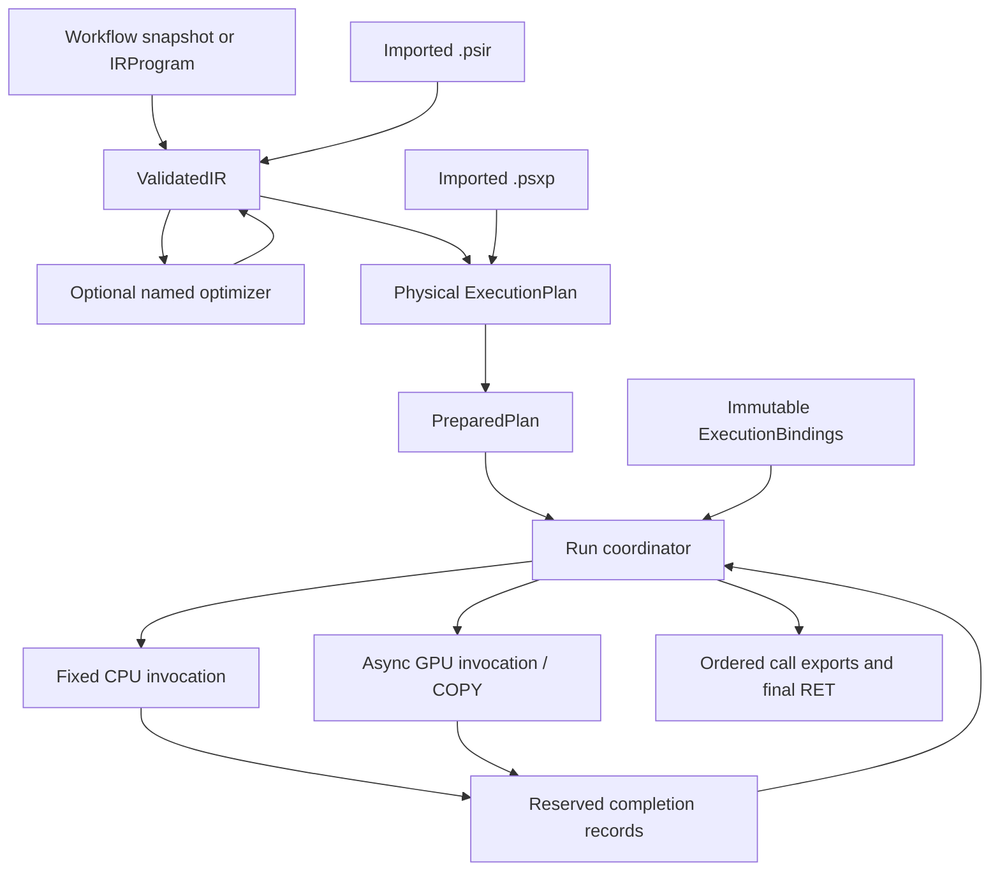

# Architecture Overview

## 1. Core summary

Photospider is an embeddable C++17 kernel that compiles local workflows into immutable physical Plans and executes them against caller-supplied Result bindings. A Plan fixes CFG, Task/Tile/Call tables, dependencies, placement, explicit COPY and resource bounds. Its coordinator issues ready work concurrently and retires calls in IR order. CPU and native Metal/Vulkan execution share fixed invocation/completion ownership contracts.

A `GraphContext` owns source revisions. An `ExecutionContext` owns bounded workers, GPU credits, fair admission, a frozen operation registry and its resource root. The daemon consumes the public installed package and separately owns Session, Job and process lifecycle.

## 2. Compilation, preparation and execution



The compiler expands reads and dependencies statically and validates the physical tables. Preparation links concrete devices, kernels, resources and module owners without changing topology. Each Run owns independent activations, dependency counters, ready queues, call retirement, cancellation and diagnostics. Task completion can release successors before call retirement. Call exports and final RET have separate owning Result holds; returned storage and observations may outlive the Run and context.

The planner accepts the initial `ValidatedIR` directly or an optionally optimized version.


## 3. Contracts and interfaces

```cpp
class Compiler {
 public:
  Result<ValidatedIR> analyze(const GraphSnapshot&,
                                  ResourceSet = {}) const;
  Result<ValidatedIR> bind_ir(IRProgram, ResourceSet = {}) const;
  Result<ValidatedIR> optimize(const ValidatedIR&,
                               const OptimizerInvocation& = {"optimize", {}}) const;
  Result<ExecutionPlan> plan(const ValidatedIR&,
                             const PlanningOptions& = {}) const;
};

class CompilerArtifact {
 public:
  static Status save_plan(const ExecutionPlan&, const std::string& path);
  static Result<ExecutionPlan> load_plan(std::shared_ptr<OperationRegistry>,
                                         const std::string& path,
                                         ResourceSet = {});
};

class ExecutionContext {
 public:
  Result<PreparedPlan> prepare(const ExecutionPlan&) const;
  Result<RunHandle> submit(const PreparedPlan&, ExecutionBindings = {},
                          const CancellationToken& = {},
                          ExecutionOptions = {});
};
// RunHandle::join() returns Result<ExecutionResult> after task drain and
// ordered observer settlement.
class RunHandle {
 public:
  Result<ExecutionResult> join() const;
};
```

These are abbreviated public signatures; unrelated members are omitted. Each stage returns a complete immutable value or a typed failure. `analyze` expands the DAG from named outputs into `DependencyPaths`, preserving shared ancestors in every referencing path with the same Call and SSA IDs. `optimize` keeps the first request for each call, removes empty chains and connects the retained chains as executable `ControlFlow`. For example, raw `ABG / AB / AC / DE / F` becomes `ABG / C / DE / F`. `bind_ir` also accepts explicit ControlFlow, including loops and conditional branches on one `UInt8` sample; that form is preserved by optimization.

`plan` invokes each operation's static lowerer and merges its fixed task, tile, layout, dependency and private-value tables. The compiler validates the complete physical program and its per-block resource bounds. Tasks issue when their dependencies and credits permit; successful completion enables internal consumers immediately, while CallGroups retire in IR order. `prepare` resolves the immutable kernel contracts, `submit` captures bindings and starts one Run, and `join` waits for accepted work and ordered observer settlement before returning final RET owners. `analyze` accepts an immutable content-addressed `ResourceSet`; operations select explicit resource identities during preparation. Result and Tensor carry structure and data; domain interpretation remains an operation parameter.

`CompilerArtifact` saves and loads v5 text (`.psir` for unified IR, `.psxp` for complete physical Plans). Raw and transformed IR may use dependency paths or CFG. Plans retain their lowered CFG, task placements, read/write views, call order and resource bounds. Versions 1–4 are rejected and require re-export. Loaded values are independent of the original GraphContext but require matching frozen registry/resources. Plan import validates and links saved tables without running lowering. See [Compiler and execution](Compiler-and-Execution.md#compiler-artifacts).

`CpuExact` is the default and requires CPU tasks. `NativeGpu` statically selects GPU lowering for GPU-capable operations and CPU lowering for CPU-only operations. GPU lowering may include CPU tasks when traits support them; placement is fixed for every task. Explicit COPY tasks connect memory domains. CPU work uses the context worker pool, and native tasks use bounded backend submission credits. Cancellation closes admission and drains accepted work before releasing its borrowed owners.

## 4. Non-goals and boundaries

- The kernel does not own daemon sessions, IPC, persistent jobs, or process lifecycle.
- The kernel ships only the WorkflowDocument DAG frontend. There is no Python or text-language frontend, machine-code backend, JIT, or automatic library discovery from artifacts.
- The optimizer resolves repeated dependency-path requests while retaining every unique call; it preserves explicit ControlFlow input. Tensor shapes and tile grids are fixed at compile time; control flow does not provide dynamic shapes.
- Compiler artifacts are editable, versioned text files without signatures; their digests are reproducibility aids.
- Native operation modules are trusted in-process code; ABI validation is not sandboxing.
- GPU availability does not imply that every operation has a native implementation.
- Results are in-memory owners, not durable identities or recovery records.

## 5. Consequences

Complete dependency-path expansion can grow exponentially with DAG sharing. The frontend bounds raw IR at 1,048,576 call occurrences and 65,536 chains. The planner coalesces eligible path blocks while preserving call order. Full-block reservation admits all selected outputs and usable scratch lanes before issue; coalescing can therefore increase peak capacity even when it improves scheduling freedom. [Measured capacity comparisons](Parallel-Execution-Model.md#native-measurements) show this tradeoff.

Plans share immutable storage and can be reused with new bindings or saved and reloaded. Runtime input addresses are captured per Run. `PlanningOptions` bounds tasks, records, dependency edges and planning work; sparse output requests limit the compiled closure. Queue or resource exhaustion returns a typed failure. Returned Results retain their storage charges until their final owner releases them. The executor performs no completed-result reuse, runtime placement rewrite or implicit transfer.
