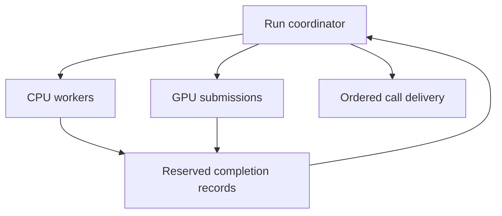

# Parallel Execution and Ordered Retirement

Status: Proposed breaking design; see the [Plan contract](Compiler-and-Execution.md) for implementation status. [Chinese reader version](zh/Parallel-Execution-Model.zh.md).

## Scope and ownership

One coordinator owns each Run's states, dependency counters, ready queues, call records and holds. A context supplies a bounded CPU pool and GPU submission queues shared by Runs. Workers and device callbacks write reserved completion records; they never mutate dependency or retirement state.

Each Context preallocates two independently charged coordinator slots. A slot starts its thread lazily and accepts a Run only while idle. Concurrent submissions with no idle slot retain an independent coordinator thread, preserving each accepted Run's progress. A slot stays busy through final Run-owner release, which occurs outside both the slot lock and the CPU pool. Its thread retains the slot alone; stopping a Context lets accepted work drain, then wakes idle slots so their own metadata leases can be released.



Multi-issue means admitting all eligible tasks that fit available credits during one coordinator turn. Per-backend ready heaps prioritize `(call ordinal, task ID)`; context admission rotates eligible Runs fairly. Dependency processing is O(T + E); heaps add O(T log T). No hardware clock is simulated.

The context keeps separate FIFO admission turns for CPU and GPU work. A frame enrolls one embedded waiter only while it has a free lane and a dependency-ready task. Busy backend capacity preserves that position. Each successful acquisition removes the turn; further work joins the tail behind existing waiters. Loss of readiness, abort and frame exit remove pending turns before accepted work drains. A drained schedule also removes its turns before waiting for observer delivery, so a blocked failure observer cannot retain an admission position. Enrollment and rotation allocate no memory. The CPU turn covers queue insertion; the GPU turn covers credit acquisition, with device submission outside the admission lock. Coordinators retry during their existing completion-driven or bounded timed wakeups, so fairness does not imply a fixed latency bound.

## State and invariants

```cpp
#include <cstdint>
namespace ps_executor_design {
enum class TaskState : std::uint8_t {
  Waiting, Ready, Submitted, Succeeded, Failed, Skipped
};
struct TaskRuntime { TaskState state; std::uint32_t pending; };
struct CallRuntime {
  std::uint32_t unsettled, first_failed_task;
};
struct CompletionKey {
  std::uint64_t run, activation;
  std::uint64_t submission;
};
}  // namespace ps_executor_design
```

`pending(t)` counts distinct predecessors that have not completed successfully. Reading two outputs from one producer waits for one event. Lifetime holds count distinct `(consumer task, tile)` pairs instead; two ports reading one tile hold it once. Every future consumer hold exists before producers can finish.

Each accepted submission owns exactly one terminal completion record. A SubmissionId maps to one task or one immutable packet member span; it is distinct from TaskId. The coordinator checks the submission key/state once before fanning its event out to member task states. `Submitted` includes CPU work queued to a worker and accepted device work. Success means every output write and input/scratch access has ended, with required visibility. Rejection transfers no ownership and enqueues no callback; the coordinator handles a local failure. Success makes all task outputs available together; failure exposes none.

Execution credit and scratch return on completion. A call is settled when all members are terminal; it retires only at `retire_head`. A selected call succeeds only if all its tasks succeed. Zero-task pure calls retire as `Elided`. A call with 100 tasks can run with two execution slots because task slots do not wait for retirement.

On success, the coordinator marks outputs available, visits each successor once, settles the call member, releases input holds/scratch and returns credit. It then retires the contiguous settled prefix and admits more work. Consumer readiness does not wait for retirement. User delivery runs separately.

| Logical example with two CPU slots | Order / duration |
| --- | --- |
| Call order | A(10), C(A,1), B(2), D(B,1), E(C,D,1) |
| Issue | A, B, D, C, E |
| Completion | B, D, A, C, E |
| Retirement | A, C, B, D, E |
| Elapsed logical ticks | 12 |

## Admission and progress

The baseline reserves the block's full output set, persistent frame state, bounded delivery storage, usable scratch lanes and completion capacity before its first task. [Tile storage](Cache-Model.md) defines the bound. Failure returns `ResourceExhausted` before any task in that block starts; earlier blocks' results/effects remain observable.

Preparation records the maximum number of CPU tasks in any block. A Run's CPU lane count is capped by that structural upper bound as well as its configured worker/parallelism limits, with at least one bookkeeping lane. Scratch reservation, completion storage and GPU scratch offsets use the resulting count consistently.

Runs without an observer omit delivery records and per-call exported Result materialization. Call retirement, trace records, dependency holds, failure propagation and final RET Result admission still execute.

A task is eligible when active, unsubmitted, dependency-ready, before the failure cut and able to acquire all credits. An effect additionally requires its call to equal retirement head. A busy scratch lane can be bypassed temporarily; fair selection revisits it. Tasks acquire their complete multi-domain resource vector atomically.

Boundary import COPYs have `call = none` and become eligible after the complete real-call prefix retires successfully. With zero real calls they are eligible at block entry. They share task submission credits and full-block reservations, while leaving call sequence numbers unchanged. A boundary failure skips remaining unsubmitted boundary COPYs and drains accepted copies; the smallest actually failed TaskId determines its terminal error. A real-call failure suppresses every unsubmitted boundary COPY. Cancellation, stale state and observer abort retain their Run-level precedence.

The coordinator drains events, applies stops, skips work, retires calls and fills lanes. It sleeps only if accepted work or a concrete context-credit event can make progress. A rejected block reservation fails instead of waiting indefinitely. Unfinished work with no in-flight or eligible task after successful admission is an invariant failure (`Internal`).

Progress assumes a finite DAG, dependencies within the same or earlier call, finite callbacks, eventual device completion, fair context service and the complete reservation. The earliest unfinished prefix call has either in-flight work or a task whose predecessors can finish. Its remaining ready work fits a guaranteed lane after current work completes. Each completion reduces unfinished work. This is a resource/scheduling guarantee under these assumptions, not a termination proof for arbitrary native code.

## Failure, effects and cancellation

`failure_cut` is the smallest ordinal of an observed task-failing call, initially the call count. Continue all work strictly older than the cut. Skip unsubmitted work at or after it; drain accepted work there. Failure never satisfies a successful dependency. Skipped consumers release their future holds once. A later event from an older failing call moves the cut backward.

Retire the successful older prefix and then one failure record for the cut call after its accepted members quiesce. No younger call retires. Return final failure only after all younger accepted work drains too. For several failures in that call, select the lowest static TaskId among actually failed tasks. Skipped tasks have no invented error. This is stable for the observed failures, not a promise to evaluate every possible sibling failure. Failure-cut suppression uses a separate internal stop mechanism; it must not cancel the older prefix with the user cancellation token.

The prototype records `TaskFailure(activation, task_id, call, task_name)` for each actual failed completion in `task_failures`. At failure retirement, `retired_failures[call]` records the lowest observed TaskId in that call. The terminal `failure` is set only for an `OperationFailed` Run; cancellation keeps observed/retired failure diagnostics without presenting them as the terminal cause. Skipped tasks produce no failure detail. Packet-scoped attribution remains separate and is not modeled by this prototype.

An effectful call has pure preparation and one terminal effect task. It starts only at retirement head after its own predecessors succeed, so all earlier calls have retired successfully. Later pure computations may already have run. Partial external writes before an effect failure cannot be rolled back. Several ordered external effects require separate calls or an operator-owned transactional protocol.

User cancellation is a Run abort. The coordinator closes admission, skips unsubmitted work, drains accepted work and suppresses further retirement. Already handed-off records remain valid and their delivery may finish. Before terminal status is latched, observed cancellation takes priority over Stale, then context/device/observer abort, then task-local failure. Within the context/device/observer category, retain the first coordinator-observed cause. Later requests cannot alter a latched outcome. Fatal device loss that prevents older work from completing uses context/device abort rather than claiming ordinary successful-prefix completion.

Graph/binding invalidation and observer failure also abort. Same-Run callback serialization, delivery failure and terminal latching follow the [return interface](Compiler-and-Execution.md#run-control-flow-and-return-interface). Device loss must establish DMA/callback quiescence before freeing storage. The backend retains leases until then. A false success, escaped CPU task or out-of-range write violates the trusted operator contract.

## CPU and GPU completion boundary

A CPU invocation receives immutable input views, exclusive preallocated outputs, private bounded scratch, parameters and cancellation. Synchronous `invoke` returns status after all accesses and internal work end. Workers publish with release ordering and the coordinator consumes with acquire ordering. Baseline kernels use one worker each; parallel phases lower into tasks rather than block workers on nested pool jobs.

The backend interface is logically `SubmitResult submit(const Invocation&, CompletionSlot&) noexcept`, returning `Rejected(Status)` or `Accepted(Ticket)`. Acceptance transfers owners until exactly one completion; rejection keeps them with the coordinator and enqueues no completion. Arm the slot before submit, so synchronous completion is legal. Callbacks only write bounded status and signal a wakeup; they allocate nothing and invoke no user code.

GPU encoding and queue acceptance do not make outputs readable. Input/output/scratch, parameters, commands, pipeline/module owners and completion slots live through device quiescence. Host-visible completion includes required cache maintenance. GPU consumers require access/layout transitions and memory visibility, including in shared memory. Cross-domain transfers are explicit COPY tasks.

Completion keys and queue timepoints are different. Task 7 completing does not imply tasks 0 through 6 completed. GPU timeline values follow actual submission order on one ordered queue; independent queues use independent timelines. TaskId and CallId must never be used as a universal completed counter.

### Device packets

Individual submissions are the baseline. Optional compiler packets batch a same-device subgraph whose external incoming edges are all satisfied before submission and whose outgoing edges become visible at packet completion. First-version packets contain no effect and belong to one call. Validate the contracted packet graph for cycles: grouping A tasks around an intervening dependent B can create an A/B cycle.

A packet consumes one backend submission credit and one completion slot; its member tasks are all Submitted until that single event is processed. Device barriers enforce internal edges. Reserve all outputs and the full packet scratch/command bound first. Success settles packet members in topological order in one event. If member-level failure information is unavailable, fail the whole call with `PacketFailure(submission, members)` and expose no packet output. Do not invent a first failed member; retain packet-scoped provenance separately from task-local error selection. Restricting packets to one call preserves cross-call failure attribution. Cross-call chains remain separate until a backend offers adequate per-task completion semantics. Batching can delay consumers; measure that cost against submission overhead.

## Diagnostics and checks

Measure ready, submit, start, device completion and retirement separately. Keep backend in-flight peaks, ready/scratch waits, transfers and drain latency. Only subtract timestamps in a comparable clock domain. The first C++ implementation exposes these additional counters:

| Metric | Definition |
| --- | --- |
| `reserved_bytes_by_domain` | Current admitted budget capacity by memory domain, including unused block reservation; count each lease once |
| `live_bytes_by_domain` | Currently allocated controlled bytes by domain, including retained returned owners; allocation-size accounting, not logical image size or RSS |
| `allocation_count` | Cumulative successful materialized tile allocations in the Run; exclude scratch, commands and borrowed input owners |
| `block_admission_failure` | Admission-failure count plus block/activation, resource dimension, requested capacity and available capacity; report before issuing that block |
| `retirement_head_wait` | Monotonic time from a call becoming head until it is settled and eligible to retire; exclude callback delivery delay and report unfinished waits separately on abort |

Report current and peak reserved/live capacity. At block end, unused reservation returns to the context while exported owners remain charged; releasing those owners updates the accounting even after Run completion. Declining live bytes does not imply declining reserved bytes within a block. [Capacity examples](Cache-Model.md#capacity-cost-and-measurement) quantify this baseline cost.

The current public implementation returns an independent `ExecutionObservation` from `RunHandle::observation()`. Its allocation-free `snapshot()` retains no Run or Result and remains readable after success, failure, cancellation and context destruction. Task/call counters publish at coordinator safe points; allocation commit, Slice release and block exit update memory counters directly.

`ExecutionDiagnostics::memory` records current and peak output/scratch backing in disjoint Host, Device and Shared domains. Native values use actual capacity; Host uses declared allocation bytes. Borrowed inputs, code, driver memory and host metadata are outside that backing record. `ExecutionDiagnostics::metadata` separately records current/peak reserved and allocated managed metadata newly attributed to the Run, including diagnostics, scheduling directories, Result/Footprint/view metadata and controlled allocation owners. Root-matching scopes inherit the Run attribution; shared Context/PreparedPlan, pre-existing inputs and foreign roots keep their prior attribution. Leases retain weak counter provenance, so cross-thread release and exported owners update observations after Run/context destruction without retaining a Run. Root `live`/`peak` still mean reserved capacity; allocated metadata counts instrumented allocation bytes, excluding allocator-private overhead and RSS. Release can lower backing live bytes inside a block while reservation remains protected until its boundary.

`lane_wait_ns`, `context_wait_ns` and `coordinator_delay_ns` partition ready-to-submit time at coordinator safe points without overlap. Lane includes its exclusive preallocated scratch; context includes fair admission, CPU FIFO or GPU credit waiting. `scratch_capacity_wait_ns` is always zero: insufficient full-block capacity rejects before tasks become ready. CPU queue/invoke, completion-to-consumption and observer queue/invoke intervals are measured separately. Throwing callbacks count as completed delivery; discarded records have no invented callback time.

`allocation_count` includes successful output-tile allocations in a subsequently failed block and excludes scratch. `block_admission_failures` and `last_block_admission_failure` retain block, activation, error category and, for budget rejection, requested/available vectors plus the first insufficient dimension captured under the same admission lock. Allocator or backend failures do not invent an insufficient-capacity dimension. Rejections of identities, Result envelopes and directories during Frame construction are captured too.

`retirement_head_wait_ns` and `peak_retirement_head_wait_ns` measure unsettled-head waits within an admitted block; a newly exposed head already settled has zero wait. Abort-truncated waits use `unfinished_head_wait_ns`, and `current_head_wait_ns` is the latest progress sample. Observer delivery is excluded. Raw benchmarks preserve failed-Run diagnostics and separately measure host steady-clock prepare, submit and join durations. `ExecutionOptions::trace_capacity` enables bounded task and call traces. Each array is admitted and allocated before Run start, including its retained diagnostic owner; capacity zero disables the arrays and native timestamp queries. `copy_task_timings()` and `copy_call_timings()` copy a synchronized prefix into caller-owned storage without allocation. Overflow increments separate dropped-record counters without growing storage across loop activations.

Task records identify block, activation, submission, task and source call. `host_epoch_ns` is the Run origin in nanoseconds from `steady_clock::time_since_epoch`, not a wall clock or device timestamp. Host `ready_ns`, `submit_ns`, `cpu_start_ns`, `completion_ns` and `consumed_ns` use nanoseconds from the Run's steady-clock epoch. Ready time begins actual issue eligibility, including effect and boundary retirement gates. CPU start is recorded on the worker; GPU start is available only in the separate device record. Completion time records the terminal callback or local rejection; consumption time records coordinator observation. Retirement records carry IR sequence and exclude observer delivery. Aggregate counters sum ready wait, CPU queue wait, CPU invocation time and completion-to-consumption delay; overlapping tasks can contribute overlapping time. `copy_bytes` counts successful COPY logical bytes once, excluding additional staging traffic. Coordinator wait and wakeup counters include timed waits.

Native timing uses the optional fixed-size `report_timing` callback before terminal `finish`. Metal records completed command-buffer [GPUStartTime](https://developer.apple.com/documentation/metal/mtlcommandbuffer/gpustarttime) and [GPUEndTime](https://developer.apple.com/documentation/metal/mtlcommandbuffer/gpuendtime) in system mach nanoseconds. Vulkan creates a submission-owned two-query [timestamp pool](https://docs.vulkan.org/refpages/latest/refpages/source/vkCmdWriteTimestamp.html) only when requested and supported, surrounds device commands with TOP/BOTTOM timestamps, and reads 64-bit values plus availability after fence completion. An unsupported queue or unavailable query produces no device record. A raw pair cannot exclude multiple counter wraps and therefore does not establish a unique elapsed duration. These intervals include device barriers and scheduling effects; CPU staging and callback delay are outside them. Device records must not be subtracted directly from host steady-clock times; cross-domain comparisons require explicit calibration and stated uncertainty, as retained by the manual benchmark below. Vulkan raw pairs support modulo subtraction within one submission; matching clock instances do not establish cross-submission calibration or prove overlap. See the [completion ABI](Plugin-ABI.md#kernel-preparation-and-invocation).

`ExecutionDiagnostics::backends` indexes CPU and GPU separately. It records submitted/completed tasks, local GPU rejections, current/peak submission-slot occupancy and summed submit-to-consumption nanoseconds. Inline completions retain their slot until coordinator consumption; local rejections count as issued tasks and then settle locally. These counters describe host scheduling and include CPU queue wait; they do not measure device utilization. Exceptional Frame unwinding waits for terminal callbacks and accounts for remaining issued tasks before releasing their owners.

`abort_drain` records the first task-coordinator abort, or exceptional Frame unwind with issued tasks, and the point at which all issued terminal events have been consumed. Both timestamps use the Run's host clock. The initial inflight count includes completed events not yet consumed. An unfinished record remains observable while drain waits. Observer delivery and cancellation-request-to-observation delay are excluded. An abort outside task coordination, such as cancellation before block entry or after all task work has drained, need not produce this record. A task-local failure cut is not a Run abort.

## Native measurements

The manual kernel tool [physical_execution_benchmark.cpp](../../tests/tools/physical_execution_benchmark.cpp) exercises the public fixed Plan, prepare, submit, join and observation path. It is an explicit `EXCLUDE_FROM_ALL` target, not a CTest or installed-consumer test. The following measurements were collected on 2026-10-20; they describe this implementation and these machines, not a cross-device performance guarantee.

| Backend | Physical device and software |
| --- | --- |
| Metal | Apple M5, 10 GPU cores, Metal 4; macOS 27.2 build 26B5101f, Darwin 27.2; RelWithDebInfo, native Metal enabled |
| Vulkan | NVIDIA GeForce RTX 3090, 24576 MiB; driver 595.99.02; Vulkan 1.4.329, queue family 0, 64 timestamp bits; Ubuntu kernel 7.0.0-38-generic, Clang 21, RelWithDebInfo |
| Profiling | Nsight Systems 2026.3.2.476, Vulkan API/workload and OS runtime trace; CPU sampling disabled |

Each stage produces 4 MiB: 1,048,576 unsigned 32-bit words represented by one UInt8 tensor of 4,194,304 bytes. The tile extent is 65,536 bytes, giving 64 tasks per stage. Integer fill/transform kernels have exact CPU/Metal/SPIR-V oracles. Verification and output release occur after the timed submit/join interval. Each case prepares once, performs one excluded warm-up, then runs five measured iterations with CPU workers 4, CPU queue capacity 64, GPU credits 4, maximum Runs 8, trace capacity 1024 and Payload limit 128 MiB. `tiles_serial` changes only GPU credits to 1; the tight-budget cases use 12 MiB. Every native submission contains one task: packet size is 1.

The four required workload shapes are `tiles` (one call), `independent` (four independent calls and four returns), `dependent` (four GPU calls linked tile by tile), and `copy` (CPU fill → Host-to-Device COPY → GPU transform → Device-to-Host COPY → CPU transform). The first three use Shared outputs; the COPY chain uses explicit Host and Device allocations with bounded Shared staging. `split` places the same four-stage dependent chain in four blocks; `dependent` uses one block. Both variants retain the same shape, operations, placement and grants.

### Reproduction and retained evidence

Build and run the manual target in a build configured for the chosen native backend:

```sh
cmake --build build/kernel-dev --target physical_execution_benchmark
mkdir -p build/physical-benchmark
./build/kernel-dev/physical_execution_benchmark all 5 > build/physical-benchmark/metal.jsonl
```

The CLI is `physical_execution_benchmark [case|all] [iterations] [cold]`; `cold` omits warm-up. The Vulkan run used the existing Linux build with Metal disabled and Vulkan enabled. Current local evidence is under ignored `build/physical-benchmark/`: `metal.jsonl`, `vulkan/vulkan.jsonl`, the analysis summary and the three Vulkan profiler captures. Configuration records include physical device identity, preparation time and retained preparation payload. Run records include status, bounded task/call traces, predecessor IDs, domain capacity, metadata, waits and drain. All 90 measured Run records retained every task and call timing without dropped records. Successful outputs matched the exact oracle, and releasing each Run's owners returned Payload to the retained-preparation baseline.

For each of `independent`, `dependent` and `copy`, one separate cold Run was profiled:

```sh
nsys profile --trace=vulkan,osrt --vulkan-gpu-workload=individual --sample=none --force-overwrite=true -o build/physical-benchmark/CASE build/physical_execution_benchmark CASE 1 cold
nsys export --type=sqlite --force-overwrite=true -o build/physical-benchmark/CASE.sqlite build/physical-benchmark/CASE.nsys-rep
```

Replace `CASE` with the case name. These captures are separate observations; their task samples are not independent repeated Runs and their timings are not pooled into the unprofiled table.

### Run time, throughput and capacity

Times below are submit-through-join wall time in milliseconds, median [minimum, maximum] over five Runs. Tight-budget rejection and cancellation are reported with their intended terminal status.

| Case | Tasks on success | Metal ms | Vulkan ms |
| --- | ---: | ---: | ---: |
| tiles | 64 | 3.982 [3.672, 7.378] | 57.611 [55.762, 60.099] |
| tiles_serial | 64 | 15.607 [14.881, 17.357] | 156.658 [154.961, 158.552] |
| independent | 256 | 16.011 [15.590, 17.121] | 232.030 [229.806, 243.205] |
| dependent | 256 | 15.048 [14.675, 27.061] | 233.236 [228.880, 245.669] |
| copy | 320 | 15.478 [9.713, 16.670] | 218.304 [214.495, 222.044] |
| split | 256 | 17.966 [15.666, 27.726] | 231.466 [224.023, 237.124] |
| coalesced_tight | rejected | 0.096 [0.080, 0.098] | 0.137 [0.071, 0.153] |
| split_tight | 256 | 16.618 [16.284, 33.307] | 237.665 [230.399, 244.129] |
| cancel | cancelled after GPU issue | 2.792 [2.515, 2.987] | 21.011 [19.994, 23.223] |

The single-call median throughput was 16,074 tasks/s on Metal and 1,111 tasks/s on Vulkan with four GPU credits; one credit produced 4,101 and 409 tasks/s respectively. This measures the complete small-task pipeline, including host submission, allocation and completion costs. It does not measure shader arithmetic throughput. Successful task/submission and output-allocation counts were 64, 256, 256 and 320 for the four main cases. The COPY count includes CPU tasks; its native GPU submission count was 192.

Domain values below are the maximum per-domain peak across five Runs, in MiB. In these cases reserved and live backing peaks were equal within each domain. Host, Device and Shared are disjoint in this diagnostic; their independently observed peaks must not be summed and presented as one simultaneous peak.

| Case | Host | Device | Shared | Maximum Run allocated metadata, Metal / Vulkan bytes |
| --- | ---: | ---: | ---: | ---: |
| tiles | 0 | 0 | 4 | 362272 / 368301 |
| independent | 0 | 0 | 16 | 774784 / 788307 |
| dependent | 0 | 0 | 16 | 610032 / 625304 |
| copy | 12 | 8 | 0.25 | 629216 / 637521 |
| split | 0 | 0 | 8 | 529256 / 537405 |

Metadata is a separate reserved/allocated observation, not an extra payload domain or an amount to add to its own reservation. Shared Context, PreparedPlan and input owners retain their original attribution. The four-stage coalesced block requires 16 MiB of Shared output capacity, so the 12 MiB case rejected before any task or backing allocation on both backends. Splitting the same computation reduced the maximum observed Shared backing to 8 MiB and completed all five tight-budget Runs on each backend. This is the measured capacity cost of full-block admission; the baseline policy is retained.

### Readiness, retirement and device intervals

The following are medians across five unprofiled Runs. Head wait is summed unsettled retirement-head time; wakeups count coordinator wakeups. Per-call latency means the call's first submitted task through retirement, rather than its retirement offset from Run start.

| Case | Metal head wait ms / wakeups | Vulkan head wait ms / wakeups |
| --- | ---: | ---: |
| tiles | 2.759 / 54 | 52.762 / 15 |
| independent | 11.311 / 230 | 210.212 / 52 |
| dependent | 12.306 / 208 | 216.607 / 46 |
| copy | 13.465 / 207 | 207.503 / 120 |
| split | 14.423 / 191 | 213.573 / 55 |

For the dependent chain, per-call median latencies were [3.426, 3.168, 2.794, 2.773] ms on Metal and [54.769, 57.195, 55.838, 54.439] ms on Vulkan. Lane, context and coordinator portions of ready-to-submit waiting are recorded separately; dynamic scratch-capacity waiting is zero under full-block admission. These accumulated waits can overlap between tasks.

Metal records completed command-buffer intervals in mach time. The benchmark samples steady S0, converted `mach_absolute_time` M, and steady S1 four times before and four times after each Run. Under the stable-offset calibration, `M - steady` lies in `[M-S1, M-S0]`; use the intersection and its midpoint to align host timestamps. All observed intersections were valid, with widths from 0 to 41 ns. This is observed calibration-bracket width, not a guarantee of GPU timestamp precision. Apple documents [mach time conversion](https://developer.apple.com/library/archive/qa/qa1643/_index.html) and [Apple Silicon timestamp alignment](https://developer.apple.com/videos/play/tech-talks/10001/).

Across the five Metal dependent Runs, 960 actual GPU predecessor-to-successor edges had a median predecessor device-end to successor host-submit gap of 2.650 ms [2.304, 14.859]. The 960 selected edges in the mixed COPY chain had median 2.558 ms and include GPU-to-CPU successors. Each gap follows recorded predecessors; it includes other readiness constraints, earlier-call priority, lane/context waiting and coordinator work. It is not pure wakeup latency.

For Metal `independent`, the peak count of overlapping command-buffer intervals was 2 in every Run. Preserving `(activation, call)` identity changes the conclusion: distinct-call peaks were [1, 1, 1, 2, 1], and total cross-call overlap was [0, 0, 0, 750, 0] ns. Thus only one sample contained 0.75 microseconds of observed cross-call interval overlap. These intervals do not prove simultaneous shader execution or GPU utilization. Four accepted host submissions likewise do not establish device overlap.

For Vulkan, raw task timestamps are used only within one submission. Cross-submission intervals instead use Nsight's common timeline: join API and workload records by `(contextId, correlationId)`, then map task submission order to API order. The mapping was checked against the single coordinator/thread/queue, exactly one `vkQueueSubmit` per accepted GPU task, no prepare-time submissions, matching record counts and unique correlations. All 256/256/192 GPU tasks in independent/dependent/COPY mapped one-to-one.

| One cold Vulkan capture | independent | dependent | copy |
| --- | ---: | ---: | ---: |
| GPU intervals / peak overlapping intervals | 256 / 1 | 256 / 1 | 192 / 1 |
| Interval union ms | 4.741 | 3.942 | 2.456 |
| First start to last end ms | 210.269 | 230.230 | 203.226 |
| Submit API start to GPU start, median microseconds | 930.004 | 867.034 | 974.565 |
| Adjacent submission signed gap, median microseconds | -277.642 | -331.817 | -254.233 |

No positive-length device interval overlap was observed in these captures, despite host GPU peak inflight 4. Interval union divided by the first-to-last interval span is not hardware utilization. An adjacent signed gap is next submit API start minus the previous interval's GPU end in submission order; negative values show host issue before that prior completion, not device concurrency.

Actual Plan dependency edges give a different measurement: the dependent capture's 192 GPU-to-GPU edges had median 57.784 ms [51.352, 63.392], while COPY's 128 GPU-to-GPU edges had median 54.714 ms [48.945, 97.936]. GPU-to-CPU edges are excluded from this profiler definition because they have no successor `vkQueueSubmit`. Issue was grouped by earlier call priority. Nevertheless, later-call submission preceded the previous call's last GPU completion at two dependent boundaries by 0.633/1.546 ms and at the COPY upload/compute boundaries by 0.123/0.484 ms. There is no whole-call completion barrier. The large per-edge gaps include earlier ready work and profiler overhead; they must not be labeled a fixed callback or wakeup cost, or summed into Run duration.

### COPY and drain

Each successful COPY chain transferred 8,388,608 logical bytes: 4 MiB upload and 4 MiB download. Across five Runs, 640 COPY tasks per backend had the following pooled task medians:

| Backend | Host submit to terminal notification | Native device interval |
| --- | ---: | ---: |
| Metal | 173.250 microseconds | 15.6045 microseconds |
| Vulkan | 3962.6395 microseconds | 4.192 microseconds |

The native interval includes device synchronization and command execution. Host staging, queueing and callback overhead make the host interval different; neither column is a pure DMA bandwidth measurement. The cold Vulkan COPY capture separately recorded upload/transform/download interval sums of 1.303/0.641/0.511 ms. Its stage spans were 50.834/54.019/98.353 ms and include gaps between tasks.

The cancellation case requests stop after observing a GPU submission slot in use. All accepted tasks completed before final return, all drain records finished, and releasing owners restored the preparation baseline. Metal drain time was median 423.958 microseconds [294.667, 1094.125], with initial inflight counts [1, 8, 8, 8, 2]. Vulkan was 7967.362 microseconds [7757.635, 10410.382], with counts [4, 3, 2, 4, 3]. These counts mean submitted tasks whose terminal event had not been consumed; they may include CPU work and already-completed notifications. They do not count physically executing GPU kernels. Real device-loss injection and optional packet batching remain outside this measurement.

## Focused validation

| Requirement | Direct behavior checks |
| --- | --- |
| Immutable physical tables, checked artifacts and subset closure | `test_physical_program`, `test_physical_compiler`, `test_compiler` |
| Bounded lowering and mixed per-task placement | `test_operation_program_limits`, `test_backend_admission` |
| Dependency issue, ordered retirement, effects and failure cuts | `test_task_schedule`, `test_physical_cpu_schedule`, `test_fixed_execution` |
| CFG/loops, simultaneous edge transfer and dynamic identity | `test_fixed_cfg`, `test_fixed_identity` |
| Accepted/Rejected/inline completion and terminal-priority races | `test_fixed_async`, `test_fixed_execution` |
| Block/domain admission, explicit COPY and retained Result storage | `test_native_block_memory`, `test_native_copy`, `test_device_result` |
| Root/Run metadata provenance, partial failure and release | `test_resources`, `test_resource_observation`, `test_execution_observation`, `test_result_metadata_budget` |
| Raw trace/report contracts and package compatibility version | `test_raw_benchmark`, `test_package_version` |
| Physical Metal/Vulkan execution and visibility | `test_fixed_native`, `test_native_gpu`, `test_fragment_atlas_gpu`, `test_vulkan_gpu` |

The retained kernel checks cover physical table and artifact validation, selection closure, CFG/loops, simultaneous edge transfer, task readiness and real CPU overlap, failure-cut and effect ordering, cancellation/stale/observer terminal priority, callback finalization races, multi-domain and metadata admission/release, Accepted/Rejected ownership, inline completion, explicit COPY and native completion visibility. `test_fixed_async` checks both device-first and observer-first abort causes while another accepted submission is held, then proves join waits for its release. `test_backend_admission` covers static mixed CPU/GPU lowering both between calls and within one call. Native tests exercise real Metal and Vulkan; controlled completion fixtures do not claim physical device-loss coverage.

The Python prototype remains a separate logical model. It checks explicit ordering without payload holds, separate retirement/RET ownership and observed task-error selection using logical ticks. Its table scans/sorts are not the C++ scheduler or native performance evidence. Optional multi-task packets are not part of the current one-task-per-submission baseline.

## Primary design references

- [BOOM ROB](https://docs.boom-core.org/en/latest/sections/reorder-buffer.html): in-order commit and head exception handling motivate call records and a retirement cursor, without speculative register state.
- [IREE Stream](https://iree.dev/reference/mlir-dialects/Stream/) and [HAL](https://iree.dev/reference/mlir-dialects/HAL/): explicit asynchronous resources and wait/signal fences motivate declared completion dependencies.
- [CUDA Graphs](https://docs.nvidia.com/cuda/cuda-programming-guide/04-special-topics/cuda-graphs.html): separate graph definition, instantiation and execution motivate prepare-once data and optional packets.
- [Metal completion](https://developer.apple.com/documentation/metal/mtlcommandbuffer/addcompletedhandler(_:)): GPU completion notification motivates the distinction between submit and Done.
  Apple's [archived command guide](https://developer.apple.com/library/archive/documentation/Miscellaneous/Conceptual/MetalProgrammingGuide/Cmd-Submiss/Cmd-Submiss.html) (updated 2016-12-12) also documents command-buffer retention and short completion handlers; only these foundational lifetime rules are used here.
- [Vulkan synchronization](https://docs.vulkan.org/spec/latest/chapters/synchronization.html): execution order, availability and visibility require explicit backend synchronization.

These sources motivate selected mechanisms; they provide no evidence of a completed Photospider implementation.
