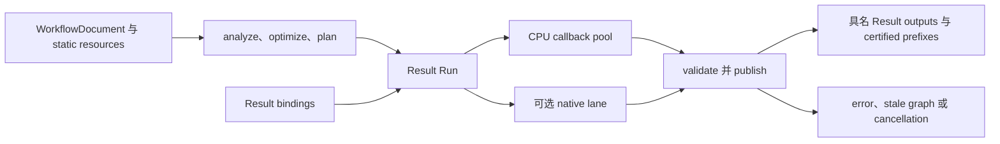

# Compiler 与本地执行

## 范围与 ownership

Compiler 验证 schema-7 `WorkflowDocument`、解析 Result operation contracts，并生成 immutable semantic、optimized 和 physical plans。它拒绝其他任何 schema 版本，包括早期基于标签的 workflow。当前 package 为 0.35.0，OperationTraits version 为 27；规范 identity 使用 semantic graph v22、physical plan v22 和 outer plan-cache key v18。`ExecutionContext` 拥有有界 CPU pool、可选 native backend lane、caches，以及由 runs 和仍存活 owners 共享的 resource root。未设置 `managed_resources` 时，context 使用默认 `ResourceLimits`；设置后使用显式 limits。`maximum_live_bytes` 也限制 Payload。Run 拥有 continuation state，只有 callbacks 退出且 cancellation 与 graph-currentness checks 允许 publication 后才返回具名 Results。

`WorkflowInputDeclaration` 保存 id、精确 name 和必需的 Result schema。`ExecutionBinding` 保存 name 和 owning `ResultRef`。Tensor 是 Result storage 和 codecs 使用的 typed backing。`OperationMetadata` 只携带完整 Result schema；metadata specialization 是根据输入 schema 和静态参数对输出 schema 做的结构推导。Tensor shape 和 layout 属于 `ResultTensorSpec`。端口在结构谓词匹配时即可连接；compiler 不比较领域标签，因此结构相同但预期含义不同的 Result 可以连接到同一个端口。

`Compiler::compile(context, options, resources)` 接收显式 `ResourceSet`。每个算子的静态 preparation 列出所需的 `ResourceIdentity`；compiler 从集合中精确选择这些条目，缺失时失败，plan 保留所选资源。SemanticGraphIR 及其 digest 仍是编译与计算身份：semantic digest 覆盖 declarations、operation keys、有序输入、静态参数、operation traits（包括绑定的校验器与声明的诊断 identity 及其 version 和 implementation）、所选资源 identity 以及输出 schema。地址、回调指针和诊断内容不参与。每个 step 的 dependency template 和 shared block contract 也纳入相同的显式资源 identity。

`FrozenExecution` 共享包含 plan、binding snapshot、operation registry 和 execution identity 的 immutable state。只要 handle 仍持有 state，`plan()` 返回的借用引用就有效。每次 frozen execution 在进入 Run 前捕获 handle，并为 structured execution 提供 plan 的 shared owner。调用方未提供 plan owner 时，普通 `ExecutionPlan` 调用借用该 plan。

`DemandHandle` 请求会用当前 generation 捕获 frozen plan；replacement 推进 generation，旧请求仍保留原 plan 和输入 owners。`replace_bindings` 在 handle mutex 内复制 frozen bundle 的 owning Root，建立其 Root allocation scope 后再获取 call lease。这样 setup work 仍由 Root 计费，并防止 context shutdown 在 Root 读取和 call admission 之间退休该 bundle。

Structured execution 的 coordinator Host 在 Run 内持有 actor 与 Run 操作。`StructuredResultCache` 拥有 completed-result proof、replay、snapshot 和 quota 状态；它通过单次调用的借用 context/actor views 工作，并通过同步 Host 请求 Need supply 和 candidate adoption。`PublicationValidationServices` 也只借用于一次 validation：它提供 work 准入、cancellation、stop 状态和 limits，供 validator 检查 publication facts。Validator 返回 status 与 retirement intent，只有 coordinator 会退休 actor。这些组件明确了所有权边界，但 Need dependency graph 仍由 coordinator 管理。

## Planning 与 execution



`analyze` 验证 graph structure、operation availability、parameters、ports 和推导出的 schemas。静态 metadata closure 沿相关 operation output 的全部输入展开，使 compiler 能校验 schema、保留静态 specialization，并让这些输入参与 semantic identity。Executable closure 从具名 outputs 和 side-effect roots 开始，再沿各选定 output 的 `input_indices` 展开；未指定 projection 时使用全部输入。Planner 建立成员网格并包含声明的共享 stage 依赖闭包；运行期 Need 选择实际 payload tile。Backend 选择和准入只针对 executable outputs。仅用于 metadata 校验或 specialization 的 side-effect-free GPU-only producer 不会运行；在 `CpuExact` 下直接请求该 GPU-only output 仍返回 `BackendUnavailable`。Run 调度已就绪工作，执行获准的 I/O，并按 plan 验证每次 publication。`ExecutionOptions::result_publication` 在 Result prefix 获得认证后通知调用方。Prefix 不代表整次 execution 成功；callback failure 会停止 Run，并遵循现有 failure、cancellation 和 retirement 路径。

```cpp
namespace ps {
struct WorkflowInputDeclaration {
  std::uint64_t id;
  std::string name;
  std::shared_ptr<const SchemaTemplate> result_schema;
};
struct ExecutionBinding {
  std::string name;
  ResultRef result;
};
struct ExecutionOptions {
  std::function<Status(ValueRef, const ResultRef&)> result_publication;
};
struct ExecutionResult {
  ResourceMap<ResultRef> results;
};
}
```

片段展示调用方相关的 Result 字段，省略默认成员值、其他 diagnostics 和 execution controls。`ExecutionContext::execute` 接收这些 bindings 并返回具名 Results。C++ operation 入口为 `start_result`，它返回 `ResultContinuation`。

## Operation 调度与错误

Result continuation 发出成员 tile Need 或显式 descriptor-only 请求。所有 payload 读取（包括控制值）贡献普通 tile 证据。Run 共享 stage 的准备独立于第一个请求输出。有副作用算子声明 mandatory stage：普通 execute 即使 plan 选择为空也执行，显式全空 DemandQuery 才跳过。Mandatory stage 失败或取消导致 Run 失败，不再使用 slot-zero/full-coverage actor 归一化。

`ResultContinuation` 以非阻塞 atomic admission 保证同一时刻只执行一个 poll。并发或重入 poll 返回带 `Protocol/Group` detail 的 `InvalidArgument`，不会进入 callback，也不会修改活动 phase、首个 failure 或 work accounting。Admission 会一直保持到异常处理与 publication 检查结束。调用方必须在 continuation 处于 inactive 时才移动或销毁它；state 只销毁一次。`OperationRegistry::start_result` 在 operation factory 前后检查 cancellation。Factory 已进入后观察到 cancellation 时，取消优先于 allocator failure、factory status 和无效返回 state；返回的 state 会在函数返回前销毁，definition lease 保持到销毁完成。

普通 CPU callback 可使用 range 服务，分阶段 CPU 协调器使用 tile 服务。Worker callback 不获得协调器服务，禁止嵌套并行提交。资格取决于 callback 角色和 worker 配额。Native submission 在 callback 退役前排空。Kernel guard 保存/恢复浮点状态，算子在实际 callback 线程建立所需模式。

使用 tile Need 的 Result operation 也可以声明 `OperationTraits::cpu_staged_tiles`，并在其发布 callback 内使用 planar staged tile 服务。`image.stmap` 对至少 65,536 像素的请求这样做：coordinator 准备有界的输出像素 span，提交一个几何只取决于 span 数的 tile stage，把 stage 上限设为四个 worker，并在发布提交前 join 所有 tile。Tile callback 只获得不可变输入和互不相交的原始输出 run；Needs、window 服务、分配、work 计费和发布都留在 coordinator 上。`ExecutionDiagnostics::cpu_stage_count` 和 `cpu_tile_callback_count` 汇总这些 stage 和 tile，与 continuation poll 分开计数。见[依赖采样](Dependency-Sampling.zh.md)和[并行执行模型](Parallel-Execution-Model.zh.md)。

`OperationTraits::allows_cpu_fallback` 允许 GPU attempt 返回 `BackendUnavailable` 后改用 CPU 重试；operation 必须同时提供两种实现。Start-time retry 要求 CPU support、trait flag 开启、traits 为 deterministic 且 side-effect-free，并且 cancellation、currentness、operation failure 与 host service 检查均通过。Poll-time retry 还要求 traits 为 deterministic 且 side-effect-free、attempt 可安全重试，并且没有已发布 output、mandatory I/O、checkpoint 或 block callback、native dispatch、实际 cancellation、stale plan 或 host stop。重试状态必须是未限定的 `BackendUnavailable`（`reason=None`，origin 为未指定或 backend，scope 为未指定或 group）。Host service 单独记录 retry veto：即使首个错误仍作为最终报告，之后出现的 typed resource、protocol、callback、observer 或其他不可重试错误也会阻止回退。Executor 释放失败的 GPU continuation 与读取能力，切换 query 到 CPU，并用新的 failure owners 启动下一次 attempt。Root work 与 stage 用量继续累计。其他错误直接传播，不触发重试；带 fallback-taint 的结果不进入可选 checkpoint、block 和 completed-result caches。

Coordinator 在调度边界依次检查 cancellation、stale graph state 和首个 sticky failure。它不会抢占进程内 callback。Callback 进入后，Run 等它退出再释放借用 phase 和 owners。失败的 Run 不会返回部分 output set。

## Cache 统计

`ExecutionContext::cache_statistics()` 返回 retained-result cache 的同步 context-local 观察值；每项计数保留其来源范围。复用路径不会为未运行的 callback 生成计时数据。

## 存储与资源

Result 拥有静态 schema、descriptor coverage、数值 backing 和 ObjectId association。Capture 固定 descriptor revision 与覆盖，不保存执行 TileRecord。依赖记录和冻结 TileEvidence 属于 Run 与可选缓存结构。合法 view 单独保留其字节所需的来源 owner。Root 计费元数据、payload、work 和保留 backing；返回 Result 与窗口在 context 退役后继续保留租约。所选算子资源由 preparation、plan 和 execution 持有，不附着到 Result。

编译时选择的算子资源保留在 plan 和执行状态中；Result 不保留它们。

`OperationTiming::reports` 持有有界算子报告的 owning `DiagnosticAccumulator`；内核合并并保存这些字节，但不解释它们。Completed-result cache 命中不会为未重复的计算增加新的工作报告。

`ExecutionDiagnostics::peak_live_bytes` 表示当前 Run 归属的受控 Payload backing 已提交容量峰值。并行 callback 都会计入其 Run observation；调用方执行前已有的输入 backing 与先前完成 cache 中的 storage 不计入。`planned_peak_bytes` 表示预留 Payload capacity 峰值，包括完整 CPU reservation 和增量 native allocation；这是容量预留值，不是已提交字节数。复用已完成的 cache Result 不会带入之前 producer epoch 的峰值。这些计数描述 Root 控制的 backing，包括已发布的 planar pages，不代表进程 RSS。

## 边界

Workflow 和 plan digests 标识 compiler content，不是 serialization 或 security boundaries。Native operation modules 作为受信任的进程内代码执行。Kernel 不拥有 daemon IPC、durable jobs、process isolation 或 recovery。已注册的 production image operation 只有在实现所需 typed Result contract 后，才能使用统一 Result image 路径；详见[图像 operations](Image-Operations.zh.md)。

GPU 共享 stage 进入 factory 后不重试。CpuExact 在实际请求 GPU stage producer 时拒绝；metadata-only 访问不实例化该 producer。
