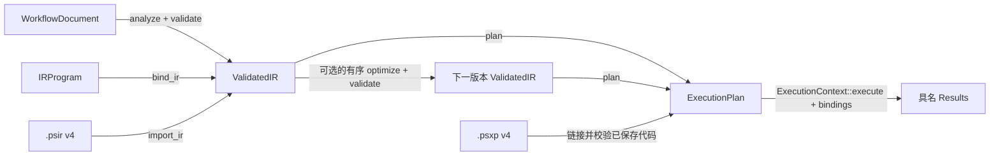
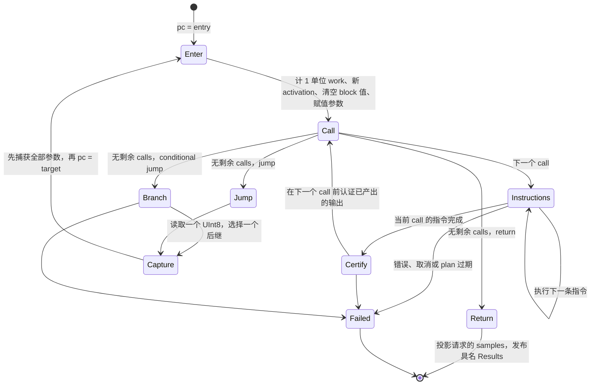

# Compiler 与本地执行

## 范围与 ownership

Frontend、optimizer 与 planner registry 具有稳定的对象身份，禁止复制、移动和赋值。通过 `shared_ptr` 共享冻结 registry；需要其他 catalog 时，创建独立 registry 并显式注册定义。

流水线由 DAG 前端、校验、可选 IR 变换、物理规划与本地执行组成。所有合法 IR 版本统一使用 `ValidatedIR`，不可变 Plan 使用 `ExecutionPlan`，每个 Run 持有可变状态。Package 0.38.0 保持 OperationTraits 29 和 Result ABI 7。`Compiler` 持有冻结的算子、前端、优化器和 planner registry。`ExecutionContext` 持有 worker pool、原生 backend、cache，以及 Run 和结果共享的 Root。`maximum_live_bytes` 在 managed resource 限制之外进一步限制 Payload。

`WorkflowInputDeclaration` 保存 id、精确 name 和必需的 Result schema。`ExecutionBinding` 保存 name 和 owning `ResultRef`。Tensor 是 Result storage 和 codecs 使用的 typed backing。`OperationMetadata` 只携带完整 Result schema；metadata specialization 是根据输入 schema 和静态参数对输出 schema 做的结构推导。Tensor shape 和 layout 属于 `ResultTensorSpec`。端口在结构谓词匹配时即可连接；compiler 不比较领域标签，因此结构相同但预期含义不同的 Result 可以连接到同一个端口。

每个算子的静态 preparation 列出所需的 `ResourceIdentity`。`analyze`、`bind_ir` 和 artifact 导入函数从调用方的 `ResourceSet` 中精确选择这些条目，缺失时失败，并在之后每个阶段保留所选 owner。Semantic identity 覆盖 declarations、operation keys、有序输入、静态参数、operation traits（包括绑定的校验器与声明的诊断 identity）、所选资源 identity、输出 schema、程序形式及其有序 blocks 和 terminators。地址、回调指针和诊断内容不参与。

## Compiler 阶段



`Compiler::compile(context, options, resources, optimizers = {}, frontend = "dag")` 分析图，只执行指定的有序优化调用，再规划最后一份 IR。默认不调用 optimizer。`CompiledWorkflow` 保留有序 `IRRevision` 和可选 Plan。`analyze`、`bind_ir`、`optimize`、`plan` 仍是独立公共库入口。CLI 还提供 IR 终点、快照和释放，见 [psc/psx](../../development/zh/Compiler-Tools.zh.md)。

- **前端：** `analyze` 按名称查找注册前端。默认 `dag@1` 按输出名称排序，按输入端口顺序 DFS，然后按 ID 保留剩余根。生成 `DependencyPaths`，保留共享 Call ID 的重复引用。上限为 65536 calls/blocks、1048576 references；schema-7 DAG 最多 4096 inputs/outputs。发布前拒绝环。
- **校验：** `bind_ir` 校验 SSA、支配关系、schema、资源和控制流，绑定静态算子契约，从可编辑 `IRProgram` 发布不可变 `ValidatedIR`。Registry 和源当前性约束继续有效。
- **可选变换：** `OptimizerRegistry` 按名称查找，有序 invocation vector 保留顺序与重复。变换读取不可变 IR、返回新程序，校验后发布；非法输出返回 `Internal`。生产者/版本/选项和父内容 identity 是来源信息，不参与内容 digest。No-op 可以保持相同 identity。默认 `optimize@1` 保留依赖路径去重，作为可选示例。
- **规划：** `plan` 接受两种合法 IR 形式。在私有副本中保留每个 Call ID 的首次请求，删除空链、把 DependencyPaths 重连为 CFG，然后静态展开 tile。它不分发 optimizer。CFG 输入保留分支和循环，不跨循环激活合并。原 IR 不变。
- **执行：** VM 根据 bindings 执行已保存物理指令，不运行 optimizer 或 mapper。

对于 `B(A), C(A), D(B,C), E(D), G(B), F(G,E)`，原始链为 `ABG / AB / AC / DE / F`。示例 optimizer 和 planner 私有 lowering 都得到 `ABG / C / DE / F`。重复 A/B 引用表示同一次调用，包括副作用；不同 Call ID 保持不同调用。直接规划时原路径仍可见。Plan 的父 identity 始终是实际输入 IR identity。

## 前端注册

```cpp
// The caller implements lowering with public IRProgram types.
ps::Result<ps::IRProgram> lower_source(const ps::WorkflowDocument&,
                                      const ps::OperationRegistry&);
auto frontends = std::make_shared<ps::FrontendRegistry>();
auto registration = frontends->add({"custom", "1", "Custom document lowering", lower_source});
if (!registration.ok()) return registration;
frontends->freeze();
ps::Compiler compiler(operations, {}, {}, frontends);
auto ir = compiler.analyze(graph.snapshot(), resources, "custom");
// The complete pipeline accepts the same frontend name as its final argument.
auto compiled = compiler.compile(graph, {}, resources, {}, "custom");
```

`FrontendDefinition` 包含名称、版本、说明和 lowering 回调。当前类型化源码契约为 `WorkflowDocument`，来自一致的 `GraphSnapshot`；回调还接收编译器冻结的算子 registry，并返回独立可编辑的 `IRProgram`。随后编译器通过 `bind_ir` 绑定算子契约与调用方资源、校验结果，并附加 snapshot 的 revision/currentness，以及注册名称和版本来源信息。来源信息与 IR 内容 identity 独立。Lowering 实现负责保持源码语义；结构绑定本身不能证明翻译等价性。

`FrontendRegistry` 保留注册顺序，拒绝空名称、重复名称、超过 1024 字节的名称、空版本、超过 128 字节的版本、缺失回调和冻结后的注册。共享前完成注册和冻结；回调必须支持相互独立的并发调用，不保留借用参数，不调用运行期算子回调。编译器保留注入的冻结 registry。`Compiler::frontends()` 返回该目录，或惰性创建仅含 `dag@1` 的默认目录。其实现位于 `src/lib/compiler/frontend/DAG/dag.cpp`，调用组织与目录管理分别位于 `frontend.cpp` 和 `frontend_registry.cpp`。

未知前端名称返回 `NotFound`。默认、已替换或过期 snapshot 返回 `Stale`，lowering 完成后及成功发布前再次检查当前性。回调主动返回的失败和绑定校验失败保留原错误码，并附加前端名称与版本诊断；源码不预设为合法。回调抛出的异常返回 `Internal`，分配失败返回 `ResourceExhausted`。失败不发布部分合法 IR。直接 `bind_ir` 和 artifact 导入均不调用注册前端；IR 导入保留保存的来源信息。

`psc` 对 DAG JSON 输入使用 `dag@1`，对 PSIR 直接导入，保持现有输入识别行为。前端选择和查询仅提供库接口。其他源码表示需要单独的类型化输入契约。当前只附带 DAG 前端。

## IR 数据模型

```cpp
namespace ps {
using IRValueId = std::uint64_t;  // zero is never valid
using IRBlockId = std::uint64_t;
using IRCallId = std::uint64_t;
enum class IRForm { ControlFlow, DependencyPaths };

struct SemanticNode {             // one static operation call
  IRCallId id;
  std::string operation;
  std::vector<IRValueId> inputs;
  std::map<std::string, ParameterValue> parameters;
  OperationTraits traits;                          // rebound by bind_ir
  std::shared_ptr<const PreparedOperation> prepared;  // rebound by bind_ir
  std::vector<SemanticOutput> outputs;             // {key, result_schema, value}
};
struct IREdge { IRBlockId target; std::vector<IRValueId> arguments; };
struct IRJump { IREdge edge; };
struct IRConditionalJump { IRValueId condition; IREdge if_true; IREdge if_false; };
struct IRReturn { std::vector<IRValueId> values; };
using IRTerminator = std::variant<IRJump, IRConditionalJump, IRReturn>;

struct IRBlock {
  IRBlockId id;
  std::vector<IRBlockParameter> parameters;  // {value, result_schema}
  std::vector<IRCallId> calls;               // requests or call sites, by form
  IRTerminator terminator;
};
struct IRProgram {
  std::vector<WorkflowInputDeclaration> input_declarations;
  std::vector<IRInputBinding> input_bindings;  // {declaration_id, value}
  std::vector<SemanticNode> calls;             // metadata order only
  std::vector<IRBlock> blocks;
  IRBlockId entry;
  std::vector<IRReturnDeclaration> returns;    // ordered result signature
  IRForm form = IRForm::ControlFlow;
};
}  // namespace ps
```

`IRProgram::calls` 保存唯一调用声明。DependencyPaths block 列表可重复同一个 Call ID；ControlFlow 每个 call 有一个静态调用位置。`ValidatedIR::form()` 标识解释方式，`program()` 返回独立可编辑副本。Pass 可以修改 builder 后重新校验；程序形式不代表是否经过 optimizer。

只有以下条件全部成立时，`bind_ir` 才接受程序：

- Call 声明、SSA 定义和 block 标识符非零，并在各自命名空间内唯一。每个 call 至少有一个引用位置，每个输入声明恰好有一个 binding。`ControlFlow` 要求每个 call 恰好有一个调用位置；`DependencyPaths` 允许对同一声明重复请求。
- `DependencyPaths` 要求非空、无参数的 blocks 按存储顺序排列。首个 block 为 entry，中间每个 terminator 都以无参数 jump 指向下一个 block，最后一个 terminator 为 return。一个 call 的首次请求位置是其输出的定义位置，全部使用都必须被定义支配。绑定接受合法的手写路径，不要求它们复现 `analyze()` 的完整树展开。
- Entry block 存在且没有参数。每个 block 都能从 entry 到达，每条边指向已存在的 block，且参数个数匹配。
- 每个 SSA 使用都被其定义支配：同一 block 中更早的 call、支配当前位置的 block、block 参数或外部输入。经过循环递归的值必须通过 block 参数传递；直接或经由其他 call 消费自身结果的 call 会绑定失败。
- 边参数 schema 与目标参数 schema 完全相等。每个 return 提供完整签名，每个 return schema 与声明一致。Block 参数必须带有已验证的 schema，循环回边也是如此。
- 分支条件是恰好含一个 tensor、该 tensor 只有一个 `UInt8` sample 的 Result。零选择 `if_false`，其他任何字节选择 `if_true`。其他形状和隐式真值判断返回 `TypeMismatch`。
- 满足数量上限：call 声明、blocks 以及每个 block 的 call 引用各最多 65,536 个；call 引用总计最多 1,048,576 次；输入声明、returns 以及每个 block 的参数各最多 4,096 个；每个 call 的输入和参数各最多 1,024 个。

Shape 和 tile grid 在编译期固定。循环或分支选择运行哪些固定形状的 call，不会产生形状依赖运行时数据的 tensor。

## 物理 plan

```cpp
namespace ps {
struct PlanningOptions {
  ExecutionMode execution_mode = ExecutionMode::CpuExact;  // or NativeGpu
  std::map<std::string, TileRequest> output_requests;      // omitted name = all tiles
  std::uint64_t tile_extent = 128;            // positive power of two
  std::uint64_t maximum_instructions = 4194304;
  std::uint64_t maximum_dependency_edges = 16777216;
  std::string planner = "static-tiles";
};
struct PlanTensorRead {      // fixed read capability
  std::uint32_t input, tensor_slot;
  bool descriptor_only;      // schema facts only, no payload
  TileSet tiles;
  Footprint samples;         // union of the complete tiles
};
struct PlanSharedRead { std::uint32_t stage; TileRequest tiles; std::vector<Footprint> samples; };
struct PlanTileInstruction {
  std::size_t step_index;
  std::uint32_t shared_stage = UINT32_MAX;  // UINT32_MAX: public output tile
  std::uint32_t tensor_slot;
  TileIndex tile_unit;
  bool cpu_fallback;                        // compiled CPU retry
  std::optional<Footprint> tensor_outputs;
  TileRequest publication;
  std::vector<Footprint> publication_samples;
  std::vector<PlanTensorRead> inputs;
  std::vector<PlanSharedRead> shared_inputs;
  std::vector<std::size_t> dependencies;    // earlier instructions in this block
};
struct PlanBlock {
  IRBlockId id;
  std::vector<std::size_t> parameters, calls;
  std::vector<PlanTileInstruction> instructions;
  PlanTerminator terminator;   // PlanJump, PlanConditionalJump, PlanReturn
};
struct PlanOutput {
  std::string name;
  std::shared_ptr<const SchemaTemplate> result_schema;
  std::vector<TileGrid> tile_grids;
  std::vector<Footprint> requested_samples;
  std::size_t record_index;    // steps().size() + return ordinal
};
}  // namespace ps
```

`PlanningOptions::planner` 指定编译器冻结的 `PlannerRegistry` 中的定义名称。默认目录注册 `static-tiles@1`。调用方可通过 `Compiler` 构造函数第三个参数注入自己的冻结目录；`Compiler::planners()` 提供只读查询。注册保留顺序，拒绝空名称、重复名称、超过 1024 字节的名称、空版本、超过 128 字节的版本、缺失回调，以及空的、非法或重复的支持 IR 形式。注册和冻结应在共享前完成；回调必须支持相互独立的并发调用。

```cpp
// The caller supplies emit_tiles with this callback signature.
ps::Status emit_tiles(const ps::ValidatedIR&, ps::PlanBuilder&,
                      const ps::PlanningOptions&);
auto planners = std::make_shared<ps::PlannerRegistry>();
auto registration = planners->add({"custom", "1", "Custom tile schedule", emit_tiles});
if (!registration.ok()) return registration;
planners->freeze();
ps::Compiler compiler(operations, {}, planners);  // frozen operation registry
ps::PlanningOptions options;
options.planner = "custom";
auto result = compiler.plan(ir, options);        // existing validated IR
```

编译器先检查源当前性和算子 registry 归属，查找名称、检查支持的输入 IR 形式，再链接私有的 Plan 基础数据。链接固定 lowering 后的 CFG、block 参数、call/output 声明、schema、prepared operation、CPU/GPU placement 和归一化输出请求。回调接收原始不可变 IR，以及提供这些基础数据只读访问的 `PlanBuilder`。`instructions(block_index)` 是唯一可修改的程序接口，初始为空。调用方不能复制或构造 builder；借用引用的有效期限定为本次回调。内置静态 planner 使用相同的公共接口。

回调成功后，编译器检查当前性、生成指令总数和保存的依赖边总数是否符合调用方限制，随后校验指令地址、发布覆盖、输入授权、依赖、call 顺序、请求根和 mandatory effect。通过后才计算物理 identity 和 cache template 并发布 `ExecutionPlan`。非法生成代码或回调异常返回 `Internal`；回调分配失败或输出预算超限返回 `ResourceExhausted`。回调主动返回的失败保留错误码，并附加 planner 名称与版本诊断。未知名称返回 `NotFound`，不支持的形式返回 `InvalidArgument`，其他 registry 的 IR 或过期 IR 返回 `Stale`。失败不发布部分 Plan。

结构校验不能证明 mapper 语义或 CPU fallback 等价性。受信任的 planner 实现必须保持这些性质，只调用纯静态 hook，并自行限制中间工作量和分配。编译器最后的指令与依赖边检查不限制回调内存使用。静态 planner 在生成代码时另行限制展开的依赖。规划不接收运行绑定，不调用执行回调。Plan artifact 保存生成的指令；加载、缩小覆盖和执行均不需要 planner registry 或回调。Planner 名称与版本用于诊断，不进入序列化 Plan 或物理 digest。独立的 `execution_mode` 选择 placement。

`ExecutionPlan::steps()` 是物理 call 输出的完整表：每个 call 结果对应一个 `PlanStep`，记录其算子、输入、backend、固定 schema、成员网格和已准备的共享 stage。Step 是声明。可执行内容在 `blocks()[i].instructions` 中，一个 step 可以没有任何指令，例如未选中的 sibling 输出或未使用的纯 call。因此 step 数量不是执行次数。

Planner 对每个 block 按以下顺序展开 root：分支条件（全部 tile）、每个边参数（全部 tile），以及按归一化后的 `output_requests` 条目限定的每个具名 return。随后加入每个非 side-effect-free 的 call 和每个 mandatory 共享 stage。对每个 root tile，planner 以 `ResultStaticQuery` 调用一次算子的静态 mapper，按 producer 的网格解析返回的读取，并在构建消费者之前递归构建 producer tile。键 `(step, shared stage, member, tile)` 对单元去重，因此被多个消费者共享的 tile 只生成一次。在每个 block 内，稳定排序恢复 IR call 顺序，同时保持每个 call 的 tile 依赖顺序。

共享 stage 单元归一化到该 call 的首个输出 step，使同一调用的不同输出可以共享相同的 stage 指令。这里的去重记录编译期间已经安排的单元；运行时缓存状态单独处理。Planner 在消费者之前构建所需依赖，并在展开时抑制重复单元。它不会先生成每个 call 的全部 tile 再删除重复任务，也不会把一个源 tile 沿全部下游 calls 流水执行到最终输出。可选 optimizer 可以消除原始路径的重复请求；仍存在重复时，planner 在私有副本中完成必要 lowering。Tile 需求选择和单元去重属于规划。

`complete_input_dependencies` 只覆盖选定的普通输入。每个共享 stage 读取都需要显式的 `ResultStaticMapping::shared_stages` 条目；仅声明 `OperationSharedStage` 不会增加读取边。Stage 之间的依赖和 tile 依赖环在规划期间解析。运行时 `ResultProgramNeed` 检查无法增加边或改变固定授权。

认证闭包被编译进读取。读取 `CompleteBundle` scope 覆盖的成员会变为读取整个 bundle；`StablePrefix` 读取延伸到前缀末端；producer 带有完整覆盖校验器时，任何非空读取都依赖该 producer 的全部 tile。消费者带有完整覆盖输入校验器时，会获得该输入的全部 tile。

`tile_extent` 必须是正的 2 的幂。指令数超过 `maximum_instructions` 或依赖边数超过 `maximum_dependency_edges` 时，planner 在发布前返回 `ResourceExhausted`，并对每个中间 tile 集合施加静态集合与工作量上限。极大的逻辑 tensor 可以通过原子 cell、仿射广播，或在调用 `plan` 时给出稀疏的 `output_requests` 选择来保持可规划；事后过滤一个已完全展开的 plan 不会降低规划代价。

`ExecutionPlan::select_outputs(requests)` 和 `tile_plan(name, request)` 只过滤已编译指令。请求必须是父 plan 归一化请求的子集；`select_outputs` 中未列出的名字不会返回。这与 `PlanningOptions::output_requests` 不同，后者未列出的名字表示全部 tile。过滤保留 CFG、每个 block 上的每个条件和边参数、有副作用的 call 和 mandatory stage，因此空选择会省略纯输出计算，但实际执行路径上的控制与 mandatory effect 仍会运行。过滤期间不运行任何 mapper、preparation 或 optimizer 回调。

`ExecutionPlan::output(name).record_index` 是具名 return 的依赖记录索引，等于 `steps().size()` 加 return 序号，output ordinal 为 0。`outputs().at(name)` 是 return 签名索引，不是 step 索引。

## 静态 VM 执行



一个 Run 同一时刻只执行一条 plan 指令。每次进入 block 时，coordinator 计入一单位 Run work，推进 activation 计数，清空该 block 的 call 值和共享 stage 状态，并把传入参数赋给 block 参数。每次 activation 都清空值，避免循环读取上一轮的结果。空循环在每次进入时同样计入 work 并观察取消，因此 `ExecutionOptions::maximum_dependency_work` 会以 `ResourceExhausted` 终止它。

对每条指令，coordinator 绑定预编译授权，检查每个被授权的输入 sample 都已认证，可选地复用缓存结果，必要时启动 continuation 并 poll。返回 `ResultProgramNeed` 的 poll 只按该指令的固定授权检查：检查会计入 work，任何超出授权的请求都以 protocol 错误失败，但不会启动 producer、收窄授权，也不会把 descriptor-only 授权变成 payload 访问。返回 `ResultPublication` 的 poll 经验证后作为该 tile 的结果保存。因此 `to_whole` 等 helper 可能在第一次 poll 就就绪；消费者不能假定第一次结果一定是 Need。

一个 call 的全部指令完成后，包括其多个输出和共享 stages 的指令，coordinator 组装并认证该 call 中每个已产出 tile 的输出。这项检查在同一 block 的下一个 call 开始前完成，下一个 call 只读取描述信息或具有副作用时也如此。因此，上游输出失败会在后续 calls 开始前终止执行。共享 stage 的发布验证仍在每次 stage 提交时执行。没有产出输出 tile 的 call 无需进行输出组装认证。

Block 中的 calls 完成后，conditional jump 读取条件 sample，只执行所选后继；两条分支都不会投机执行。边在修改任何目标参数之前先捕获每个参数值及其依赖证据，因此交换和自环都看到一致的来源。Return 把每个具名输出投影到其请求的 samples，记录 synthetic return 证据，计算可选 result digest，并发布 Results。共享 stage 状态持续到下一次 block activation；把 calls 合并到一条 chain 可能延长该生命周期，本身不保证降低内存用量。

Coordinator 每次计入 work 时都检查取消、plan 有效性、observer 失败和宿主 stop 信号：进入 block 时、每条指令处，以及算子 work 回调内部。它不会抢占进程内 callback。Callback 进入后，Run 等它退出再释放借用 phase 和 owners。失败的 Run 不返回部分输出集合。指令失败时携带产出 call 的 `node_id`；输入校验器失败保留外部 `input_id`（错误为 `InvalidArgument`）或上游 `node_id`（错误为 `OperationFailed`），使非法调用方数据与非法算子输出保持可区分。

`FrozenExecution` 共享包含 plan、binding snapshot、operation registry 和 execution identity 的不可变状态。只要 handle 仍持有该状态，`plan()` 返回的借用引用就有效。`ExecutionContext::execute_fragments` 先对请求子集调用 `select_outputs`，再运行过滤后的程序；它从不调用 mapper。`DemandHandle` 请求会以当前 generation 捕获 frozen plan；replacement 推进 generation，旧请求仍保留原 plan 和输入 owners。`replace_bindings` 在持有 handle mutex 时复制 frozen bundle 的 owning Root，建立其 Root allocation scope 后再获取 call lease。

## Compiler 产物

`CompilerArtifact::export_ir/import_ir` 保存和读取统一的 `ValidatedIR`，`export_plan/import_plan` 处理 `ExecutionPlan`。两种文本格式都是 v4；v1–v3 拒绝并提示重新导出。IR 依次保存 `psir 4`、`stage ir`、parent、producer/version、类型化 options，以及 manifest 和含显式 form 的程序声明。DependencyPaths 和 ControlFlow 均原样往返。导入成为新驱动会话的 IR0，并保留来源；来源不参与内容 identity。

Plan 以 `psxp 4` 开头，parent 是实际输入 IR identity。它保存私有 lowering 的 CFG、完整物理指令、授权、依赖、输出选择、backend 和 fallback。Plan 导入直接接收冻结的算子 registry，链接契约/资源、恢复并校验指令；保存程序不是 ControlFlow 时拒绝。此路径不运行前端、optimizer、mapper、tile 展开或后端选择。派生网格与纯静态 preparation 会重建；保存的 CFG 可以不同于父 IR 的原始形式。

算子 manifest digest 描述契约，不认证 callback 代码。资源使用 SHA-256 和字节长度，导入需要调用方提供匹配字节。不保存 DSO 路径、原生指针、cache 或 Run 状态。缺少契约/资源返回 `NotFound`，契约变化返回 `TypeMismatch`，IR/Plan identity 重新计算。文本上限 64 MiB，语法错误包含行列。类型化参数保留 binary64 位，包括算子 schema 允许的负零和非有限 payload。

导入阶段具有本地 revision 1，依赖仍存活的冻结 registry，不依赖旧 GraphContext。源绑定阶段仍受 graph 当前性约束；过期或默认对象导出返回 `Stale`。库 `save_*` 先编码后打开文件，但不是原子写入，I/O 失败可留下部分文本。CLI 使用字节 codec 和自己的原子发布策略。参见[文件格式](../../development/zh/Compiler-Tool-Formats.zh.md)与[CLI 发布](../../development/zh/Compiler-Tools.zh.md)。

```cpp
ps::Compiler compiler(registry);  // frozen registry
auto ir = compiler.analyze(graph.snapshot(), resources);
if (!ir.ok()) return ir.status();
auto plan = compiler.plan(ir.value());  // zero optimizer calls
if (!plan.ok()) return plan.status();
auto text = ps::CompilerArtifact::export_plan(plan.value());
if (!text.ok()) return text.status();
auto restored = ps::CompilerArtifact::import_plan(registry, text.value(), resources);
if (!restored.ok()) return restored.status();
auto result = execution.execute(restored.value(), bindings);
```

## 算子回调与错误

`ResultContinuation` 以非阻塞 atomic admission 保证同一时刻只执行一个 poll。并发或重入 poll 返回带 `Protocol/Group` detail 的 `InvalidArgument`，不会进入 callback，也不会修改活动 phase、首个 failure 或 work accounting。调用方必须在 continuation 存活且处于 inactive 时才移动或销毁它；state 只销毁一次。`OperationRegistry::start_result` 在 operation factory 前后检查取消；factory 已进入后观察到的取消优先于 allocator failure、factory status 和无效返回 state。VM 对每条指令的 poll 次数以 `DependencyLimits::maximum_stages` 与输出 `maximum_dependency_stages` 中较小者为上限。

普通 CPU callback 在 context CPU pool 上运行并使用 range 服务；GPU callback 在 native lane 上运行。Worker callback 不获得 coordinator 服务，禁止嵌套并行提交。Native submission 在 callback 退役前排空。Kernel guard 保存/恢复浮点状态，算子在实际 callback 线程建立所需模式。

声明 `OperationTraits::cpu_staged_tiles` 的算子在 coordinator 上运行其 poll，并使用 planar staged tile 服务。`image.stmap` 对至少 65,536 像素的请求这样做：coordinator 准备有界的输出像素 span，提交一个几何只取决于 span 数的 tile stage，并在发布提交前 join 所有 tile。`ExecutionOptions::maximum_parallelism` 限制该 tile 服务的 worker 数；为零时使用 CPU pool 的 worker 数。Tile callback 只获得不可变输入和互不相交的原始输出 run。见[依赖采样](Dependency-Sampling.zh.md#发布与并行算术)和[并行执行模型](Parallel-Execution-Model.zh.md#planar-staged-tile-service)。

GPU 到 CPU 的回退在编译期确定。当某个 step 放置在 GPU，且其 traits 声明 `allows_cpu_fallback`、CPU 支持、确定性和无副作用时，planner 以 CPU backend 再调用一次 mapper，并且只有当 CPU 读取落在 GPU 授权之内（包括完整校验覆盖）时才设置 `PlanTileInstruction::cpu_fallback`。合法 CPU 映射若超出已保存授权，则关闭 fallback 并保留其余条件合法的 GPU Plan；mapper 返回非法映射仍属于规划错误。带共享 stage 读取的指令不获得编译期回退；该路径需要显式 IR 控制流。运行时，GPU start 或 poll 以未限定的 `BackendUnavailable`（`reason=None`，origin 为未指定或 backend，scope 为未指定或 group）失败后，只有当该 attempt 未发布任何内容、未进行输入读取、native dispatch、checkpoint、block 或 GPU selection，且没有 protocol、observer、resource、取消或 stop 失败否决时，才使用相同授权在 CPU 上重试。被拒绝的 GPU attempt 保留其计时记录，CPU attempt 使用新的 failure owner 启动，重试得到的结果不进入 completed-result、checkpoint 和 block 复用。

## 存储、资源与诊断

Result 拥有静态 schema、descriptor coverage、数值 backing 和 ObjectId。Run 为每条已执行指令保存一个 tile，并在首次使用时由这些 tile 组装 call 的 Result。依赖记录和冻结 TileEvidence 属于 Run 与可选缓存结构；每个 Run 都从固定授权重建证据。Root 计费元数据、payload、work 和保留 backing；返回 Result 与窗口在 context 退役后继续保留租约。所选算子资源由 preparation、plan 和 execution 持有，不附着到 Result。

`ExecutionDiagnostics::operation_timings` 为每次 poll 和每次失败的 start 保存一条原始 `OperationTiming`；成功的 start 没有单独记录。记录带有 `shared_stage`、实际 backend 和结果，消费者按 output、backend 和 stage 汇总。`OperationTiming::reports` 持有有界算子报告的 owning `DiagnosticAccumulator`。静态 VM 的 `peak_active_tasks` 为 1。`peak_live_bytes` 表示 Run 归属的受控 Payload backing 已提交容量峰值；`planned_peak_bytes` 表示预留 Payload capacity 峰值。这些计数描述 Root 控制的 backing，不代表进程 RSS。`ExecutionContext::cache_statistics()` 返回同步的 context-local 缓存观察值；复用不会为未运行的工作产生计时记录。

## 公共接口与版本边界

| 版本轴 | 当前值 |
| --- | --- |
| Package / SOVERSION | 0.38.0 / 0.38 |
| `OperationTraits::version` | 29 |
| C Result operation ABI | 7（`ps_result_operation_plugin_get_api_v7`） |
| WorkflowDocument schema | 7 |
| `.psir` / `.psxp` 文本格式 | 4 |
| IR identity domain | `validated-ssa-ir-v26` |
| Example optimizer | `optimize@1` (provenance only) |
| Physical plan identity domain | `static-tile-program-v27` |
| Plan cache key domain | `plan-cache-key-v20` |
| Saved operation contract domain | `artifact-static-operation-contract-v2` |
| Result schema canonical tag | `photospider.result-schema.v6` |

这些版本轴彼此独立。CPU parallel 与 tiles 服务为版本 2，native GPU 服务为版本 1。`TileGrid::from_schema` 返回 `Result<TileGrid>`，`OperationRegistry::prepare_operation` 解析静态算子契约。IR 和 Plan digest 包含程序标识符，因此即使计算相同，重新编号 call 或 value 也会改变这些 digest。

公共 C++ IR 和 `PlanningOptions` 对象布局要求头文件与库匹配；任一布局发生变化时，消费者必须重新构建。WorkflowDocument schema 7 与 C Result operation ABI 7 保持独立的版本轴。

## 限制与非目标

- 内核只附带 WorkflowDocument DAG 前端。Python 或文本语言前端、机器码 backend、JIT 编译以及根据产物自动查找算子库都不存在；`bind_ir` 和 `.psir` 导入是这类前端将来使用的入口。
- 当前优化消除重复的依赖路径请求并移除空 chain，保留每个唯一 call，并保持显式 ControlFlow 输入不变。它不会按相同算子或参数合并不同 calls、移除未使用的 call 声明或融合算子。
- Tensor shape、schema 和 tile grid 在编译期固定。控制流在固定形状的 call 之间选择，不提供动态 shape。
- 一个 Run 同一时刻只执行一条 plan 指令，没有 ready queue、producer task 或 work stealing。并行来自并发的 Runs，以及单个算子回调内部的 CPU range、CPU tile 和 GPU 工作；见[并行执行模型](Parallel-Execution-Model.zh.md)。
- 产物 digest 是可复现辅助，不是签名。Native operation module 作为受信任的进程内代码执行；ABI 校验不提供沙箱。Kernel 不拥有 daemon IPC、durable jobs、process isolation 或 recovery。已注册的 production image operation 只有在实现所需 typed Result contract 后，才能使用统一 Result image 路径；详见[图像 operations](Image-Operations.zh.md)。
- `CpuExact` 只在 planner 实际为 GPU-only call 或 GPU 共享 stage 生成指令时才拒绝它；没有任何 root 到达的 GPU-only call 不产生指令，也不报错。
