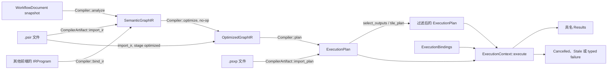
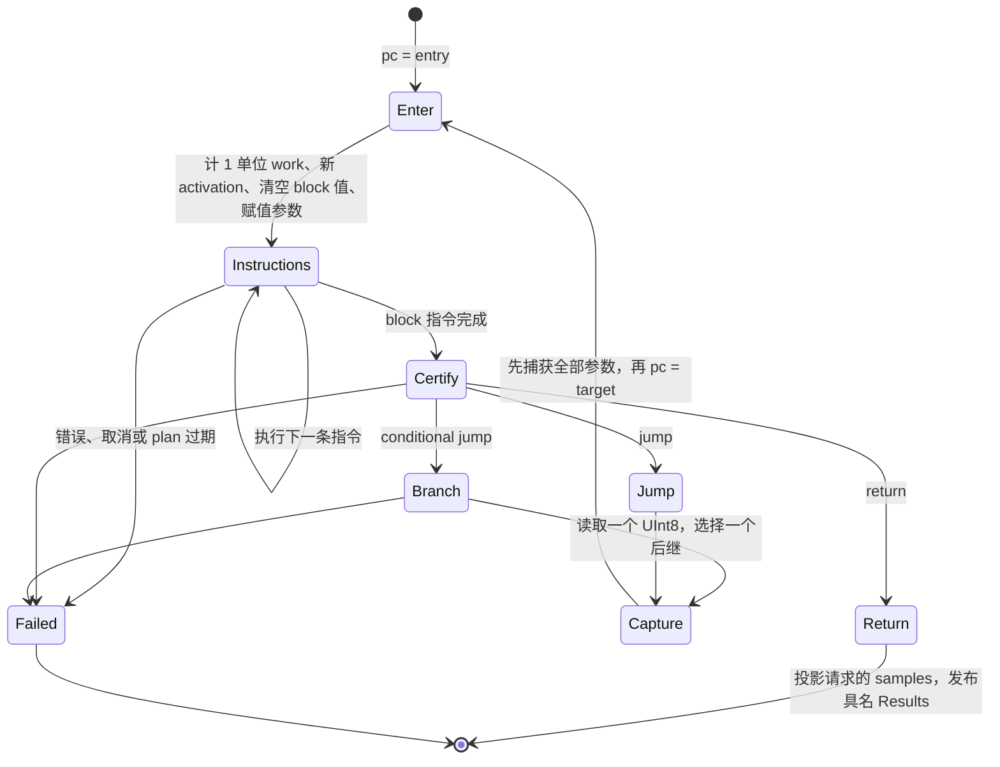

# Compiler 与本地执行

## 范围与 ownership

可分别调用的流水线包含五个阶段：DAG 前端、`SemanticGraphIR`、`OptimizedGraphIR`、`ExecutionPlan`，以及通过 `ExecutionContext` 执行。Semantic IR、optimized IR 和 plan 是不可变的编译值；每个 Run 拥有可变执行状态。当前 package 为 0.37.0，OperationTraits version 为 29。`Compiler` 在整个生命周期内借用一个已冻结的 `OperationRegistry`；registry 为空或仍可变时，构造函数抛出 `std::invalid_argument`。`ExecutionContext` 拥有有界 CPU pool、可选 native backend lane、caches，以及由 Runs 和仍存活 owners 共享的 resource root。未设置 `managed_resources` 时，context 使用默认 `ResourceLimits`；设置后使用显式 limits。`maximum_live_bytes` 也限制 Payload。

`WorkflowInputDeclaration` 保存 id、精确 name 和必需的 Result schema。`ExecutionBinding` 保存 name 和 owning `ResultRef`。Tensor 是 Result storage 和 codecs 使用的 typed backing。`OperationMetadata` 只携带完整 Result schema；metadata specialization 是根据输入 schema 和静态参数对输出 schema 做的结构推导。Tensor shape 和 layout 属于 `ResultTensorSpec`。端口在结构谓词匹配时即可连接；compiler 不比较领域标签，因此结构相同但预期含义不同的 Result 可以连接到同一个端口。

每个算子的静态 preparation 列出所需的 `ResourceIdentity`。`analyze`、`bind_ir` 和 artifact 导入函数从调用方的 `ResourceSet` 中精确选择这些条目，缺失时失败，并在之后每个阶段保留所选 owner。Semantic identity 覆盖 declarations、operation keys、有序输入、静态参数、operation traits（包括绑定的校验器与声明的诊断 identity）、所选资源 identity、输出 schema 和控制流图。地址、回调指针和诊断内容不参与。

## Compiler 阶段



`Compiler::compile(context, options, resources)` 以“发布前失败”的单一流程依次运行 `analyze`、`optimize` 和 `plan`，返回三个阶段及原始阶段计时。每个阶段也可以单独调用，调用方可以保存、检查或替换任一中间对象。

- **DAG 前端。** `analyze(snapshot, resources)` 只接受当前有效的 schema-7 `WorkflowDocument`，最多 65,536 个节点、4,096 个输入和 1 到 4,096 个具名输出；其他版本（包括早期基于标签的 workflow）失败。前端按名称排序具名输出，从每个被返回的节点出发，按端口顺序沿输入做迭代深度优先遍历，然后按 id 顺序从其余每个节点出发继续遍历。因此每个前端 call 在 IR 中恰好出现一次，包括没有任何输出使用的 call；共享的上游 call 只保留一个定义。每个 call 自成一个 basic block，显式 jump 按遍历顺序把每个 block 连到下一个 block。最后一个 block 返回具名输出。存在环时返回 `Cycle`。
- **IR 绑定。** `bind_ir(program, resources)` 接受任意前端产生的 `IRProgram` 并返回 `SemanticGraphIR`。它与 `analyze` 使用同一个校验与准备流程。绑定忽略调用方提供的 traits 和 preparation，从 registry 重新绑定两者；每个 call 只准备一次。
- **Optimizer。** `optimize(semantic)` 原样复制每个 call、value、block 和 terminator，并计算独立的 optimized digest。这个阶段让以后的优化 pass 能改写 IR 而不改变 DAG 前端；前端降级不做语义裁剪。
- **Planner。** `plan(optimized, options)` 把每个可达结果展开为固定 tile 指令，把每条指令放到其 call 所在的 block，并在返回前验证整个程序。
- **执行。** `ExecutionContext::execute(plan, bindings, cancellation, options)` 按顺序解释 plan 的 blocks。它从不映射依赖、展开 tile 或重排指令。

## IR 数据模型

```cpp
namespace ps {
using IRValueId = std::uint64_t;  // zero is never valid
using IRBlockId = std::uint64_t;
using IRCallId = std::uint64_t;

struct SemanticNode {             // one static operation call
  IRCallId id;
  std::string operation;
  std::vector<IRValueId> inputs;
  std::map<std::string, ParameterValue> parameters;
  OperationTraits traits;                          // rebound by bind_ir
  std::shared_ptr<const PreparedOperation> prepared;  // rebound by bind_ir
  std::vector<SemanticOutput> outputs;             // {key, result_schema, value}
};
struct IREdge { IRBlockId target; std::vector<IRValueId> arguments; };
struct IRJump { IREdge edge; };
struct IRConditionalJump { IRValueId condition; IREdge if_true; IREdge if_false; };
struct IRReturn { std::vector<IRValueId> values; };
using IRTerminator = std::variant<IRJump, IRConditionalJump, IRReturn>;

struct IRBlock {
  IRBlockId id;
  std::vector<IRBlockParameter> parameters;  // {value, result_schema}
  std::vector<IRCallId> calls;               // execution order inside the block
  IRTerminator terminator;
};
struct IRProgram {
  std::vector<WorkflowInputDeclaration> input_declarations;
  std::vector<IRInputBinding> input_bindings;  // {declaration_id, value}
  std::vector<SemanticNode> calls;             // metadata order only
  std::vector<IRBlock> blocks;
  IRBlockId entry;
  std::vector<IRReturnDeclaration> returns;    // ordered result signature
};
}  // namespace ps
```

Block 的 `calls` 列表定义执行顺序；`IRProgram::calls` 的顺序只决定 metadata 准备顺序。`SemanticGraphIR::program()` 和 `OptimizedGraphIR::program()` 返回一份拥有所有权的可编辑副本，其他 pass 或前端可以修改后重新绑定。

只有以下条件全部成立时，`bind_ir` 才接受程序：

- Call、value 和 block 标识符非零，并在各自命名空间内唯一。每个 call 恰好属于一个 block，每个 declaration 恰好有一个 input binding。
- Entry block 存在且没有参数。每个 block 都能从 entry 到达，每条边指向已存在的 block，且参数个数匹配。
- 每个 SSA 使用都被其定义支配：同一 block 中更早的 call、支配当前位置的 block、block 参数或外部输入。经过循环递归的值必须通过 block 参数传递；直接或经由其他 call 消费自身结果的 call 会绑定失败。
- 边参数 schema 与目标参数 schema 完全相等。每个 return 提供完整签名，每个 return schema 与声明一致。Block 参数必须带有已验证的 schema，循环回边也是如此。
- 分支条件是恰好含一个 tensor、该 tensor 只有一个 `UInt8` sample 的 Result。零选择 `if_false`，其他任何字节选择 `if_true`。其他形状和隐式真值判断返回 `TypeMismatch`。
- 满足数量上限：最多 65,536 个 calls 和 blocks；declarations、returns 以及每个 block 的参数最多 4,096 个；每个 call 的输入和参数最多 1,024 个。

Shape 和 tile grid 在编译期固定。循环或分支选择运行哪些固定形状的 call，不会产生形状依赖运行时数据的 tensor。

## 物理 plan

```cpp
namespace ps {
struct PlanningOptions {
  ExecutionMode execution_mode = ExecutionMode::CpuExact;  // or NativeGpu
  std::map<std::string, TileRequest> output_requests;      // omitted name = all tiles
  std::uint64_t tile_extent = 128;            // positive power of two
  std::uint64_t maximum_instructions = 4194304;
  std::uint64_t maximum_dependency_edges = 16777216;
};
struct PlanTensorRead {      // fixed read capability
  std::uint32_t input, tensor_slot;
  bool descriptor_only;      // schema facts only, no payload
  TileSet tiles;
  Footprint samples;         // union of the complete tiles
};
struct PlanSharedRead { std::uint32_t stage; TileRequest tiles; std::vector<Footprint> samples; };
struct PlanTileInstruction {
  std::size_t step_index;
  std::uint32_t shared_stage = UINT32_MAX;  // UINT32_MAX: public output tile
  std::uint32_t tensor_slot;
  TileIndex tile_unit;
  bool cpu_fallback;                        // compiled CPU retry
  std::optional<Footprint> tensor_outputs;
  TileRequest publication;
  std::vector<Footprint> publication_samples;
  std::vector<PlanTensorRead> inputs;
  std::vector<PlanSharedRead> shared_inputs;
  std::vector<std::size_t> dependencies;    // earlier instructions in this block
};
struct PlanBlock {
  IRBlockId id;
  std::vector<std::size_t> parameters, calls;
  std::vector<PlanTileInstruction> instructions;
  PlanTerminator terminator;   // PlanJump, PlanConditionalJump, PlanReturn
};
struct PlanOutput {
  std::string name;
  std::shared_ptr<const SchemaTemplate> result_schema;
  std::vector<TileGrid> tile_grids;
  std::vector<Footprint> requested_samples;
  std::size_t record_index;    // steps().size() + return ordinal
};
}  // namespace ps
```

`ExecutionPlan::steps()` 是物理 call 输出的完整表：每个 call 结果对应一个 `PlanStep`，记录其算子、输入、backend、固定 schema、成员网格和已准备的共享 stage。Step 是声明。可执行内容在 `blocks()[i].instructions` 中，一个 step 可以没有任何指令，例如未选中的 sibling 输出或未使用的纯 call。因此 step 数量不是执行次数。

Planner 对每个 block 按以下顺序展开 root：分支条件（全部 tile）、每个边参数（全部 tile），以及按归一化后的 `output_requests` 条目限定的每个具名 return。随后加入每个非 side-effect-free 的 call 和每个 mandatory 共享 stage。对每个 root tile，planner 以 `ResultStaticQuery` 调用一次算子的静态 mapper，按 producer 的网格解析返回的读取，并在构建消费者之前递归构建 producer tile。键 `(step, shared stage, member, tile)` 对单元去重，因此被多个消费者共享的 tile 只生成一次。在每个 block 内，稳定排序恢复 IR call 顺序，同时保持每个 call 的 tile 依赖顺序。

认证闭包被编译进读取。读取 `CompleteBundle` scope 覆盖的成员会变为读取整个 bundle；`StablePrefix` 读取延伸到前缀末端；producer 带有完整覆盖校验器时，任何非空读取都依赖该 producer 的全部 tile。消费者带有完整覆盖输入校验器时，会获得该输入的全部 tile。

`tile_extent` 必须是正的 2 的幂。指令数超过 `maximum_instructions` 或依赖边数超过 `maximum_dependency_edges` 时，planner 在发布前返回 `ResourceExhausted`，并对每个中间 tile 集合施加静态集合与工作量上限。极大的逻辑 tensor 可以通过原子 cell、仿射广播，或在调用 `plan` 时给出稀疏的 `output_requests` 选择来保持可规划；事后过滤一个已完全展开的 plan 不会降低规划代价。

`ExecutionPlan::select_outputs(requests)` 和 `tile_plan(name, request)` 只过滤已编译指令。请求必须是父 plan 归一化请求的子集；`select_outputs` 中未列出的名字不会返回。这与 `PlanningOptions::output_requests` 不同，后者未列出的名字表示全部 tile。过滤保留 CFG、每个 block 上的每个条件和边参数、有副作用的 call 和 mandatory stage，因此空选择会省略纯输出计算，但实际执行路径上的控制与 mandatory effect 仍会运行。过滤期间不运行任何 mapper、preparation 或 optimizer 回调。

`ExecutionPlan::output(name).record_index` 是具名 return 的依赖记录索引，等于 `steps().size()` 加 return 序号，output ordinal 为 0。`outputs().at(name)` 是 return 签名索引，不是 step 索引。

## 静态 VM 执行



一个 Run 同一时刻只执行一条 plan 指令。每次进入 block 时，coordinator 计入一单位 Run work，推进 activation 计数，清空该 block 的 call 值和共享 stage 状态，并把传入参数赋给 block 参数。每次 activation 都清空值，避免循环读取上一轮的结果。空循环在每次进入时同样计入 work 并观察取消，因此 `ExecutionOptions::maximum_dependency_work` 会以 `ResourceExhausted` 终止它。

对每条指令，coordinator 绑定预编译授权，检查每个被授权的输入 sample 都已认证，可选地复用缓存结果，必要时启动 continuation 并 poll。返回 `ResultProgramNeed` 的 poll 只按该指令的固定授权检查：检查会计入 work，任何超出授权的请求都以 protocol 错误失败，但不会启动 producer、收窄授权，也不会把 descriptor-only 授权变成 payload 访问。返回 `ResultPublication` 的 poll 经验证后作为该 tile 的结果保存。因此 `to_whole` 等 helper 可能在第一次 poll 就就绪；消费者不能假定第一次结果一定是 Need。

一个 block 的全部指令完成后，coordinator 组装并认证在该 block 中产出 tile 的每个 call，包括无人读取的有副作用 call。Conditional jump 读取条件 sample，只执行所选后继；两条分支都不会投机执行。边在修改任何目标参数之前先捕获每个参数值及其依赖证据，因此交换和自环都看到一致的来源。Return 把每个具名输出投影到其请求的 samples，记录 synthetic return 证据，计算可选 result digest，并发布 Results。

Coordinator 每次计入 work 时都检查取消、plan 有效性、observer 失败和宿主 stop 信号：进入 block 时、每条指令处，以及算子 work 回调内部。它不会抢占进程内 callback。Callback 进入后，Run 等它退出再释放借用 phase 和 owners。失败的 Run 不返回部分输出集合。指令失败时携带产出 call 的 `node_id`；输入校验器失败保留外部 `input_id`（错误为 `InvalidArgument`）或上游 `node_id`（错误为 `OperationFailed`），使非法调用方数据与非法算子输出保持可区分。

`FrozenExecution` 共享包含 plan、binding snapshot、operation registry 和 execution identity 的不可变状态。只要 handle 仍持有该状态，`plan()` 返回的借用引用就有效。`ExecutionContext::execute_fragments` 先对请求子集调用 `select_outputs`，再运行过滤后的程序；它从不调用 mapper。`DemandHandle` 请求会以当前 generation 捕获 frozen plan；replacement 推进 generation，旧请求仍保留原 plan 和输入 owners。`replace_bindings` 在持有 handle mutex 时复制 frozen bundle 的 owning Root，建立其 Root allocation scope 后再获取 call lease。

## Compiler 产物

`CompilerArtifact` 以可编辑 UTF-8 文本保存阶段。`.psir` 保存语义或优化后的 IR 程序；`.psxp` 保存完整执行 plan。两者都使用文本格式版本 2；版本 1 文件被拒绝。

```cpp
namespace ps {
enum class ArtifactKind { SemanticIR, OptimizedIR, ExecutionPlan };
struct ArtifactOperation { std::string key; std::string contract_digest; };
struct ArtifactManifest {
  ArtifactKind kind;
  std::uint32_t format_version = 2;
  std::vector<ArtifactOperation> operations;
  std::vector<ResourceIdentity> resources;
};
using ImportedIR = std::variant<SemanticGraphIR, OptimizedGraphIR>;

class CompilerArtifact {
 public:
  static Result<std::string> export_ir(const SemanticGraphIR&);
  static Result<std::string> export_ir(const OptimizedGraphIR&);
  static Result<std::string> export_plan(const ExecutionPlan&);
  static Result<ArtifactManifest> inspect(std::string_view text);
  static Result<ImportedIR> import_ir(const Compiler&, std::string_view, ResourceSet = {});
  static Result<ExecutionPlan> import_plan(const Compiler&, std::string_view, ResourceSet = {});
  static Status save_ir(const SemanticGraphIR&, const std::string& path);
  static Status save_ir(const OptimizedGraphIR&, const std::string& path);
  static Status save_plan(const ExecutionPlan&, const std::string& path);
  static Result<ImportedIR> load_ir(const Compiler&, const std::string& path, ResourceSet = {});
  static Result<ExecutionPlan> load_plan(const Compiler&, const std::string& path, ResourceSet = {});
};
}  // namespace ps
```

两种格式都以 magic 与版本行（`psir 2` 或 `psxp 2`）和父阶段 digest 开头。`.psir` 文件随后记录 `stage semantic` 或 `stage optimized`、operation manifest、资源、输入声明与绑定、带有每 call 资源使用的 calls、return 签名、entry block 以及各 block。`.psxp` 文件另外记录执行模式与 `tile_extent`、每个 step 的 backend 放置、具名输出请求，以及包含每个 block 指令的 `code` 段：publication 目标、已发布 samples、固定的输入与共享授权、block 内依赖序号和 `cpu_fallback` 标记。Tile grids 不另存；导入时根据固定 schema 和 `tile_extent` 重建。

文本支持 `;` 行注释、转义字符串和显式类型参数（`i64`、`f64`、`f64_bits`、`bool`、`string`）。Writer 把有限正规 double 写成可往返的十进制，把 NaN、无穷和次正规值写成带十六位十六进制数字的 `f64_bits`。解析和写出使用 classic locale、默认浮点环境和 round-to-nearest，结果不依赖调用方的 locale 或舍入模式。

Manifest 列出每个 operation key 及其 contract digest，以及每个资源的 SHA-256 identity 和字节长度。Contract digest 标识注册的 traits 与 validator、report 引用，不标识也不认证 native callback 代码。文件不含库路径、可执行代码、原生指针、设备句柄、Run 状态、缓存内容或资源字节。

- `inspect(text)` 在没有 registry 的情况下解析整个文件并返回 manifest。宿主用它决定在导入前加载哪些算子库、提供哪些资源。
- `import_ir` 把 manifest 链接到 compiler 的冻结 registry；contract digest 不同时返回 `TypeMismatch`，缺少算子或资源时返回 `NotFound`，随后运行 `bind_ir`。优化后的产物保持为优化阶段，不运行优化。
- `import_plan` 执行相同链接，恢复声明、放置和指令 blocks，重建网格和静态 preparation，并运行完整 plan 验证：固定授权、输入 projection、成员与范围、publication 闭包、block 内依赖就绪顺序、IR call 顺序、CFG 和 backend 合法性。它不调用 mapper，不做 tile 展开，也不选择 backend。当前宿主无法执行的已存选择（例如 `CpuExact` plan 中的 GPU 放置）返回 `BackendUnavailable` 或 `InvalidArgument`。
- 导入时重新计算 digest。保存的父 digest 是 provenance，不是对文本的签名；编辑后的文件当且仅当通过绑定和验证时有效。

导入的阶段独立于任何 `GraphContext`。其 `revision()` 为 1，只要 registry 存活 `current()` 就保持 true。执行必须使用基于同一冻结 registry 实例构建的 `ExecutionContext`；对链接到其他 registry 的 plan，`execute`、`freeze` 和 `open_demand` 返回 `Stale`。直接从 DAG 编译得到的阶段保留其 snapshot 语义，源 `GraphContext` 被替换或销毁后变为 stale；保存的文件不携带源的活性。导出 stale 或默认构造的阶段返回 `Stale`。

文本和文件上限为 64 MiB。语法错误返回带行列信息的 `InvalidArgument`。`save_*` 在打开目标之前完成全部编码，编码失败时文件保持不变；写入本身不是原子 rename，I/O 失败可能留下部分文本，并返回带 Io/ShortIo detail 的 `OperationFailed`。`load_*` 对不可读路径返回 `NotFound`，并根据 magic 行而不是扩展名选择格式。

下面的片段展示一次完整往返。`registry` 是已冻结的 `std::shared_ptr<OperationRegistry>`，`graph` 是 `GraphContext`，`resources` 是静态 preparation 从中选择资源的 `ResourceSet`，`bindings` 是每次 Run 的 `ExecutionBindings`。

```cpp
ps::Status compile_save_and_run(std::shared_ptr<ps::OperationRegistry> registry,
                                const ps::GraphContext& graph,
                                const ps::ResourceSet& resources,
                                const ps::ExecutionBindings& bindings) {
  ps::Compiler compiler(registry);
  auto semantic = compiler.analyze(graph.snapshot(), resources);
  if (!semantic.ok())
    return semantic.status();
  auto optimized = compiler.optimize(semantic.value());
  if (!optimized.ok())
    return optimized.status();
  auto plan = compiler.plan(optimized.value(), ps::PlanningOptions{});
  if (!plan.ok())
    return plan.status();

  auto saved = ps::CompilerArtifact::save_ir(semantic.value(), "pipeline.psir");
  if (saved.ok())
    saved = ps::CompilerArtifact::save_ir(optimized.value(), "pipeline.opt.psir");
  if (saved.ok())
    saved = ps::CompilerArtifact::save_plan(plan.value(), "pipeline.psxp");
  if (!saved.ok())
    return saved;

  auto ir = ps::CompilerArtifact::load_ir(compiler, "pipeline.opt.psir", resources);
  if (!ir.ok())
    return ir.status();
  if (!std::holds_alternative<ps::OptimizedGraphIR>(ir.value()))
    return {ps::ErrorCode::TypeMismatch, "expected an optimized IR artifact"};

  auto loaded = ps::CompilerArtifact::load_plan(compiler, "pipeline.psxp", resources);
  if (!loaded.ok())
    return loaded.status();
  ps::ExecutionContext execution(registry);
  auto result = execution.execute(loaded.value(), bindings);
  if (!result.ok())
    return result.status();
  // result.value().results maps each named output to its ResultRef.
  return ps::Status::success();
}
```

`load_ir` 返回 `ImportedIR`；调用方对语义阶段继续调用 `optimize`，对优化阶段继续调用 `plan`。产物 API 没有命令行前端。

## 算子回调与错误

`ResultContinuation` 以非阻塞 atomic admission 保证同一时刻只执行一个 poll。并发或重入 poll 返回带 `Protocol/Group` detail 的 `InvalidArgument`，不会进入 callback，也不会修改活动 phase、首个 failure 或 work accounting。调用方必须在 continuation 存活且处于 inactive 时才移动或销毁它；state 只销毁一次。`OperationRegistry::start_result` 在 operation factory 前后检查取消；factory 已进入后观察到的取消优先于 allocator failure、factory status 和无效返回 state。VM 对每条指令的 poll 次数以 `DependencyLimits::maximum_stages` 与输出 `maximum_dependency_stages` 中较小者为上限。

普通 CPU callback 在 context CPU pool 上运行并使用 range 服务；GPU callback 在 native lane 上运行。Worker callback 不获得 coordinator 服务，禁止嵌套并行提交。Native submission 在 callback 退役前排空。Kernel guard 保存/恢复浮点状态，算子在实际 callback 线程建立所需模式。

声明 `OperationTraits::cpu_staged_tiles` 的算子在 coordinator 上运行其 poll，并使用 planar staged tile 服务。`image.stmap` 对至少 65,536 像素的请求这样做：coordinator 准备有界的输出像素 span，提交一个几何只取决于 span 数的 tile stage，并在发布提交前 join 所有 tile。`ExecutionOptions::maximum_parallelism` 限制该 tile 服务的 worker 数；为零时使用 CPU pool 的 worker 数。Tile callback 只获得不可变输入和互不相交的原始输出 run。见[依赖采样](Dependency-Sampling.zh.md#发布与并行算术)和[并行执行模型](Parallel-Execution-Model.zh.md#planar-staged-tile-service)。

GPU 到 CPU 的回退在编译期确定。当某个 step 放置在 GPU，且其 traits 声明 `allows_cpu_fallback`、CPU 支持、确定性和无副作用时，planner 以 CPU backend 再调用一次 mapper，并且只有当 CPU 读取落在 GPU 授权之内（包括完整校验覆盖）时才设置 `PlanTileInstruction::cpu_fallback`。带共享 stage 读取的指令不获得编译期回退；该路径需要显式 IR 控制流。运行时，GPU start 或 poll 以未限定的 `BackendUnavailable`（`reason=None`，origin 为未指定或 backend，scope 为未指定或 group）失败后，只有当该 attempt 未发布任何内容、未进行输入读取、native dispatch、checkpoint、block 或 GPU selection，且没有 protocol、observer、resource、取消或 stop 失败否决时，才使用相同授权在 CPU 上重试。被拒绝的 GPU attempt 保留其计时记录，CPU attempt 使用新的 failure owner 启动，重试得到的结果不进入 completed-result、checkpoint 和 block 复用。

## 存储、资源与诊断

Result 拥有静态 schema、descriptor coverage、数值 backing 和 ObjectId。Run 为每条已执行指令保存一个 tile，并在首次使用时由这些 tile 组装 call 的 Result。依赖记录和冻结 TileEvidence 属于 Run 与可选缓存结构；每个 Run 都从固定授权重建证据。Root 计费元数据、payload、work 和保留 backing；返回 Result 与窗口在 context 退役后继续保留租约。所选算子资源由 preparation、plan 和 execution 持有，不附着到 Result。

`ExecutionDiagnostics::operation_timings` 为每次 poll 和每次失败的 start 保存一条原始 `OperationTiming`；成功的 start 没有单独记录。记录带有 `shared_stage`、实际 backend 和结果，消费者按 output、backend 和 stage 汇总。`OperationTiming::reports` 持有有界算子报告的 owning `DiagnosticAccumulator`。静态 VM 的 `peak_active_tasks` 为 1。`peak_live_bytes` 表示 Run 归属的受控 Payload backing 已提交容量峰值；`planned_peak_bytes` 表示预留 Payload capacity 峰值。这些计数描述 Root 控制的 backing，不代表进程 RSS。`ExecutionContext::cache_statistics()` 返回同步的 context-local 缓存观察值；复用不会为未运行的工作产生计时记录。

## 公共接口与版本边界

| 版本轴 | 当前值 |
| --- | --- |
| Package / SOVERSION | 0.37.0 / 0.37 |
| `OperationTraits::version` | 29 |
| C Result operation ABI | 7（`ps_result_operation_plugin_get_api_v7`） |
| WorkflowDocument schema | 7 |
| `.psir` / `.psxp` 文本格式 | 2 |
| Semantic identity domain | `semantic-ssa-ir-v24` |
| Optimizer identity domain | `optimizer-v6-ssa-noop` |
| Physical plan identity domain | `static-tile-program-v26` |
| Plan cache key domain | `plan-cache-key-v19` |
| Saved operation contract domain | `artifact-static-operation-contract-v2` |
| Result schema canonical tag | `photospider.result-schema.v6` |

这些版本轴彼此独立。CPU parallel 与 tiles 服务为版本 2，native GPU 服务为版本 1。`TileGrid::from_schema` 返回 `Result<TileGrid>`，`OperationRegistry::prepare_operation` 解析静态算子契约。Semantic、optimized 和 plan digest 包含程序标识符，因此即使计算相同，重新编号 call 或 value 也会改变这些 digest。

## 限制与非目标

- 内核只附带 WorkflowDocument DAG 前端。Python 或文本语言前端、机器码 backend、JIT 编译以及根据产物自动查找算子库都不存在；`bind_ir` 和 `.psir` 导入是这类前端将来使用的入口。
- Optimizer 不做任何变换，保留每个 call、value 和 block。
- Tensor shape、schema 和 tile grid 在编译期固定。控制流在固定形状的 call 之间选择，不提供动态 shape。
- 一个 Run 同一时刻只执行一条 plan 指令，没有 ready queue、producer task 或 work stealing。并行来自并发的 Runs，以及单个算子回调内部的 CPU range、CPU tile 和 GPU 工作；见[并行执行模型](Parallel-Execution-Model.zh.md)。
- 产物 digest 是可复现辅助，不是签名。Native operation module 作为受信任的进程内代码执行；ABI 校验不提供沙箱。Kernel 不拥有 daemon IPC、durable jobs、process isolation 或 recovery。已注册的 production image operation 只有在实现所需 typed Result contract 后，才能使用统一 Result image 路径；详见[图像 operations](Image-Operations.zh.md)。
- `CpuExact` 只在 planner 实际为 GPU-only call 或 GPU 共享 stage 生成指令时才拒绝它；没有任何 root 到达的 GPU-only call 不产生指令，也不报错。
