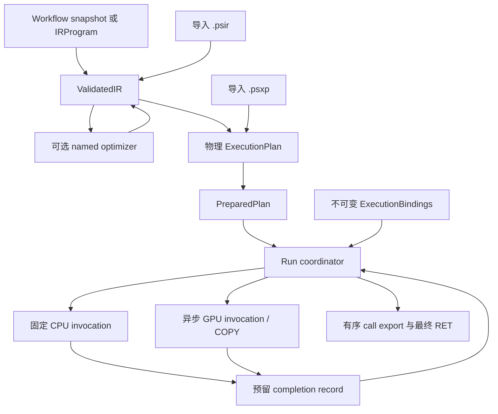

# 架构概览

## 1. 核心摘要

Photospider 是可嵌入的 C++17 内核，将本地 workflow 编译为不可变物理 Plan，并针对调用方提供的 Result binding 执行。Plan 固定 CFG、Task/Tile/Call 表、依赖、placement、显式 COPY 和资源上界。Coordinator 并发发射就绪工作，按 IR 顺序退休 call；CPU 与原生 Metal/Vulkan 共用固定 invocation/completion 所有权契约。

`GraphContext` 持有源修订；`ExecutionContext` 持有有界 worker、GPU credit、公平准入、冻结的 operation registry 和资源根。Daemon 使用公共安装包，独立管理 Session、Job 与进程生命周期。

## 2. 编译、准备与执行



Compiler 在静态阶段展开读取与依赖，校验物理表。Preparation 链接具体 device、kernel、resource 和 module owner，不改变拓扑。每个 Run 拥有独立 activation、依赖计数、ready queue、call retirement、取消与诊断状态。Task 完成后即可唤醒后继；call export 与最终 RET 持有独立的 owning Result。返回存储与 observation 可以超过 Run/context 生命周期。

Planner 直接接受初始 `ValidatedIR`，也可接受可选 optimizer 产生的版本。


## 3. 契约与接口

```cpp
class Compiler {
 public:
  Result<ValidatedIR> analyze(const GraphSnapshot&,
                                  ResourceSet = {}) const;
  Result<ValidatedIR> bind_ir(IRProgram, ResourceSet = {}) const;
  Result<ValidatedIR> optimize(const ValidatedIR&,
                               const OptimizerInvocation& = {"optimize", {}}) const;
  Result<ExecutionPlan> plan(const ValidatedIR&,
                             const PlanningOptions& = {}) const;
};

class CompilerArtifact {
 public:
  static Status save_plan(const ExecutionPlan&, const std::string& path);
  static Result<ExecutionPlan> load_plan(std::shared_ptr<OperationRegistry>,
                                         const std::string& path,
                                         ResourceSet = {});
};

class ExecutionContext {
 public:
  Result<PreparedPlan> prepare(const ExecutionPlan&) const;
  Result<RunHandle> submit(const PreparedPlan&, ExecutionBindings = {},
                          const CancellationToken& = {},
                          ExecutionOptions = {});
};
// RunHandle::join() returns Result<ExecutionResult> after task drain and
// ordered observer settlement.
class RunHandle {
 public:
  Result<ExecutionResult> join() const;
};
```

以上是省略其他成员后的 public 签名。每个阶段返回完整不可变值或带类型的失败。`analyze` 从具名输出出发，把 DAG 展开为 `DependencyPaths`，在每条引用路径中保留共享祖先，并使用相同的 Call 和 SSA ID。`optimize` 保留每个 call 的首次请求，移除空 chain，把剩余 chains 连接为可执行的 `ControlFlow`。例如，原始 `ABG / AB / AC / DE / F` 转换为 `ABG / C / DE / F`。`bind_ir` 也接受显式 ControlFlow，包括循环和基于单个 `UInt8` sample 的条件分支；优化保持这种形式不变。

`plan` 调用各算子的静态 lowerer，合并固定 task、tile、layout、dependency 和私有 value 表。Compiler 校验完整物理 program 与逐 block 资源上界。Task 在依赖和额度允许时发射；成功完成立即启用内部消费者，CallGroup 按 IR 顺序退休。`prepare` 解析不可变 kernel 契约，`submit` 捕获 bindings 并启动 Run，`join` 在已接受工作排空及有序 observer 交付结算后返回最终 RET owner。`analyze` 接受不可变、内容寻址的 `ResourceSet`，算子在 preparation 中选择显式资源 identity。Result 和 Tensor 携带结构和数据，领域解释由算子参数决定。

`CompilerArtifact` 保存和加载 v5 文本（`.psir` 是统一 IR，`.psxp` 是完整物理 Plan）。原始及变换后的 IR 可使用依赖路径或 CFG。Plan 保存 lowering 后的 CFG、task placement、读写 view、call 顺序及资源上界。版本 1–4 被拒绝，需要重新导出。加载对象独立于原 GraphContext，但要求匹配的冻结 registry 和资源。Plan 导入校验并链接保存的表，不重新执行 lowering。见[Compiler 与执行](Compiler-and-Execution.zh.md#compiler-产物)。

`CpuExact` 是默认模式，要求 CPU task。`NativeGpu` 在编译时为支持 GPU 的算子选择 GPU lowering，为 CPU-only 算子选择 CPU lowering。Traits 允许时，GPU lowering 可以包含 CPU task；每个 task 的 placement 都在执行前固定。显式 COPY 连接内存域。CPU 工作使用 context worker pool，native task 使用有界 backend submission credit。取消关闭准入，排空已接受工作后才释放其借用 owner。

## 4. 明确边界

- Kernel 不拥有 daemon session、IPC、持久 Job 或进程生命周期。
- 内核只附带 WorkflowDocument DAG 前端。不存在 Python 或文本语言前端、机器码 backend、JIT，也不会根据产物自动查找算子库。
- Optimizer 消除重复的依赖路径请求，同时保留每个唯一 call；显式 ControlFlow 输入保持不变。Tensor shape 和 tile grid 在编译期固定；控制流不提供动态 shape。
- Compiler 产物是可编辑、带版本、无签名的文本文件；其 digest 是可复现辅助。
- Native operation module 是受信任的进程内代码；ABI 校验不构成沙箱。
- GPU 可用不代表所有算子都有原生实现。
- Result 是内存中的 owner，不是持久身份或恢复记录。

## 5. 后果与代价

完整依赖路径展开的规模可能随 DAG 共享结构呈指数增长。前端将原始 IR 限制为最多 1,048,576 次 call 引用和 65,536 条 chain。Planner 在保持 call 顺序的前提下合并符合条件的路径 block。Full-block reservation 在发射前准入全部选中输出和可用 scratch lane；因此合并增加调度自由度时，也可能提高峰值容量。[实测容量比较](Parallel-Execution-Model.zh.md#原生测量)记录了这一取舍。

Plan 共享不可变存储，可配合新 bindings 重用或保存后重新加载。运行期输入地址由每次 Run 捕获。`PlanningOptions` 限制 task、record、dependency edge 和规划 work，稀疏输出请求限制编译闭包。队列或资源耗尽返回带类型的失败。返回的 Result 持续计费，直到最后一个 owner 释放。Executor 不复用已完成 Result，不在运行时改写 placement，也不执行隐式传输。
