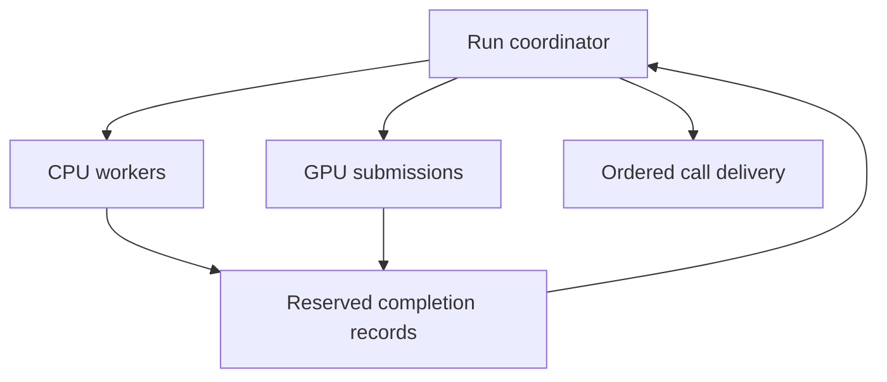

# 并行执行与有序退休

状态：Proposed breaking design，实现状态见 [Plan 契约](Compiler-and-Execution.zh.md)。[英文权威文档](../Parallel-Execution-Model.md)。

## 范围与职责

每个 Run 的 coordinator 是状态、依赖计数、ready queue、call record 与 hold 的唯一修改者。Context 提供 Run 共享的有界 CPU pool 和 GPU submission queue。Worker 与设备 callback 写入预留完成记录，不修改依赖或退休状态。



多发射表示在一次 coordinator 推进中准入所有符合条件且资源允许的 task。各 backend 的 ready heap 按 `(call ordinal, task ID)` 排序，context 公平轮转可执行 Run。依赖处理为 O(T + E)，heap 增加 O(T log T)，不模拟硬件时钟。

Context 为 CPU 与 GPU 工作分别维护 FIFO 准入顺序。Frame 仅在有空闲 lane 和依赖就绪 task 时，将一个内嵌 waiter 加入队列。Backend 容量繁忙时保留位置；每次成功获取资源后移除本次等待项，后续工作重新排到已有 waiter 之后。失去就绪条件、abort 和 frame 退出都会在已接受工作排空前移除待准入项。调度器排空后也会先移除等待项，再等待 observer 交付，阻塞中的失败 observer 因此不会占住准入位置。入队和轮转不分配内存。CPU 准入锁覆盖 queue 插入，GPU 准入锁覆盖 credit 获取；设备 submit 在准入锁之外执行。Coordinator 沿用完成事件唤醒和有界定时唤醒进行重试，因此公平性不表示固定的延迟上限。

## 状态与不变量

```cpp
#include <cstdint>
namespace ps_executor_design {
enum class TaskState : std::uint8_t {
  Waiting, Ready, Submitted, Succeeded, Failed, Skipped
};
struct TaskRuntime { TaskState state; std::uint32_t pending; };
struct CallRuntime {
  std::uint32_t unsettled, first_failed_task;
};
struct CompletionKey {
  std::uint64_t run, activation;
  std::uint64_t submission;
};
}  // namespace ps_executor_design
```

`pending(t)` 统计尚未成功完成的不同 predecessor。同一 producer 的两个输出只等待一个事件。生命周期 hold 则按不同 `(consumer task, tile)` 计数；两个端口读取同一 tile 只持有一次。Producer 完成前，未来消费者的 hold 已全部建立。

每次被接受的提交恰好拥有一条终态完成记录。SubmissionId 映射到一个 task 或不可变 packet 成员范围，与 TaskId 独立。Coordinator 先检查 submission key/state 一次，再将事件分发到各成员状态。`Submitted` 包括已排入 worker 的 CPU 工作和已接受的设备工作。成功表示全部输出写入以及 input/scratch 访问结束，并具备所需可见性。拒绝提交不转移所有权，也不产生 callback，由 coordinator 处理局部失败。成功一次性公开 task 的全部输出；失败不公开输出。

执行额度和 scratch 在完成时归还。Call 的全部成员进入终态后视为 settled，只能在 `retire_head` 退休。选中的 call 只有在全部 task 成功时才成功；零 task 纯 call 以 `Elided` 退休。100 个 task 的 call 可以使用两个执行槽，因为执行槽不等待退休。

成功处理依次标记输出可用、访问每个 successor 一次、结算 call 成员、释放 input hold/scratch 并归还额度，然后退休连续的 settled 前缀并准入新工作。消费者就绪不等待退休。用户交付独立执行。

| 两个 CPU slot 的逻辑示例 | 顺序 / 时间 |
| --- | --- |
| Call 顺序 | A(10), C(A,1), B(2), D(B,1), E(C,D,1) |
| 发射 | A, B, D, C, E |
| 完成 | B, D, A, C, E |
| 退休 | A, C, B, D, E |
| 总逻辑 tick | 12 |

## 准入与推进

第一版在 block 第一个 task 之前预留全部输出、持久 frame 状态、有界交付存储、可用 scratch lane 和完成容量，计算公式见 [tile 存储](Cache-Model.zh.md)。失败时返回 `ResourceExhausted`，本 block 没有 task 开始；先前 block 的结果和 effect 仍可观察。

Task 必须处于活动、未提交、依赖就绪、failure cut 之前的状态，并取得全部额度。Effect 还要求其 call 等于退休头。Scratch lane 忙时可暂时绕过，通过公平选择重新访问。Task 原子获取完整的跨内存域资源向量。

边界 import COPY 使用 `call = none`，在完整真实 call 前缀成功退休后获得执行资格。零真实 call 时，它们在 block entry 即可发射。它们共享 task 提交额度和完整 block reservation，保持 call sequence 不变。边界失败跳过剩余未提交的边界 COPY，并排空已接受的 COPY；实际失败 task 中最小的 TaskId 决定其终态错误。真实 call 失败会抑制所有未提交的边界 COPY。取消、Stale 与 observer abort 保持 Run 级优先级。

Coordinator 接收事件、应用 stop、跳过工作、退休 call 并填充 lane。只有已接受工作或具体 context-credit 事件能够推动进展时才等待。Block reservation 被拒绝后失败，不无限等待。成功准入后，若仍有未完成工作但没有在途或可执行 task，属于 `Internal` 不变量错误。

推进保证以有限 DAG、同 call 或更早 call 的依赖、有限 callback、设备最终完成、context 公平服务及完整预留为前提。最早未完成前缀 call 必有在途工作，或有 predecessor 能够完成的 task。当前工作完成后，该 call 的 ready task 可装入保底 lane，每次完成减少未结束工作。这是上述假设下的资源与调度保证，不是任意 native code 的终止证明。

## 失败、副作用与取消

`failure_cut` 是已经观察到 task 失败的最小 call ordinal，初始为 call 数量。严格早于 cut 的工作继续运行。Cut 及之后尚未提交的工作被跳过，已经接受的工作必须 drain。失败不满足成功依赖；被跳过消费者的未来 hold 释放一次。更早 call 的失败事件可以继续向前移动 cut。

先退休成功的较早前缀，再在失败 call 的已接受成员全部停止访问后退休一条失败记录。更晚 call 不退休，最终错误必须等待全部更晚在途工作也排空。同一 call 多个 task 失败时，从实际失败 task 中选择最小静态 TaskId；不为被跳过 task 编造错误。该规则对已观察失败稳定，不承诺执行所有 sibling 以发现每种可能错误。Failure-cut 使用独立内部停止机制，不得通过用户取消 token 取消较早前缀。

原型为每次实际失败的 completion 在 `task_failures` 中记录 `TaskFailure(activation, task_id, call, task_name)`。失败退休时，`retired_failures[call]` 记录该 call 中最小已观察 TaskId。终态 `failure` 只在 Run 为 `OperationFailed` 时设置；取消保留已观察/已退休失败诊断，但不把它们作为最终原因。跳过的 task 不生成失败 detail。Packet 级错误归属独立处理，当前原型尚未覆盖。

Effectful call 包含纯 preparation 与一个终端 effect task。它仅在退休头且自身 predecessor 成功后启动，因此更早 call 已全部成功退休。更晚纯计算可能已运行。Effect 失败前已发生的外部写入不能回滚。多个有序外部 effect 需要拆成不同 call，或由算子实现事务协议。

用户取消属于 Run abort。Coordinator 关闭准入、跳过未提交工作、排空已接受工作并停止进一步退休。已移交的记录继续有效，交付可以继续完成。终态锁定前，已观察用户取消优先于 Stale，再优先于 context/device/observer abort，最后是 task 局部失败；context/device/observer 类别内部保留 coordinator 首先观察到的原因；锁定后新请求不再改变结果。设备永久失败导致更早工作无法完成时，使用 context/device abort，不承诺普通的成功前缀完成。

图或 binding 失效以及 observer 失败同样 abort。同 Run callback 串行化、交付失败与终态锁定遵循[返回接口](Compiler-and-Execution.zh.md#run控制流与返回接口)。Device loss 必须确认 DMA/callback 停止访问，才能释放存储，backend 在此之前保留 lease。虚假成功、逃逸 CPU 工作或越界写入违反受信任算子契约。

## CPU 与 GPU 完成边界

CPU invocation 接收不可变输入 view、独占预分配输出、私有有界 scratch、参数和 cancellation。同步 `invoke` 在全部访问与内部工作结束后返回 status。Worker 以 release 顺序发布，coordinator 以 acquire 顺序消费。基础 kernel 每 task 使用一个 worker；并行阶段降低为 task，不通过嵌套 pool job 阻塞 worker。

Backend 逻辑接口为 `SubmitResult submit(const Invocation&, CompletionSlot&) noexcept`，返回 `Rejected(Status)` 或 `Accepted(Ticket)`。接受后转移 owner，直到恰好一次 completion；拒绝时 owner 留在 coordinator，且不排入 completion。Submit 前先准备 slot，因此允许同步完成。Callback 只写有界 status 并唤醒，不分配、不运行用户代码。

GPU encode 和 queue 接受不使输出可读。Input/output/scratch、参数、command、pipeline/module owner 和 completion slot 保持到设备停止访问。Host 可见完成包含必要 cache maintenance。GPU 消费者需要 access/layout transition 与内存可见性，共享内存也需要同步。跨域传输使用显式 COPY task。

Completion key 与 queue timepoint 分离。Task 7 完成不代表 task 0 至 6 完成。GPU timeline 按同一有序 queue 的实际提交顺序编号，独立 queue 使用独立 timeline。TaskId 和 CallId 不得作为通用完成计数器。

### Device packet

基础设计逐 task 提交。可选 compiler packet 将同设备子图合包，要求全部外部输入边在提交前满足，全部对外输出边在 packet 完成后可用。第一版 packet 不含 effect，并只属于一个 call。收缩后的 packet 图必须无环；围绕一个依赖 B 的中间 task 合并两侧 A task 可能产生 A/B 环。

Packet 消耗一个 backend submission credit 和一个 completion slot，其全部成员在该单一事件处理前保持 Submitted。设备 barrier 实现内部依赖。提交前预留全部输出和完整 packet scratch/command 上界。成功时在一个事件中按拓扑顺序结算成员。缺乏逐成员失败信息时以 `PacketFailure(submission, members)` 使整个 call 失败，不公开 packet 输出。不编造首个失败成员，packet 级来源与 task 局部错误选择分开记录。限制为一个 call 可保持跨 call 失败归属；跨 call 链在 backend 提供充分逐 task 完成语义前保持独立提交。合包可能延迟消费者，需要与提交开销一起测量。

## 诊断与检查

分别测量 ready、submit、start、device completion 和 retirement，保留 backend 在途峰值、ready/scratch 等待、传输及 drain 延迟。只对可比较时钟域的时间戳作差。第一版 C++ 实现额外输出以下指标：

| 指标 | 定义 |
| --- | --- |
| `reserved_bytes_by_domain` | 按内存域统计当前准入预算容量，包含未使用的 block reservation；每个 lease 计一次 |
| `live_bytes_by_domain` | 各域当前实际分配的受控字节，包含保留的返回 owner；按 allocation 大小计费，不等同于逻辑图像大小或 RSS |
| `allocation_count` | Run 内成功物化 tile allocation 的累计数量，排除 scratch、command 和借用的 input owner |
| `block_admission_failure` | 准入失败次数及 block/activation、资源维度、所需容量和可用容量；在该 block 发射前报告 |
| `retirement_head_wait` | Call 成为退休头至其 settled 且可退休的单调时钟时间；不含 callback 交付延迟，abort 时单独报告尚未结束的等待 |

同时报告 reserved/live 当前值与峰值。Block 结束后归还未使用 reservation，导出 owner 保持计费；Run 完成后释放这些 owner 仍更新计费。Block 内 live bytes 下降不表示 reserved bytes 同步下降。[容量示例](Cache-Model.zh.md#容量成本与测量)量化这一基线成本。

当前公开实现通过 `RunHandle::observation()` 返回独立的 `ExecutionObservation`。其 `snapshot()` 不分配内存，不保留 Run 或 Result，成功、失败、取消及 context 销毁后均可读取。Task/call 计数在 coordinator 安全点发布；内存计数由实际 allocation commit、Slice 释放和 block 退出更新。

`ExecutionDiagnostics::memory` 记录输出与 scratch backing 的 Host/Device/Shared 当前值和峰值，三者互不重叠。Native 使用实际容量，Host 使用申报的分配字节。借用输入、代码、driver 内存与 host metadata 不在该 backing 记录中。`ExecutionDiagnostics::metadata` 单独记录 Run 新增的 managed metadata reserved/allocated 当前值与峰值，包括诊断、调度目录、Result/Footprint/view metadata 和受控分配 owner。Root-matching scope 继承该 Run 的归属；共享 Context/PreparedPlan、既有输入和 foreign root 保留原归属。Lease 以弱引用保持计数归属，跨线程释放和导出 owner 在 Run/context 销毁后仍更新 observation，不保活 Run。Root `live`/`peak` 保持预约容量语义；metadata allocated 只计已插桩的实际分配，不含 allocator 私有开销或 RSS。Block 内释放可降低 live，但 reserved 保持至边界。

`lane_wait_ns`、`context_wait_ns` 与 `coordinator_delay_ns` 在 coordinator 安全点分类，共同分割 ready-to-submit 区间，不互相叠加。Lane 包含独占预分配 scratch；context 包含公平准入、CPU FIFO 或 GPU credit 等待。`scratch_capacity_wait_ns` 恒为零：完整 block reservation 容量不足时在就绪前拒绝。CPU queue/invoke、completion-to-consumption，以及 observer queue/invoke 另外计时。抛异常的 callback 计入 completed delivery；丢弃的记录不伪造 callback 时间。

`allocation_count` 包含失败 block 中已成功分配的输出 tile，排除 scratch。`block_admission_failures` 与 `last_block_admission_failure` 保留 block、activation、错误类别，以及预算拒绝时在同一 admission lock 下取得的 requested/available 向量和首个不足维度。系统分配或 backend 失败没有虚构的容量不足维度。Frame 构造中的 identity、Result envelope 和目录拒绝也被捕获。

`retirement_head_wait_ns` 与 `peak_retirement_head_wait_ns` 统计已准入 block 中未 settled 的 head 等待；新 head 已 settled 时等待为零。Abort 截断的等待单列为 `unfinished_head_wait_ns`，运行中最近一次采样为 `current_head_wait_ns`。Observer delivery 不计入这些等待。Raw benchmark 保留失败 Run 的诊断，并分别记录 host steady-clock 的 prepare、submit、join 时长。`ExecutionOptions::trace_capacity` 启用有界 task 与 call trace。两个数组及其保留的 diagnostic owner 均在 Run 启动前准入和分配；容量为零时禁用数组与原生时间戳查询。`copy_task_timings()` 和 `copy_call_timings()` 将同步的前缀复制到调用方存储，不分配内存。超出容量的记录分别计入 dropped 计数，循环 activation 不会使存储增长。

Task 记录标识 block、activation、submission、task 和 source call。`host_epoch_ns` 是 Run 起点相对 `steady_clock::time_since_epoch` 的纳秒值，不是 wall clock 或 device timestamp。Host 的 `ready_ns`、`submit_ns`、`cpu_start_ns`、`completion_ns`、`consumed_ns` 使用相对 Run steady-clock 起点的纳秒值。Ready 从实际获得发射资格开始，包含 effect 和边界退休约束。CPU start 在线程执行调用时记录；GPU start 只出现在独立 device record 中。Completion 记录终态 callback 或本地拒绝，consumption 记录 coordinator 观察时间。退休记录包含 IR sequence，排除 observer delivery。聚合计数分别累加 ready 等待、CPU 队列等待、CPU 调用耗时和完成至消费的延迟；并行 task 的时间可以重叠。`copy_bytes` 对成功 COPY 的逻辑字节计一次，排除额外 staging 流量。Coordinator wait 和 wakeup 计数包含定时等待。

Native 计时通过可选的固定大小 `report_timing` callback 在终态 `finish` 前上报。Metal 将已完成 command buffer 的 [GPUStartTime](https://developer.apple.com/documentation/metal/mtlcommandbuffer/gpustarttime) 和 [GPUEndTime](https://developer.apple.com/documentation/metal/mtlcommandbuffer/gpuendtime) 记录为 system mach 纳秒。Vulkan 仅在请求且支持时创建 submission 独占的双 query [timestamp pool](https://docs.vulkan.org/refpages/latest/refpages/source/vkCmdWriteTimestamp.html)，用 TOP/BOTTOM 时间戳包围设备命令，在 fence 完成后读取 64-bit 值与 availability。不支持的 queue 或不可用 query 不产生 device record。Raw pair 无法排除计数器多次回绕，因此不能确定唯一的经过时长。这些区间包含设备 barrier 和调度影响，CPU staging 与 callback 延迟不在其中。设备记录不得直接与 host steady-clock 作差；跨域比较必须显式校准并报告不确定度，下面的手动 benchmark 保留了该校准。Vulkan raw pair 支持同次提交内的模减；相同 clock instance 不建立跨提交校准关系，也不能证明重叠。参见[完成 ABI](Plugin-ABI.zh.md#kernel-preparation-与调用)。

`ExecutionDiagnostics::backends` 分别索引 CPU 与 GPU，记录已提交/已完成 task、本地 GPU 拒绝、当前与峰值 submission-slot 占用，以及 submit 至 consumption 的累计纳秒数。Inline completion 的槽持续保留至 coordinator 消费；本地拒绝计为已发射 task，随后在本地结算。这些计数描述 host 调度，包含 CPU 队列等待，不表示设备利用率。Frame 异常展开先等待终态 callback，再对剩余已发射 task 补记统计，最后释放 owner。

`abort_drain` 记录 task coordinator 首次 abort，或存在已发射 task 时的 Frame 异常展开，以及全部已发射终态事件被消费的时刻。两端均使用 Run 的 host 时钟。初始 inflight 数量包含已完成但尚未消费的事件。排空等待期间可以读取 unfinished 记录。Observer delivery 与取消请求至观察到取消的延迟均不计入。发生在 task coordination 之外的 abort，例如 block entry 前取消或全部 task 工作排空后取消，可以没有该记录。Task 局部 failure cut 不属于 Run abort。

## 原生测量

手动 kernel 工具 [physical_execution_benchmark.cpp](../../../tests/tools/physical_execution_benchmark.cpp) 使用公开的物理 Plan、prepare、submit、join 和 observation 路径。它是显式构建的 `EXCLUDE_FROM_ALL` target，不是 CTest 或安装消费测试。以下数据采集于 2026-10-20，描述本实现与这两台机器，不构成跨设备性能保证。

| Backend | 物理设备与软件 |
| --- | --- |
| Metal | Apple M5，10 个 GPU core，Metal 4；macOS 27.2 build 26B5101f，Darwin 27.2；RelWithDebInfo，启用 native Metal |
| Vulkan | NVIDIA GeForce RTX 3090，24576 MiB；driver 595.99.02；Vulkan 1.4.329，queue family 0，64 timestamp bits；Ubuntu kernel 7.0.0-38-generic，Clang 21，RelWithDebInfo |
| Profiling | Nsight Systems 2026.3.2.476，记录 Vulkan API/workload 与 OS runtime，关闭 CPU sampling |

每个 stage 产生 4 MiB：1,048,576 个 unsigned 32-bit word，表示为包含 4,194,304 字节的单个 UInt8 tensor。Tile extent 为 65,536 字节，每 stage 有 64 个 task。整数 fill/transform kernel 使用精确的 CPU/Metal/SPIR-V oracle。数值校验与输出释放在计时的 submit/join 区间之后进行。每个 case prepare 一次，先执行一次不计入统计的 warm-up，再测量五次。CPU worker 为 4，CPU queue capacity 为 64，GPU credit 为 4，maximum Runs 为 8，trace capacity 为 1024，Payload 上限为 128 MiB。`tiles_serial` 仅将 GPU credit 改为 1；tight-budget case 使用 12 MiB。每次 native submission 只包含一个 task，packet size 为 1。

四类必需工作负载分别是 `tiles`（单 call）、`independent`（四个独立 call 与四个 return）、`dependent`（按对应 tile 连接的四个 GPU call）和 `copy`（CPU fill → Host-to-Device COPY → GPU transform → Device-to-Host COPY → CPU transform）。前三者使用 Shared 输出；COPY 链显式使用 Host、Device allocation 和有界 Shared staging。`split` 将相同四阶段依赖链放入四个 block；`dependent` 使用一个 block。两者的 shape、运算、placement 和 grant 相同。

### 复现与保留证据

在已配置目标 native backend 的构建中执行：

```sh
cmake --build build/kernel-dev --target physical_execution_benchmark
mkdir -p build/physical-benchmark
./build/kernel-dev/physical_execution_benchmark all 5 > build/physical-benchmark/metal.jsonl
```

CLI 为 `physical_execution_benchmark [case|all] [iterations] [cold]`，`cold` 跳过 warm-up。Vulkan 测量使用现有 Linux 构建，关闭 Metal、启用 Vulkan。本次本地证据保留在忽略目录 `build/physical-benchmark/`，包括 `metal.jsonl`、`vulkan/vulkan.jsonl`、分析 summary 与三个 Vulkan profiler capture。配置记录包含物理设备、prepare 时间与 preparation 持有的 payload。Run 记录包含 status、有界 task/call trace、predecessor ID、各域容量、metadata、等待与 drain。90 条测量 Run 记录没有丢弃 task/call timing。成功输出均匹配精确 oracle；释放每次 Run 的 owner 后，Payload 恢复到 retained preparation 基线。

另外对 `independent`、`dependent` 和 `copy` 各采集了一次独立 cold Run：

```sh
nsys profile --trace=vulkan,osrt --vulkan-gpu-workload=individual --sample=none --force-overwrite=true -o build/physical-benchmark/CASE build/physical_execution_benchmark CASE 1 cold
nsys export --type=sqlite --force-overwrite=true -o build/physical-benchmark/CASE.sqlite build/physical-benchmark/CASE.nsys-rep
```

将 `CASE` 替换为 case 名称。这些 capture 单独报告；同一次 Run 中的 task 样本不是独立重复 Run，其时间也不混入未启用 profiler 的统计表。

### Run 时间、吞吐与容量

下表为 submit 至 join 完成的 wall time，单位毫秒，表示五次 Run 的 median [minimum, maximum]。紧预算拒绝与取消按各自预期终态报告。

| Case | 成功时 task 数 | Metal ms | Vulkan ms |
| --- | ---: | ---: | ---: |
| tiles | 64 | 3.982 [3.672, 7.378] | 57.611 [55.762, 60.099] |
| tiles_serial | 64 | 15.607 [14.881, 17.357] | 156.658 [154.961, 158.552] |
| independent | 256 | 16.011 [15.590, 17.121] | 232.030 [229.806, 243.205] |
| dependent | 256 | 15.048 [14.675, 27.061] | 233.236 [228.880, 245.669] |
| copy | 320 | 15.478 [9.713, 16.670] | 218.304 [214.495, 222.044] |
| split | 256 | 17.966 [15.666, 27.726] | 231.466 [224.023, 237.124] |
| coalesced_tight | 拒绝 | 0.096 [0.080, 0.098] | 0.137 [0.071, 0.153] |
| split_tight | 256 | 16.618 [16.284, 33.307] | 237.665 [230.399, 244.129] |
| cancel | GPU issue 后取消 | 2.792 [2.515, 2.987] | 21.011 [19.994, 23.223] |

四个 GPU credit 时，单 call median 吞吐为 Metal 16,074 task/s、Vulkan 1,111 task/s；一个 credit 时分别为 4,101 和 409 task/s。它衡量包含 host 提交、分配和完成成本的小 task 完整流水线，不是 shader 算术吞吐。四个主要 case 的成功 task/submission 与输出 allocation 数量分别为 64、256、256、320。COPY 数量包含 CPU task，其 native GPU submission 为 192。

以下容量是五次 Run 中每个 domain 的最大 peak，单位 MiB。本组数据中，各域 reserved 与 live backing peak 相等。该 diagnostic 的 Host、Device、Shared 互不重叠，但各自 peak 的观测时刻可能不同，不能相加并称为同一时刻总峰值。

| Case | Host | Device | Shared | Run allocated metadata 最大值，Metal / Vulkan bytes |
| --- | ---: | ---: | ---: | ---: |
| tiles | 0 | 0 | 4 | 362272 / 368301 |
| independent | 0 | 0 | 16 | 774784 / 788307 |
| dependent | 0 | 0 | 16 | 610032 / 625304 |
| copy | 12 | 8 | 0.25 | 629216 / 637521 |
| split | 0 | 0 | 8 | 529256 / 537405 |

Metadata 单独报告 reserved/allocated，不是额外 payload domain，也不能再与自身 reservation 相加。共享 Context、PreparedPlan 和 input owner 保留原有归属。合并后的四阶段 block 需要 16 MiB Shared 输出容量，因此 12 MiB case 在两后端都于零 task、零 backing allocation 时拒绝。将同一计算拆成 block 后，Shared backing 最大值降至 8 MiB，两后端各五次紧预算 Run 全部完成。这量化了完整 block admission 的容量成本，当前保留该基线策略。

### 就绪、退休与设备区间

下表为五次未启用 profiler 的 Run 的 median。Head wait 为未 settled 退休头等待的累计时间；wakeups 为 coordinator 唤醒次数。Per-call latency 定义为该 call 的首个 task submit 至 retirement，不是从 Run 起点算起的 retirement offset。

| Case | Metal head wait ms / wakeups | Vulkan head wait ms / wakeups |
| --- | ---: | ---: |
| tiles | 2.759 / 54 | 52.762 / 15 |
| independent | 11.311 / 230 | 210.212 / 52 |
| dependent | 12.306 / 208 | 216.607 / 46 |
| copy | 13.465 / 207 | 207.503 / 120 |
| split | 14.423 / 191 | 213.573 / 55 |

依赖链四个 call 的 median latency：Metal 为 [3.426, 3.168, 2.794, 2.773] ms，Vulkan 为 [54.769, 57.195, 55.838, 54.439] ms。Ready-to-submit 的 lane、context 与 coordinator 等待分别记录；完整 block admission 下动态 scratch-capacity wait 为零。不同 task 的累计等待可能重叠。

Metal 将已完成 command buffer 区间记录为 mach 时间。Benchmark 在每次 Run 前后各四次采样 steady S0、转换后的 `mach_absolute_time` M、steady S1。在 offset 稳定的校准假设下，`M - steady` 位于 `[M-S1, M-S0]`；取区间交集及中点完成 host 对齐。观测到的交集均有效，宽度为 0 至 41 ns。这是校准 bracket 的观测宽度，不保证 GPU timestamp 具有同等精度。Apple 文档说明了 [mach 时间转换](https://developer.apple.com/library/archive/qa/qa1643/_index.html)和 [Apple Silicon 时间戳对齐](https://developer.apple.com/videos/play/tech-talks/10001/)。

五次 Metal dependent Run 的 960 条真实 GPU predecessor-to-successor edge 中，前驱 device end 至后继 host submit 的 gap median 为 2.650 ms [2.304, 14.859]。混合 COPY 链选取的 960 条 edge median 为 2.558 ms，其中包括 GPU-to-CPU 后继。每条 gap 都沿记录的 predecessor 计算，可能包含其他就绪约束、较早 call 优先级、lane/context 等待及 coordinator 工作，不能称为纯 wakeup latency。

Metal `independent` 的五次 Run 均观测到最多两个 command-buffer 区间重叠。保留 `(activation, call)` 后，跨 Call 结论不同：distinct-call peak 为 [1, 1, 1, 2, 1]，总跨 Call overlap 为 [0, 0, 0, 750, 0] ns。仅一次样本出现 0.75 微秒的跨 Call 区间重叠。该区间不证明 shader 同时执行或 GPU 利用率；四个已接受 host submission 同样不证明设备重叠。

Vulkan 原始 task timestamp 只用于同次 submission 内比较。跨 submission 改用 Nsight 的公共时间线：API 与 workload 通过 `(contextId, correlationId)` 连接，再按 task submission 与 API 顺序映射。映射核对了单 coordinator/thread/queue、每个 accepted GPU task 恰有一次 `vkQueueSubmit`、prepare 不提交、记录数匹配且 correlation 唯一。Independent/dependent/COPY 的 256/256/192 个 GPU task 均一对一映射。

| 单次 cold Vulkan capture | independent | dependent | copy |
| --- | ---: | ---: | ---: |
| GPU interval 数 / interval overlap peak | 256 / 1 | 256 / 1 | 192 / 1 |
| Interval union ms | 4.741 | 3.942 | 2.456 |
| 首个 start 至最后 end ms | 210.269 | 230.230 | 203.226 |
| Submit API start 至 GPU start，median 微秒 | 930.004 | 867.034 | 974.565 |
| 相邻 submission signed gap，median 微秒 | -277.642 | -331.817 | -254.233 |

这三个 capture 没有正长度设备区间重叠，尽管 host GPU peak inflight 为 4。Interval union 与首末跨度之比不是硬件利用率。相邻 signed gap 按 submission 顺序计算下一次 submit API start 减前一 GPU end；负值只说明 host 在前一工作完成前提交，不表示设备并发。

真实 Plan 依赖边给出另一组量：dependent capture 的 192 条 GPU-to-GPU edge median 为 57.784 ms [51.352, 63.392]；COPY 的 128 条为 54.714 ms [48.945, 97.936]。该 profiler 定义不包括 GPU-to-CPU edge，因为后继没有 `vkQueueSubmit`。Issue 按较早 call 优先级分组，但 dependent 两个边界的后继 call 分别早于前一 call 最后 GPU completion 0.633/1.546 ms 提交，COPY upload/compute 边界分别早 0.123/0.484 ms。不存在整 call completion barrier。较大的逐 edge gap 包含更早 ready work 与 profiler 开销，不能全部称为固定 callback/wakeup 成本，也不能相加得到 Run duration。

### COPY 与 drain

每条成功 COPY 链逻辑复制 8,388,608 字节，即 upload 与 download 各 4 MiB。五次 Run 汇总的每后端 640 个 COPY task，task median 如下：

| Backend | Host submit 至 terminal notification | Native device interval |
| --- | ---: | ---: |
| Metal | 173.250 微秒 | 15.6045 微秒 |
| Vulkan | 3962.6395 微秒 | 4.192 微秒 |

Native interval 包含设备同步与命令执行。Host staging、排队和 callback 成本使 host interval 不同；两列都不是纯 DMA 带宽。单次 cold Vulkan COPY capture 的 upload/transform/download interval 总和为 1.303/0.641/0.511 ms；对应 stage 跨度为 50.834/54.019/98.353 ms，包含 task 之间的间隙。

取消 case 在观察到 GPU submission slot 被占用后请求停止。所有已接受 task 均在最终返回前完成，drain record 全部 finished，释放 owner 后恢复 preparation 基线。Metal drain median 为 423.958 微秒 [294.667, 1094.125]，初始 inflight 为 [1, 8, 8, 8, 2]；Vulkan 为 7967.362 微秒 [7757.635, 10410.382]，计数为 [4, 3, 2, 4, 3]。这些计数表示已提交且 terminal event 尚未消费的 task，可能包括 CPU 工作和已完成通知，不表示物理上正在运行的 GPU kernel 数。真实 device-loss 注入与可选 packet 合包不属于本次测量。

## Focused validation

| 要求 | 直接行为检查 |
| --- | --- |
| 不可变物理表、checked artifact 与 subset closure | `test_physical_program`、`test_physical_compiler`、`test_compiler` |
| 有界 lowering 与混合逐 task placement | `test_operation_program_limits`、`test_backend_admission` |
| 依赖发射、有序退休、effect 与 failure cut | `test_task_schedule`、`test_physical_cpu_schedule`、`test_fixed_execution` |
| CFG/loop、同时边传递与动态 identity | `test_fixed_cfg`、`test_fixed_identity` |
| Accepted/Rejected/inline completion 与终态优先级竞争 | `test_fixed_async`、`test_fixed_execution` |
| Block/domain 准入、显式 COPY 与保留的 Result 存储 | `test_native_block_memory`、`test_native_copy`、`test_device_result` |
| Root/Run metadata 归属、部分失败与释放 | `test_resources`、`test_resource_observation`、`test_execution_observation`、`test_result_metadata_budget` |
| 原始 trace/report 契约与 package 兼容版本 | `test_raw_benchmark`、`test_package_version` |
| 物理 Metal/Vulkan 执行与可见性 | `test_fixed_native`、`test_native_gpu`、`test_fragment_atlas_gpu`、`test_vulkan_gpu` |

保留的 kernel 检查覆盖物理表与 artifact 校验、selection closure、CFG/loop、同时边传递、task readiness 与真实 CPU 重叠、failure-cut/effect 顺序、cancel/stale/observer 终态优先级、callback finalization 竞争、多域与 metadata admission/release、Accepted/Rejected 所有权、inline completion、显式 COPY 和原生完成可见性。`test_fixed_async` 在持有另一个 accepted submission 时检查 device-first 与 observer-first abort，并证明 join 等待其释放。`test_backend_admission` 同时覆盖跨 call 与同 call 的静态 CPU/GPU 混合 lowering。Native 测试执行真实 Metal/Vulkan；受控 completion fixture 不构成物理 device-loss 覆盖。

Python 原型保持为独立逻辑模型，以逻辑 tick 检查不增加 payload hold 的显式顺序、独立退休/RET owner 与已观察 task-error 选择。其扫描/排序不是 C++ scheduler 或 native 性能证据。可选多 task packet 不属于当前逐 task submission 基线。

## 一手设计参考

- [BOOM ROB](https://docs.boom-core.org/en/latest/sections/reorder-buffer.html)：有序 commit 与队头异常处理为 call record 和退休游标提供参考，不引入投机寄存器状态。
- [IREE Stream](https://iree.dev/reference/mlir-dialects/Stream/) 与 [HAL](https://iree.dev/reference/mlir-dialects/HAL/)：异步资源与 wait/signal fence 为显式完成依赖提供参考。
- [CUDA Graphs](https://docs.nvidia.com/cuda/cuda-programming-guide/04-special-topics/cuda-graphs.html)：分离定义、实例化与执行，为 prepare-once 数据和可选 packet 提供参考。
- [Metal completion](https://developer.apple.com/documentation/metal/mtlcommandbuffer/addcompletedhandler(_:))：设备完成通知支持区分 submit 与 Done。
  Apple 的[归档 command guide](https://developer.apple.com/library/archive/documentation/Miscellaneous/Conceptual/MetalProgrammingGuide/Cmd-Submiss/Cmd-Submiss.html)（2016-12-12 更新）同时说明 command-buffer 保活与快速完成 handler；这里只引用这些基础生命周期机制。
- [Vulkan synchronization](https://docs.vulkan.org/spec/latest/chapters/synchronization.html)：执行顺序、可用性和可见性需要显式 backend 同步。

这些来源为特定机制提供依据，不构成 Photospider 已实现该执行器的证据。
