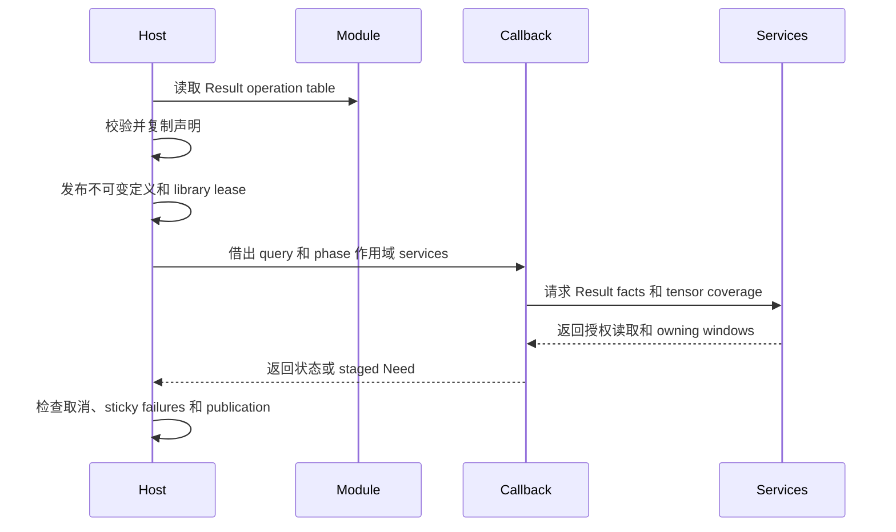

# 插件 ABI 与所有权

## 1. 核心摘要 (TL;DR)

Photospider 通过版本化 C 表在宿主进程中加载受信任的 operation module，并在发布前复制声明。Structured Result C ABI 的每个 port 对应一个 Result object；typed tensor members 保存数值或图像 samples，fields 保存 primitive records。当前 package 为 0.34.0，operation plugin 仅使用 Result operation C ABI 4，OperationTraits 为 26。ABI 4 增加校验器与诊断注册、metadata resolution 期间的显式资源选择、授权的校验读取以及 `fail_domain`；Result 记录不携带 facet 或领域 metadata。

## 2. 架构心智模型 (Mental Model & Intuition)



Registry 持有每个不可变定义及其动态库 lease。Invocation snapshot 在 callback 运行期间保留定义。Result coordinator 解析具名 outputs、tensor 投影、field I/O、dependency relations 和 backend services。Result 持有 schema 与 tensor storage；tensor 可使用 affine CPU storage 或由 physical layout 描述的其他 backing。

### 入口与核心模型

```c
#include "photospider/plugin/result_operation_plugin_api.h"

typedef struct ps_result_operation_plugin_api_v4 {
  uint32_t struct_size, abi_version;
  const ps_result_operation_v4* operations;
  uint32_t operation_count;
  void* context;
  void (*destroy)(void*);
  const ps_result_validation_definition_v4* validators;
  uint32_t validator_count;
  const ps_result_diagnostic_definition_v4* diagnostics;
  uint32_t diagnostic_count;
} ps_result_operation_plugin_api_v4;

const ps_result_operation_plugin_api_v4*
ps_result_operation_plugin_get_api_v4(void);
```

`result_operation_plugin_api.h` 是独立的 C11 operation-plugin header。它定义 Result element type 与 parameter type enums、parameter descriptor/value records、extension identity 与 resource identity/view records、校验器与诊断定义、capability flags 和普通 callback/service statuses。`PS_RESULT_EXPORT` 也在此定义，并使用共享的 `PHOTOSPIDER_OPERATION_PLUGIN_BUILD` producer switch。Native GPU 声明位于独立的 `native_gpu_api.h`，使用自己的 ABI 版本。

```cpp
#include <utility>
#include "photospider/data/result.hpp"

ps::SchemaTemplate schema;
ps::ResultTensorSpec pixels;
pixels.key = "pixels";
pixels.batch_axes = {2, 3};
pixels.descriptor = {ps::ElementType::Float32, {1080, 1920, 4}};
pixels.layout.spatial = true;
pixels.layout.height_axis = 0;
pixels.layout.width_axis = 1;
pixels.layout.channel_axis = 2;
schema.tensors.push_back(std::move(pixels));
```

Result schema 声明 tensor members、primitive fields 和 domain；tensor members 与 fields 合计最多 16 个。Tensor descriptor 描述 cell axes 与 element type；`batch_axes` 位于这些 axes 前面，构成完整 sample shape，完整 rank 最多为 8。`ResultTensorLayout` 中的空间轴索引相对于 cell axes。Storage order 和 row pitch 描述 physical layout，不属于 semantic schema identity。Tensor payload 与打包的 field records 分开存储。 对于 non-spatial tensor，所有 batch 与 cell extents 都必须为正数，完整 sample rank 为 1 至 8；schema validation 不要求 dense byte allocation，也不要求所有 extents 的乘积可表示。Packed field 的 record rank 最多为 7。Schema validation 会计算每行字节数，并在乘积超过 `INT64_MAX` 时拒绝 schema，但不会为该 field 的全部 rows 分配 dense storage。

Result object identity、schema、descriptor facts、fields、tensor members 和 relations 由 owning Result reference 持有。算子资源属于 prepared operation 和 plan，不属于 Result。Association 按顺序保留 source ObjectIds 作为历史记录；dependency support 由 relation rows 表示。Association 本身不保留 source payload。保留的 Result、tensor window 或已发布 view 会持有读取所需的 backing owners。

Result operation ABI 4 是独立 C table。Module 导出 `ps_result_operation_plugin_get_api_v4`；loader 在接管 table destroy hook 前检查 table alignment、精确结构大小和 ABI version。ABI 3 getter 不被接受，也没有兼容头文件或转发入口。导入阶段校验 pointer/count 配对与 alignment、record 大小（读取任何嵌套指针前先检查外层记录大小）、operation constraints，以及有界且严格合法的 UTF-8 operation 和 parameter 名称。Table 中的校验器与诊断定义随 operations 一起注册。每个端口的 `validators` 数组和每个 operation 的 `diagnostics` 数组命名 extension identity（key、version、implementation），它们必须解析到同一次导入或 registry 中的定义；identity 缺失或 version/implementation 冲突会拒绝导入。Loader 会先将全部 records 导入并校验到私有 registry candidate，再将完整 candidate 一次性替换进 live registry。设置 `repeated_maximum` 时，如果 `repeated_match` 和 `resolve_metadata` 都缺失，导入会拒绝该 repeated input。任何校验或 duplicate-key 失败都会保持 live registry 不变。成功导入后，只要已注册定义仍可能使用 plugin-owned declarations，host 就保留 table owner；保留的 table 生命周期结束时调用 destroy。导入失败、重复 key 或 owner 分配失败时，loader 先通过已接管的 destroy hook 释放 table，再关闭 native library。Loader 只接受 Result ABI 4 入口。`Value` 是 Result storage 与 codecs 使用的 typed numeric backing，不定义 operation 或 workflow 的 input/output 类型。C++ 与 C operation interface 都使用 Result ports。Dependency records 描述 Result support evidence，不是另一套 operation callback table。 `test_result_plugin.cpp::continuation_owns_library` 启动 Result Object Need 后让 registry 离开作用域，期间没有 publication observer，随后 continuation 仍能成功继续；导入的 definition 会将 module owner 保留到 callback 完成。

每个 Result output descriptor 声明名称、Result port、input projection、Whole 或 Regional 执行方式及 output policy。Input ports 约束 Result schema 或选定的 tensor-member predicate。可选的 `resolve_metadata` callback 接收借用的已编译 input metadata、parameters 和 output prototypes。它按 output index 对每个 output 调用一次同步 metadata sink；sink 在返回前复制并校验嵌套 schema records。Resolver 可推导 output port/schema，但不能改变 flags 或 payload bound；`start` 和 `poll` 接收的 `output` view 会反映已注册的 policy。Sink failures 为 sticky；有 output 未提供时 preparation 失败。Sink 的 `set_resources` 调用列出 operation 需要的 `ps_result_resource_identity_v4` 条目（字节长度与 SHA-256）；compiler 从调用方的 `ResourceSet` 中选择这些条目，之后 `start`、`poll` 和校验器 `prepare` 以借用的 `ps_result_resource_view_v4` 记录接收这些字节。不存在隐式资源查找。Operation keys、output names 和 projections、Result schema identity 及已声明约束保持固定。

`ps_result_output_v4::flags` 选择不可变的 output policy。`PS_RESULT_OUTPUT_PRESERVE_VIEWS_V4` 允许 CPU、Atomic output 保留兼容的 immutable input view。`PS_RESULT_OUTPUT_REQUIRE_INPUT_VIEWS_V4` 隐含 Preserve flag，要求 CPU Whole execution；affine view 不可用时会在 computation callback 前拒绝。Compiled structured CPU Whole path 中，coordinator 会在 computation poll 前准备已授权的 Need boxes；Auto 仅在 view 不可用时收集。Direct callback entry 不会自动生成 Need 或 view preparation。`PS_RESULT_OUTPUT_PAYLOAD_BOUND_V4` 启用 `maximum_output_payload_bytes`；零表示显式的零字节上限，而 flag 清零时该字段必须为零。Payload bound 支持 CPU Whole 或 staged output。Host 在 publication 时检查实际物理 owners、对共享 backing 去重，并排除由 Result 或已授权 Tensor Need 保活的 source allocations。Root 仍单独计量 source 与收集后的 input backing、workspace、metadata 和算子资源。Singleton callback query 都会反映注册的 output policy。Bound 不会阻止 callback 之前已进行的分配。Importer 会拒绝未知或不一致的 flags。

嵌套的 `ps_result_output_v4` 记录在 operation table ABI 4 中携带这些输出字段。Importer 要求当前输出结构的精确大小，拒绝 `struct_size` 不同的记录，因此 C module 按当前 header 构建。开发阶段的 package 版本未冻结。

`start` 或 `poll` callback 接收解析后的 ports、选中的 output index、requested coverage、tile geometry、parameters、所选资源 views 和 backend。`read_tensor` 复制已授权 samples。Retained tensor handles 会保留已认证的 tensor capability，直到释放或 operation state 销毁。

普通 Result C callback 和 service 返回 `int`，其 0 至 6 状态码由 `ps_result_status_v4` 定义，依次表示 success、failure、cancelled、backend unavailable、resource exhausted、type mismatch 和 invalid argument。Poll yield code 与 `VIEW_UNAVAILABLE` 遵循各自的 service 契约。Native GPU service 使用独立的 GPU result code。Operation capability flags 为 `PS_RESULT_FLAG_DETERMINISTIC_V4`、`PS_RESULT_FLAG_SIDE_EFFECT_FREE_V4`、`PS_RESULT_FLAG_CPU_V4`、`PS_RESULT_FLAG_GPU_V4` 和 `PS_RESULT_FLAG_CPU_FALLBACK_V4`。Fallback flag 要求同时声明 CPU 和 GPU capability。

`PS_RESULT_FLAG_CPU_FALLBACK_V4` 是显式的 GPU-to-CPU 可恢复错误重试 opt-in，并要求同时声明 CPU 与 GPU capability。Result C table 的 `start` 与 `poll` callbacks 都在 structured executor 的 poll-phase fallback gate 中执行。回退要求 traits 为 deterministic 且 side-effect-free、attempt 可安全重试，并且尚无已发布 output、field I/O、native dispatch、sticky operation/service、取消或 stale-state failure。其他错误为终止错误。独立的 C++ `OperationRegistry::start_result` 入口会在创建 continuation 前验证 operation 声明的 backend capability，但不会检测 execution context 是否具有可用 GPU lane 或 device。Structured execution 会在进入 GPU-targeted start factory 前检查 GPU lane 与 device 是否可用，再按既有规则处理 `BackendUnavailable` fallback。成功发布 tensor/view/field/Result 后若 callback 返回 `BackendUnavailable`，会被转换为 `OperationFailed`；单独调用 `begin_result` 不算 publication。`publish_result` 的 `complete` 只能为 0 或 1，每个 poll 只能成功 publication 一次；下一 poll 可再发布一个 prefix。同一 poll 中有效的重复 publication 会锁存 `OperationFailed`。实际 host cancellation 可在 execution 边界覆盖有效重复 publication 的失败；callback 自行返回 `Cancelled` 不会覆盖。

### Callback 生命周期、资源与执行

Query 和 service table 在一次 `start` 或 `poll` callback 期间借用；callback 返回后保存的 phase context 过期，C services 也只能在该 callback 内调用。Poll lease 会在 callback 返回时使转换后的 service handles 失效，并将 tombstones 保留到 continuation 销毁，以便拒绝过期 handle 且不复用其地址。Operation state 由 continuation 持有；它们销毁后，保留的 operation definition 才释放 DSO lease。Retained tensor windows 和 relations 各自有明确的释放与销毁生命周期。Entry-thread services 在 callback entry thread 上运行。CPU range 和 tile workers 可调用 `cancelled` 并写入已准入的 scratch；owning window 的 `row` 和 `rectangle` access 也可由 CPU workers 并发执行，且不会重新进入 execution services。Window data pointers 在最后一个对应 handle 释放前有效；释放必须发生在 worker 完成后。Metadata sink 仅在 resolver entry 期间借用。即使 callback 随后报告成功，host 仍保留 service failures。

C++ Result operation factory 及 scalar poll callback 会在 registry 与 continuation 边界捕获异常。`std::bad_alloc` 转为 `ResourceExhausted`；标准异常转为带 `HostException` 的 `OperationFailed`，并保留 `what()` 文本；若 `what()` 为 null，则 message 为空。非标准异常转为带固定 `HostException` 诊断的 `OperationFailed`。Phase service 已记录的 failure 优先；host failure observer 抛出的异常不会替换该已选错误。

`ResultProgramPhase::acquire_native_tensor` 与 C service `acquire_native_tensor_window` 将当前 GPU callback 已授权的 tensor Need 转为供 native access 使用的 owning window。GPU callback 再将其 row 或 rectangle 绑定到 native dispatch；API 不会代替调用者执行 dispatch。没有 GPU lane 时返回 `BackendUnavailable`。缺少 slot、coverage 不足或仅有 Descriptor 授权时，会产生 sticky `InvalidArgument` protocol errors。CPU 或不兼容设备的 backing 会按需 packing 并在 Root 计费后上传。兼容的同设备 affine backing 可直接复用而无需上传。Fragmented backing 可能先 materialize 再 upload，两步分别计为 transfer。Window 会跨 callback phases 和外部 owner 释放继续保留 source Result owner、schema、descriptor、cancellation state 与 native storage。C caller 使用普通 window release service 释放返回的 handle。 Executor 可在同一 Run 内复用 raw native backing，前提是仍存活的 weak proof 指向同一 CPU storage，且完整 physical view key 匹配；该复用不保留 source CPU owner、Result schema 或 association。跨 Run 的可选 byte-bounded content cache 使用 device instance/build 以及 logical samples、Region、dtype 和 shape 作为 key。Key 不包含 Result schema 与 association；命中后会按当前 Result schema 和 association 重新绑定。可选 hashing 使用 coordinator 共享的 cache-work budget；可选工作不足时会跳过 cache 查找或保留。容量压力可先回收可重新传输的 Run entries，再驱逐 context 保留的 native entries。`host_access_count` 只记录 callback scope 中实际暴露的 live native-backed storage CPU 读取，并按 storage 去重；普通 metadata 检查、native address 获取、view 转发和上传 hashing 均不计为 host read。

Whole CPU callbacks 可以使用 CPU range service。CPU tile callbacks 使用 coordinator 的 tile service。存在 native GPU lane 时，callback 根据 operation capability 获得相应 native services。GPU 调用在 active callback thread 上执行，dispatch 会保留引用的 owners 直到完成。C++ `ResultProgramPhase::gpu_status` 读取 active invocation 的 host status，并随 phase 过期。CPU tile callback 作为不可分割的 tile task 运行。

Execution Root 计量准入的 work、stages、metadata、payload capacity 和 retained owners。超出限制时 callback 收到 resource 或 stage failure；已发放的 work 不退款。Result publication 在公开 immutable result 前校验 schema、sample 坐标、cancellation 和 resource ownership。

Owning tensor-window reads 也会从捕获的 execution Root 扣除 work。C row 与 rectangle services 在读取前按 `ResultWindowAccess::read_work` 计算并扣除上界；row 的系数为 1，rectangle 为 2。Retained window 的寿命超过 borrowed poll phase，因此这部分属于 Root-lifetime work，与单次 execution 配置的 per-run dependency/program work limit 分开。

### C 校验器、诊断与领域失败

`ps_result_validation_definition_v4` 提供 extension identity、`scratch_bytes`、`requires_complete` 和三个回调。`prepare` 接收 `ps_result_validation_preparation_v4`（端口 schema、parameters、所选资源 views）并返回拥有所有权的状态指针；`destroy_prepared` 释放该状态（包括 `prepare` 失败之后），并且总在 module owner 退休前执行。`validate` 接收 `ps_result_validation_context_v4`，其服务只在入口线程上、调用返回前有效：`tensor_regions` 与 `field_range` 描述新授权的 coverage，`read_tensor` 与 `read_field` 每次按逻辑顺序最多复制 65,536 字节，`consume_work`/`cancelled` 连接宿主预算。授权 coverage 之外的读取失败且保持 sticky，即使回调忽略返回码。C bridge 让第一次服务失败或 `fail_domain` 失败优先于之后的回调状态或异常。

`ps_result_diagnostic_definition_v4` 声明固定 `payload_bytes` 的记录及 `validate` 与 `merge` 回调；`merge` 写出完整目标，且不得修改输入。Operation 在 `ps_result_operation_v4::diagnostics` 中列出可能产生的诊断 identity，并通过运行服务上的 `report_diagnostic(type_index, bytes, size)` 报告。

运行服务和校验 context 上的 `fail_domain(status_code, domain_code)` 记录第一次领域失败，包含非零状态码和不透明的 64 位领域码。宿主把该码复制到 `FailureDetail::domain_code`，不作解释。

### SDK targets

共享的 `Photospider::operation_sdk` target 提供 C++ Result helpers，包括 `ps::plugin::element_type_value`。Result operation table 仍是独立的 C11 interface，其 DSO callback 不要求使用 C++。Native GPU services 在 `native_gpu_api.h` 中单独声明，ABI 为 1；CPU parallel 与 tile services 也保持 ABI 1。Callback outcome codes 不携带 C callback 提供的 error string；host status、timing 和 count diagnostics 与通过 `report_diagnostic` 提供的有界报告分开。

`Photospider::ops_sdk` 是算子领域 SDK。它只链接 `Photospider::kernel`，公开头文件安装在 `include/photospider/ops/` 下（导出宏 `PHOTOSPIDER_OPS_SDK_API`）：颜色描述与 ICC/OCIO 资源、transfer/RGB/white codec、精确领域算术、描述编辑、3D LUT bake 契约与质量报告、数值诊断以及 Layer 合成类型。CMake 选项 `PHOTOSPIDER_BUILD_OPS_SDK` 默认取 `PHOTOSPIDER_BUILD_OPS` 的值；bundled operations 需要它。`PHOTOSPIDER_BUILD_OPS` 默认为 `OFF`，因此默认的仅内核配置两者都不构建。内核本身不包含这些领域类型。

## 4. 负面清单与边界 (Non-Goals & Explicit Boundaries)

- Operation module 是同进程受信任代码。ABI 校验不提供 sandbox 或 authentication。
- C++ consumers 针对已安装的 package 0.34.0 headers 构建。Resource facilities 声明在 `photospider/core/`：`core/cancellation.hpp`、`core/resources.hpp`、`core/resource_allocator.hpp` 和存放 data-movement enums 的 `core/data_movement.hpp`。WorkflowDocument schema 6 和 OperationTraits 26 定义当前 compiler contract。Result operation C table 为 ABI 4。C import boundary 拒绝非法外部记录，内部 execution states 只在校验后表示。
- 内置 operations 通过已安装头文件中未冻结的 C++ `OperationDefinition` 注册路径注册，C importer 只接受与 ABI 4 精确相等的结构体大小。[ADR 0022](../../adr/zh/0022-freeze-operation-c-abi-v3.zh.md)（Proposed）记录目标契约：内置与外部模块共用一套按前缀协商的 C ABI，服务表各自带版本，回调路径与声明式能力并列且可选。
- ABI 不携带 semantic kind、facet 或附着描述。领域解释是算子参数，领域合法性由绑定的校验器证明。
- Production image operation 的可用性按[图像 operations](Image-Operations.zh.md)中的源码与 registry 分类确定。
- GPU 执行需要 native-backend build 和可用设备。Table 或 capability 声明本身不能证明硬件执行。
- Result C table 仅提供 Result ports 与 tensor members。IPC plugin loading 和 daemon protocol 不属于该 ABI。

## 5. 后果与代价 (Consequences)

格式错误或不兼容的 table 在 registry 发布前失败。Native loading 后被拒绝的 module 会释放 library owner。已发布定义在最后一个 invocation 或 state owner 退役前保持动态库加载。Service、资源和取消失败均为终止错误。Backend failure 也为终止错误，只有上文说明的显式 opt-in、attempt 可安全重试的 GPU `BackendUnavailable` 情形会例外。

同步 native dispatch 会保留 input owners 直到设备完成，因此取消可能等待正在执行的调用。长 CPU callback 必须通过 services 观察取消。Native modules 具有宿主进程权限，只能加载受信任代码。
