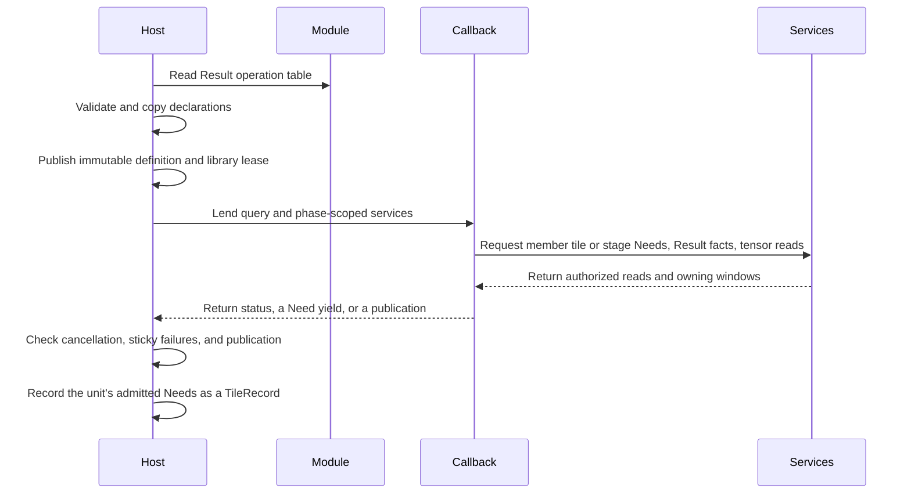

# 插件 ABI 与所有权

## 1. 核心摘要 (TL;DR)

Photospider 通过精确大小的版本化 C 表在宿主进程中加载受信任的 operation module，并在发布前复制声明；内置 operations 则通过 C++ `OperationRegistry` 注册。Structured Result C ABI 的每个 port 对应一个 Result object，每个 Result 都是由 1..16 个 typed Tensor 成员组成的静态目录，成员保存数值或图像 samples。Result 只存储结构与数据：callback 通过显式的成员 tile Need 请求输入，宿主在 Result 之外记录每个已完成计算单元的 Needs。Package 0.36.0 使用 Result operation C ABI 6 与 OperationTraits 28。ABI 6 提供成员局部的 tile 区间、静态 publication scope、Run 共享 stage、校验器与诊断注册、metadata resolution 期间的显式资源选择、授权的校验读取以及 `fail_domain`；Result 记录不携带 facet 或领域 metadata。

## 2. 架构心智模型 (Mental Model & Intuition)



Registry 拥有每个不可变 definition 及其动态库租约。Invocation snapshot 在 callback 运行期间保留该 definition。Result 协调器解析具名输出、输入投影、输入 tile Need、共享 stage 与后端服务，并把每个已完成计算单元的已准入 Need 记录在 `TileRecord` 中。Result 拥有 schema 与 tensor 存储；tensor 可以使用 tiled CPU 存储、affine CPU 存储，或由其物理布局描述的其他 backing。

## 3. 契约规约与接口 (Formal Contracts & APIs)

### 入口与核心模型

```c
#include "photospider/plugin/result_operation_plugin_api.h"

typedef struct ps_result_operation_plugin_api_v6 {
  uint32_t struct_size, abi_version;
  const ps_result_operation_v6* operations;
  uint32_t operation_count;
  void* context;
  void (*destroy)(void*);
  const ps_result_validation_definition_v6* validators;
  uint32_t validator_count;
  const ps_result_diagnostic_definition_v6* diagnostics;
  uint32_t diagnostic_count;
} ps_result_operation_plugin_api_v6;

const ps_result_operation_plugin_api_v6*
ps_result_operation_plugin_get_api_v6(void);
```

`result_operation_plugin_api.h` 是独立的 C11 operation-plugin 头文件。它拥有 Result element-type 与 parameter-type 枚举、参数 descriptor/value 记录，schema、tensor、tile-grid、tile-Need 与 shared-stage 记录，extension identity 与 resource identity/view 记录，校验器与诊断定义，以及能力标志。`PS_RESULT_EXPORT` 在此定义，并使用共享的 `PHOTOSPIDER_OPERATION_PLUGIN_BUILD` 生产方开关。Native GPU 声明来自独立的 `native_gpu_api.h`，使用各自的 ABI 版本。`result_tile_helpers.h` 中的 C tile 辅助函数依据借用的网格记录构造成员 Need。

```cpp
#include <utility>
#include "photospider/data/result.hpp"

ps::SchemaTemplate schema;
ps::ResultTensorSpec pixels;
pixels.key = "pixels";
pixels.batch_axes = {2, 3};
pixels.descriptor = {ps::ElementType::Float32, {4, 1080, 1920}};
pixels.layout.spatial = true;
pixels.layout.channel_axis = 0;
pixels.layout.height_axis = 1;
pixels.layout.width_axis = 2;
schema.tensors.push_back(std::move(pixels));
```

Result schema 声明 1..16 个 Tensor 成员 和可选的 publication scope。Tensor descriptor 描述 cell 轴与元素类型；`batch_axes` 作为前缀与这些轴组成完整样本形状，rank 至多为八。`ResultTensorLayout` 中的 spatial 轴索引相对于 cell。每个 batch 与 cell extent 必须为正，每个成员形状在执行前固定；schema 校验不要求稠密字节分配，也不要求所有 extent 的乘积可表示。

Result 对象身份、schema、捕获的 descriptor 事实与 tensor 成员属于拥有型 Result 引用。Operation 资源属于已准备的 operation 与 plan，不属于 Result。依赖事实属于执行的 `TileRecord` 表，记录每个计算单元实际的 Need。`ResultObjectInputs` 和 Need 授权 tensor capability 保留实际输入 Result；保留的读取窗口或已发布 view 直接持有所需来源 backing。Result 对象身份、依赖证明和物理 owner retention 是不同概念。

Result operation ABI 6 是独立的 C 表，module 导出 `ps_result_operation_plugin_get_api_v6`。调用它之前，loader 先查找旧 Result getter `ps_result_operation_plugin_get_api_v1` 至 `_v5` 以及 planar 图像 getter；导出其中任何一个的 module 返回 `TypeMismatch`，即使它同时导出 ABI 6 getter。

随后 loader 调用 ABI 6 getter，并在挂接表的 destroy hook 前检查表非 NULL、对齐、`struct_size` 精确相等且 `abi_version == 6`；任一检查失败返回 `InvalidArgument`。不存在兼容头文件或转发入口，旧记录布局也没有兼容前缀。

导入校验指针/计数对与对齐、记录大小（读取任何嵌套指针之前先检查外层记录大小）、operation 约束，以及有界的严格 UTF-8 operation 与参数名称。设置了 `repeated_maximum` 的重复输入，若 `repeated_match` 与 `resolve_metadata` 都缺失则被拒绝。

表中的校验器与诊断定义与 operations 一起注册。每个 port 的 `validators` 数组、每个共享 stage 的 `validators` 数组和每个 operation 的 `diagnostics` 数组都命名 extension identity（key、version、implementation），它们必须解析到同一次导入或 registry 中的定义；缺失的身份或 version/implementation 冲突会使导入被拒绝。

Loader 先把每条记录导入并校验到私有 registry 候选中，再把完整候选整体换入实时 registry。任何校验或重复 key 失败都不改变实时 registry。

成功导入的 definition 在其记录可能被使用期间保留插件表 owner；保留的生命周期结束时运行表的 destroy 回调。导入失败、重复 key 或 owner 分配失败时，先通过 destroy hook 释放已挂接的表，再关闭 native 库。C++ 与 C operation 接口都使用 Result port 与同一 tile Need 模型。

### 输出、共享 stage 与元数据

每个 `ps_result_output_v6` 声明其名称、Result port、输入投影、标志与 payload 上限。每个输出都按其编译期网格中每个成员 tile 一个计算单元执行；不存在执行粒度字段。C 导入仅当两个纯度标志都存在时才设置 `cacheable`。没有 side-effect-free 标志的 operation 必须声明至少一个 mandatory 共享 stage，此时它不可缓存。输入 port 约束 Result schema 或所选 tensor 成员谓词。

`ps_result_shared_stage_v6` 声明一个 Run 共享 stage：key、schema、有序输入投影、后端、`mandatory`，以及累计的 `state_bytes`、`workspace_bytes`、`maximum_work`、`maximum_output_payload_bytes`、`maximum_stages` 和校验器。Stage 没有公开的输出身份。Host 在注册与准备期间复制这些声明，并为每个 Run、node 与 stage 至多创建一个 producer。`start` 与 `poll` callback 通过 `ps_result_query_v6::shared_stage` 选择 stage；tile callback 在该字段看到 `UINT32_MAX`。Stage callback 忽略 `output_index`、`tensor_slot` 与 `tile_unit`。执行器的 stage 契约见 [Run 共享 stage](Global-Results.zh.md#run-共享-stage)。

可选的 `resolve_metadata` callback 接收借用的编译期输入元数据、参数与输出原型。它对每个输出索引调用同步 metadata sink 一次；sink 在返回前复制并校验嵌套 schema 记录。Resolver 可以细化 Result port/schema，但不能改变输出标志或 payload 上限。`set_shared_stages` 以拥有所有权的静态声明一次性替换全部 stage 原型。`set_resources` 列出 operation 需要的 `ps_result_resource_identity_v6` 条目（字节长度与 SHA-256）；编译器从调用方的 `ResourceSet` 中选择它们，随后 `start`、`poll` 与校验器 `prepare` 以借用的 `ps_result_resource_view_v6` 记录接收这些字节。不存在环境式资源查找。Sink 失败是 sticky 的，遗漏任一输出时准备失败。Operation key、输出名称与投影、Result schema 身份和声明的约束保持固定。

`PS_RESULT_OUTPUT_PAYLOAD_BOUND_V6` 是唯一的输出标志。它启用 `maximum_output_payload_bytes`；显式的零上限只允许借用存储。未知位被拒绝。标志清除时，字节字段必须为零。Host 在每个 Run 中对每个输出跨 tile actor 累计，并对每个唯一物理 owner 只计一次，排除输入与共享 stage 的 owner。Root 仍计费来源 backing、workspace、元数据与 operation 资源。检查发生在发布时，因此不能阻止 callback 更早的分配。

### Query 与 tile Need

`start` 或 `poll` callback 接收一个 `ps_result_query_v6`，其中包括解析后的 port、所选输出索引、后端、所选成员的 `tensor_slot`、`tile_unit` 与 `tile_extent`、共享 stage 选择器与声明、每个输入一个编译期网格组以及输出网格组、参数和所选资源 view。网格组按 schema 顺序为每个成员保存一个 `ps_result_tile_grid_v6`。网格记录给出成员的完整形状、batch rank 与 `batch_axis_mask`、height 与 width 轴（取值等于 rank 表示该切分轴不存在）、tile extent、tile 行数与列数，以及 tile 数。`read_tensor` 复制已授权样本。保留的 tensor 句柄在释放或 operation 状态销毁前保留其已认证的 tensor capability。

Callback 通过 `need_tiles` 请求输入，然后返回 `PS_RESULT_NEED_V6`：

```c
typedef struct ps_result_tile_interval_v6 {
  uint64_t begin, end;
} ps_result_tile_interval_v6;

typedef struct ps_result_tile_need_v6 {
  uint32_t struct_size, input, tensor_slot, descriptor_only;
  const ps_result_tile_interval_v6* intervals;
  uint64_t interval_count;
} ps_result_tile_need_v6;
```

| 形式 | 授权 |
| --- | --- |
| `descriptor_only = 0`，`interval_count > 0` | 经网格边界校验后，所列成员 tile 的样本（按 `atomic_trailing_axes` 闭合），以及该输入的 descriptor 事实。 |
| `descriptor_only = 0`，`interval_count = 0` | 不授予任何内容。Host 不创建依赖、不授予 descriptor，也不产生 producer 工作。 |
| `descriptor_only = 1` | 仅捕获的 descriptor 事实。`tensor_slot` 必须为零，且没有区间。 |

区间是 producer 成员编译期网格中的半开局部 tile 索引。一次调用至多接受 65,536 个区间。重叠与相邻区间会合并；反向或超出网格的区间失败。Host 在 Root work 与容量上限下复制并规范化区间，并在启动任何 producer 之前校验完整 envelope。失败的请求是 sticky 的。协调器本身不转换样本矩形：C module 依据借用的网格记录推导区间，C++ operation 可以使用 `photospider/plugin/tile_helpers.hpp`。单元完成时，host 把其已准入 Need 合并为一个 `TileRecord`，区间只在同一 producer 成员内合并。

`result_tile_helpers.h` 提供 `ps_result_need_descriptor_v6`、`ps_result_to_whole_v6`（以完整区间请求全部成员）和 `ps_result_need_regions_v6`（请求与一个成员的显式矩形相交的 tile）。`ps_result_need_regions_v6` 闭合 atomic 轴，把连续的行与 batch 转为区间，并在分配 scratch 之前至多准入 65,536 个区间。当提供的每个矩形都为空时，它提交一个零区间 Need，即不请求任何内容。`ps_result_output_region_v6` 解析所选输出成员的 tile。`ps_result_to_whole_v6` 只提交 Need：外层 poll 返回 Need，后续 poll 再获取已授权的拥有型窗口。C API 通过窗口的 acquire/retain/release 和 `publish_tensor_view` 提供等价的 tile 发布能力，没有名为 `ps_result_to_tile_v6` 的便捷函数。

### 共享 stage 服务

`need_shared_stage(stage)` 请求一个已准备 stage 的每个成员 tile。`need_shared_tiles(stage, slot, intervals, count)` 请求 stage 成员局部的 tile 区间；对不同成员重复调用。零区间的调用不授予样本，也不启动该 stage。一次 poll 中两种调用不能命名同一个 stage，重复或未知的序号失败。`acquire_shared_window(stage, slot, region, ...)` 从已提供的 stage Result 返回一个保留窗口。它不授予访问 stage 原始输入的权限，窗口遵循普通的 retain 与 release 生命周期。当当前 query 本身是共享 stage 时，host 依据该 stage 已准备的 `input_indices` 投影检查每个 C tile Need。

### ABI 6 显式零复制 view 服务

```c
// result_operation_plugin_api.h 中的记录摘录。
typedef struct ps_result_tensor_transform_v6 {
  uint32_t struct_size, reshape, source_rank;
  const ps_result_view_axis_v6* axes;
} ps_result_tensor_transform_v6;
typedef struct ps_result_tensor_view_piece_v6 {
  uint32_t struct_size;
  uint64_t window_handle;
  ps_result_region_v6 region;
  ps_result_tensor_transform_v6 transform;
} ps_result_tensor_view_piece_v6;
```

`ps_result_tensor_transform_v6` 包含精确的 `struct_size`、`reshape`、`source_rank` 与 `axes` 指针。每个 `ps_result_view_axis_v6` 提供 `output_axis`、`source_origin`、有符号 `step` 和 `output_origin`；仿射发布为包括 batch 轴的每个完整来源轴提供一条映射，使用[Result 视图](Global-Results.zh.md#显式-tensor-view-与发布所有权)所定义的绝对坐标锚点公式。

`publish_tensor_view` 即使执行恒等视图也要求非 NULL 的显式 transform。单源 reshape 形式 `reshape=1, source_rank=0, axes=NULL` 合法；实现检查逻辑样本数与物理仿射可表示性。逻辑合法但物理上不可表示的视图可返回 `PS_RESULT_VIEW_UNAVAILABLE_V6`，由调用方显式复制重试。

`ps_result_tensor_view_piece_v6` 包含精确的 `struct_size`、已获取的 `window_handle`、目标坐标 `region` 与显式 `ps_result_tensor_transform_v6`。C 服务 `publish_tensor_view_pieces` 接受 1..16 条记录，每条内部 transform 大小精确，且 `reshape=0`。各片组成互不重叠、恰好覆盖整个目标区域的分区。**Atomic closure 约束总目标区域和各片的并集，每片允许拆开 atomic tuple。** 例如 `[1,2]` 的目标张量最后一个通道轴为 atomic 时，可用 `[0,1)` 和 `[1,2)` 两片联合发布完整双通道 tuple。

桥接层在整个同步服务调用中保留窗口记录和借用的轴元数据。Builder 校验完整逻辑 envelope、映射物理 spans、检查全部来源 owner 之间的 cycle，再一次提交覆盖。C window handle 释放、callback 退出后，已发布 Result 仍保留来源 backing；存储继续计费于原 Root。

物理上不可表示的 view 可返回非 sticky 的 `PS_RESULT_VIEW_UNAVAILABLE_V6`，供调用方**显式**选择物化。缺失/过期窗口 handle、NULL transform、错误的记录大小、来源授权或分区非法、owner cycle、资源失败与取消均不能当作复制重试。失败事务不推进 coverage/revision，也不公开早期片；普通服务错误保持 sticky。

### 状态、fallback 与发布

普通 Result C callback 与服务返回 `ps_result_status_v6` 定义的 `int` 值：代码 0 到 6 依次表示成功、失败、取消、后端不可用、资源耗尽、类型不匹配与非法参数。Poll 让出代码（`PS_RESULT_NEED_V6`、`PS_RESULT_PUBLISH_V6`）与 `PS_RESULT_VIEW_UNAVAILABLE_V6` 遵循各自的服务契约。Native GPU 服务使用其独立的 GPU 结果码。Operation 能力标志为 `PS_RESULT_FLAG_DETERMINISTIC_V6`、`PS_RESULT_FLAG_SIDE_EFFECT_FREE_V6`、`PS_RESULT_FLAG_CPU_V6`、`PS_RESULT_FLAG_GPU_V6`、`PS_RESULT_FLAG_CPU_FALLBACK_V6` 与 `PS_RESULT_FLAG_SHARE_BLOCKS_ACROSS_OUTPUTS_V6`。Fallback 标志要求同时具备 CPU 与 GPU 能力标志。

Result C 表的两个 callback `start` 与 `poll` 都在结构化执行器的 poll 阶段 fallback 闸门内执行。重试要求显式的 CPU fallback 选项、确定且无副作用的 trait，以及一次可安全重试的尝试：没有已发布输出、checkpoint、block 或 discovery callback、native dispatch、不可重试的 sticky operation/服务失败、取消或过期状态失败。其他错误保持终止。重试丢弃该尝试的 continuation、输入 capability、已记录 Need 与输入事实，然后在 CPU 上重新启动同一计算单元；已完成的 producer 单元、已消耗的 Root work 与 stage 计费保持不变。重试的单元带 fallback 污染，不进入 checkpoint、block 状态或 completed-result 缓存。进入 factory 之后，stage 计算从不重试。独立的 C++ `OperationRegistry::start_result` 入口在创建 continuation 之前校验 operation 声明的后端支持；它不判断执行上下文是否有可用的 GPU lane 或设备。结构化执行期间，协调器在进入面向 GPU 的 start factory 之前检查 GPU lane 与设备可用性，然后按普通 fallback 规则处理 `BackendUnavailable`。成功发布 tensor、view 或 Result 之后，callback 返回的 `BackendUnavailable` 被转换为 `OperationFailed`；仅调用 `begin_result` 不算发布。`publish_result` 只接受 `complete` 取值 0 或 1，每次 poll 允许一次成功发布；共享 stage continuation 可以在后续 poll 发布另一个前缀。普通 tile 发布必须完整且恰好覆盖其所选成员 tile，其他成员为空。同一 poll 中合法的重复发布锁存 `OperationFailed`。若 callback 之后尝试合法发布或报告成功，更早的非法服务失败仍保持 sticky。实际的 host 取消可以在执行边界取代合法的重复发布失败；callback 返回的 `Cancelled` 不能。

### Callback 生命周期、资源与执行

Query 与服务表在一次 `start` 或 `poll` callback 中借用。保存的 phase 上下文在该 callback 返回时失效；C 服务只能在该 callback 期间调用。Poll 租约在 callback 返回时使其转换后的服务句柄失效，并保留墓碑直到 continuation 销毁，从而在不复用其地址的前提下拒绝过期句柄。Operation 状态由 continuation 拥有，并在保留的 operation definition 释放其 DSO 租约之前销毁。保留的 tensor 窗口保持各自显式的释放与销毁生命周期。入口线程服务在 callback 入口线程上运行。CPU range 与 tile worker 可以调用 `cancelled` 并写入已准入的 scratch；拥有型窗口的 `row` 与 `rectangle` 访问也可以在 CPU worker 上并发运行，而不重入执行服务。窗口数据指针在最后一个对应句柄释放前保持有效；释放发生在 worker 完成之后。Metadata sink 只在 resolver 入口期间借用。即使 callback 之后报告成功，host 也保持服务失败为 sticky。

C++ Result operation factory 与标量 poll callback 在其 registry 与 continuation 边界处有异常栅栏。`std::bad_alloc` 变为 `ResourceExhausted`；标准异常变为带 `HostException` 及其 `what()` 文本的 `OperationFailed`，`what()` 为 null 时消息为空。非标准异常变为带固定 `HostException` 诊断的 `OperationFailed`。Phase 服务已记录的失败具有优先权；host 失败观察者抛出的异常不会替换已选定的失败。若直接共享 stage continuation 的校验器拒绝后续 tile，host 以最终受保护 poll 的失败使其投影 producer 退役；已逃逸的较早前缀通过 `production_status()` 报告该失败，并仍可读取其已认证 tile。

`ResultProgramPhase::acquire_native_tensor` 与 C 服务 `acquire_native_tensor_window` 把当前 GPU callback 已授权的 tensor Need 暴露为由 native 访问支持的拥有型窗口。GPU callback 随后把其 row 或 rectangle 绑定到 native dispatch；该 API 不会代替调用方 dispatch。没有 GPU lane 时获取返回 `BackendUnavailable`。缺失的 slot、未覆盖的区域与 descriptor-only 授权作为 sticky `InvalidArgument` 协议错误失败。CPU 或不兼容设备上的 backing 按需打包，并在 Root 计费下上传。兼容的同设备 affine backing 可以不经上传而复用。碎片化 backing 可能同时需要物化与上传，两者分别计数。窗口让来源 Result owner、schema、descriptor、取消状态与 native 存储在 callback 阶段之间和外部 owner 释放后保持存活。C 调用方通过普通窗口释放服务释放返回的句柄。Native 上传复用与缓存见 [Native GPU 输入访问](Global-Results.zh.md#native-gpu-输入访问)。

普通 CPU poll callback 可以使用 CPU range 服务 `ps_cpu_parallel_service_v2`。CPU 分阶段的协调器通过 `ps_cpu_tiles_service_v2` 提交 tile 计算；CPU tile callback 作为不可分割的 tile 任务运行。CPU tile worker 和 GPU callback 不获得 range 服务。并行工作在服务调用返回之前完成，禁止嵌套提交并行工作。内核 callback 继承其 worker 的浮点环境，并在返回时恢复；数值 operation 在执行它们的 worker 内部建立自己的环境。当 native GPU lane 可用时，callback 依据 operation 能力接收其 native 服务。GPU 调用在活动 callback 线程上运行，dispatch 在完成前保留引用的 owner。C++ `ResultProgramPhase::gpu_status` 读取活动 invocation 的 host 状态，并随 phase 失效。

执行 Root 计费已准入的 work、stage、元数据、payload 容量与保留的 owner。超出上限的 callback 收到资源或 stage 失败；已发出的 work 不退还。Result 发布在暴露不可变结果之前校验 schema、样本坐标、取消与资源所有权。

拥有型 tensor 窗口的读取也从捕获的执行 Root 扣费。C row 与 rectangle 服务在读取前扣除由 `ResultWindowAccess::read_work` 计算的上界；row 的系数为 1，rectangle 为 2。这是 Root 生命周期内的 work，因为保留的窗口比借用的 poll phase 存活更久。它独立于为一次执行配置的每 Run 依赖/程序 work 上限。

### C 校验器、诊断与领域失败

`ps_result_validation_definition_v6` 提供一个 extension identity、`scratch_bytes`、`requires_complete` 和三个 callback。`prepare` 接收 `ps_result_validation_preparation_v6`（输出标志、port、共享 stage 序号、schema、参数、所选资源 view），并返回拥有所有权的状态指针；`destroy_prepared` 释放它（包括 `prepare` 失败后），并总在 module owner 退役前运行。`validate` 接收 `ps_result_validation_context_v6`，其服务只在入口线程上存在到调用返回为止：`tensor_regions` 描述某成员新授权的覆盖，`read_tensor` 每次按逻辑顺序至多复制 65,536 字节，`consume_work`/`cancelled` 连接到 host 预算。`complete` 报告已校验覆盖是否完整，定义见[端口校验器](Global-Results.zh.md#端口校验器与诊断报告)。授权覆盖之外的读取失败，即使 callback 忽略返回码也保持 sticky。C 桥接让第一个服务或 `fail_domain` 失败优先于之后的 callback 状态或异常。

`ps_result_diagnostic_definition_v6` 声明一条定长 `payload_bytes` 记录及 `validate` 与 `merge` callback；`merge` 写入完整的目标且不得修改其输入。Operation 在 `ps_result_operation_v6::diagnostics` 中列出它可能发出的诊断身份，并通过其 run 服务上的 `report_diagnostic(type_index, bytes, size)` 报告。

Run 服务与校验 context 上的 `fail_domain(status_code, domain_code)` 记录第一个领域失败，其状态码非零，并带一个不透明的 64 位领域代码。Host 把该代码复制到 `FailureDetail::domain_code` 中而不解释。

### SDK targets

共享的 `Photospider::operation_sdk` target 提供 C++ Result 辅助函数，包括 `ps::plugin::element_type_value`、`tile_helpers.hpp`、`tensor_helpers.hpp`（`sdk::to_whole`、`sdk::to_tile`、`sdk::collect`、`sdk::publish_dense_tensor`）以及 `whole_stage.hpp`（`sdk::with_whole_stage`、`sdk::shared_result_tile`）。这些辅助函数见 [SDK 获取辅助函数](Global-Results.zh.md#sdk-获取辅助函数)。Result operation 表仍是独立的 C11 接口，其 DSO callback 不需要 C++。Native GPU 服务在 `native_gpu_api.h` 中以 ABI 1 单独声明，CPU parallel 与 CPU tiles 服务为 ABI 2。Callback 结果码不携带 C 提供的错误字符串；host 状态、计时与计数诊断与通过 `report_diagnostic` 提供的有界报告相互独立。

`Photospider::ops_sdk` 是算子领域 SDK。它只链接 `Photospider::kernel`，并在 `include/photospider/ops/` 下安装公开头文件（导出宏 `PHOTOSPIDER_OPS_SDK_API`）：颜色描述与 ICC/OCIO 资源、显式 `TensorColorGroup` 配置、transfer/RGB/white 编解码、精确领域算术、描述编辑、`ops.scalar-range` 校验器、3D LUT bake 契约与质量报告、数值诊断以及 Layer 复合类型。CMake 选项 `PHOTOSPIDER_BUILD_OPS_SDK` 默认取 `PHOTOSPIDER_BUILD_OPS` 的值；内置 operations 需要它。`PHOTOSPIDER_BUILD_OPS` 默认为 `OFF`，因此默认的仅内核配置二者都不构建。内核本身不含任何这些领域类型。

## 4. 负面清单与边界 (Non-Goals & Explicit Boundaries)

- Operation module 是受信任的进程内代码。ABI 校验不对其做沙箱隔离或认证。
- C++ consumer 针对已安装的 package 0.36.0 头文件构建。资源设施在 `photospider/core/` 中声明：`core/cancellation.hpp`、`core/resources.hpp` 与 `core/resource_allocator.hpp`。WorkflowDocument schema 7 与 OperationTraits 28 定义当前编译器契约。Result operation C 表为 ABI 6。C 导入边界拒绝无效的外部记录，内部执行状态只在校验之后表示。
- 内置 operations 通过已安装头文件中未冻结的 C++ `OperationDefinition` 注册路径注册，C importer 只接受精确的 ABI 6 结构大小。C operation 没有由算子持有的持久准备状态。其 metadata resolver 可以通过 `set_shared_stages` 替换静态共享 stage 声明，包括输入投影和 workspace 上限。C 校验器保留各自的准备状态。[ADR 0022](../../adr/zh/0022-freeze-operation-c-abi-v3.zh.md)（Proposed）记录目标：内置与外部 module 共用一个按前缀协商的 C ABI、单独版本化的服务表，以及 module 侧的 header-only C++ SDK。
- ABI 不携带 semantic kind、facet 或附着描述。领域解释是 operation 参数或算子领域配置，领域合法性由绑定的校验器检查。
- ABI 没有整体 Result 执行模式、运行期成员计数或动态 tile End。需要完整输入的算法请求每个成员 tile 或使用共享 stage。
- 生产级图像 operation 的可用性遵循 [Image operations](Image-Operations.zh.md) 中的源码与 registry 分类。
- GPU 执行需要 native 后端构建和可用设备。仅凭表或能力声明不能证明硬件执行。
- Result C 表只暴露 Result port 与 tensor 成员。IPC 插件加载与 daemon 协议不属于该 ABI。

## 5. 后果与代价 (Consequences)

格式错误或不兼容的表在 registry 发布之前失败。针对旧 Result ABI（例如 ABI 5）构建的 module 被拒绝，必须针对 ABI 6 头文件重建。在 native 加载之后被拒绝的 module 释放其库 owner。已发布的 definition 让库保持加载，直到其最后一次 invocation 或状态 owner 退役。服务、资源与取消失败保持终止。后端失败同样保持终止，上文所述显式选择启用且可安全重试的 GPU `BackendUnavailable` 情形除外。

同步 native dispatch 在设备完成前保留输入 owner，因此取消可能需要等待进行中的调用。长时间运行的 CPU callback 必须通过服务观察取消。Native module 以宿主进程权限运行，因此只应加载受信任的代码。
